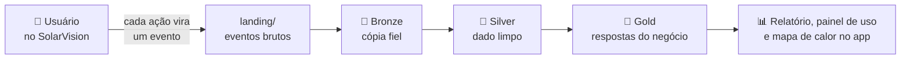

# Datalake de uso do SolarVision

Cada ação de um usuário no SolarVision (abrir uma tela, cadastrar uma placa, importar leituras, imprimir o relatório) vira um **evento de uso**: um pequeno registro em JSON que diz o que aconteceu, quando e em que tela. Este diretório constrói o **datalake em arquitetura medalhão** que transforma esses eventos em business intelligence do produto: funil de ativação, engajamento, aquisição e retenção, previsão de ativação e mapa de calor das telas. Um segundo workflow usa as mesmas ferramentas para outra coisa: **prever a energia que cada placa vai gerar nos próximos 7 dias**, corrigindo a estimativa física do app com a geração real ([docs/PREVISAO_ENERGIA.md](docs/PREVISAO_ENERGIA.md)).

> **Base:** projeto-modelo de engenharia de dados do professor (datalake de tracking da DadosPro). Infraestrutura (Docker, floci, PySpark), `pipeline/comum.py`, `pipeline/bronze.py`, o `explorador/` e a base do `gerador/` vieram de lá; o catálogo de eventos, as jornadas simuladas, as regras da Silver, as Golds e a integração com o app são do SolarVision.

## O que há aqui

| Pasta | O que é |
| --- | --- |
| [`docs/`](docs/ENUNCIADO.md) | o [enunciado](docs/ENUNCIADO.md) adaptado, o [contrato do evento](docs/CONTRATO_EVENTO.md) e a [previsão de energia](docs/PREVISAO_ENERGIA.md) |
| [`gerador/`](gerador/README.md) | simula semanas de uso do SolarVision (com defeitos) e importa o JSONL exportado pelo app |
| `coletor/` | leva os eventos reais da tabela `eventos_coletados` do Supabase para a landing (e apaga de lá o que levou), e as placas, o clima e as leituras para a landing de energia |
| [`pipeline/`](pipeline/README.md) | os jobs PySpark: Bronze, Silver, as Golds, as exportações para o app e o script de sequência |
| [`workflows/`](workflows/README.md) | as etapas numeradas do medalhão (`01_bronze_eventos` … `10_exportar_mapa_calor`) e o workflow `medalhao.json` |
| [`explorador/`](explorador/README.md) | console de estudo (S3, Glue, Athena) em http://localhost:8501: ver o bucket, rodar jobs e fazer consultas SQL sobre a Gold |
| [`RELATORIO.md`](RELATORIO.md) | as respostas às quatro perguntas e a qualidade do dado |

## Entrega ao professor

A entrega do projeto final da disciplina (as evidências por job no formato do projeto-modelo, com a assinatura Pro hipotética que o enunciado de receita pedia) está na branch [`feat/datalake-entrega-final`](https://github.com/danieltanjos/SolarVision/tree/feat/datalake-entrega-final). Esta versão fica só com o que serve ao produto: o uso real da plataforma, o mapa de calor e as decisões de UI/UX.

## Começar

1. Prepare o ambiente: [SETUP.md](SETUP.md) (só o Docker é necessário).
2. Popule a landing: `docker compose run --rm app python gerador/gerar_eventos.py`.
3. Rode o datalake inteiro: `docker compose run --rm app python pipeline/rodar_tudo.py`.
4. Abra o console: `docker compose up -d explorador` e http://localhost:8501.
5. No app (`frontend`, `npm run dev`), entre como ADMIN e abra **Uso da plataforma** e o botão **Mapa de calor**.
