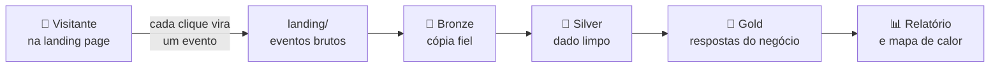
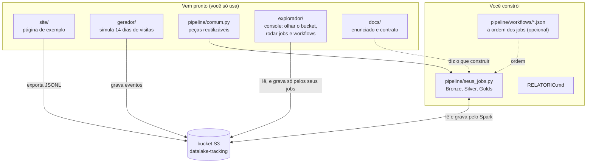

# DadosPro — projeto final de engenharia de dados

Uma empresa vende um curso online por uma landing page de conversão. Uma **landing page** é uma página única, feita para convencer o visitante a fazer uma ação: aqui, comprar o curso DadosPro ou baixar um e-book.

Cada interação do visitante (abrir a página, rolar, dar play no vídeo, comprar) vira um **evento de tracking**: um pequeno registro em JSON que diz o que aconteceu, quando e com quem. Esses eventos são gravados num **bucket S3**, que é uma "pasta na nuvem" para guardar arquivos.

O projeto é construir o **datalake em arquitetura medalhão** que transforma esses eventos em respostas de negócio: funil de compra, engajamento, receita líquida e previsão de compra.

- **Datalake** é um lugar central onde os dados ficam guardados como arquivos, prontos para análise.
- **Arquitetura medalhão** organiza esse datalake em camadas, do dado mais cru ao mais refinado: Bronze (cópia fiel do que chegou), Silver (dado limpo e organizado) e Gold (tabelas que respondem perguntas do negócio).

> **Pense assim:** o projeto é uma **fábrica de dados**. Os eventos são a matéria-prima que chega pelo portão (a landing). Cada camada é uma linha de produção que entrega algo mais acabado para a seguinte, até o produto final (as tabelas Gold), que é o que o gerente da empresa consegue usar para decidir.

O desenho mostra o caminho de um evento: nasce no clique do visitante, entra pela landing e é refinado camada a camada até virar resposta.

Os termos novos estão explicados no [glossário do enunciado](docs/ENUNCIADO.md#glossário).

## O que há aqui

A tabela abaixo mostra as pastas principais do repositório.

| Pasta | O que é |
| --- | --- |
| [`site/`](site/index.html) | a landing page de exemplo. Abra no navegador, navegue e veja cada evento nascer no painel lateral. O botão **Mapa de calor** do painel mostra, por cima da página, a sua Gold de cliques e de rolagem (requisito R11) |
| [`gerador/`](gerador/README.md) | o coletor simulado: popula o bucket com 14 dias de eventos, inclusive com defeitos |
| [`pipeline/`](pipeline/README.md) | onde o datalake é construído |
| [`explorador/`](explorador/README.md) | um console de estudo no estilo do S3, do Glue e do Athena (http://localhost:8501): ver os arquivos de todos os buckets, o catálogo de tabelas, rodar os seus jobs, juntá-los em **workflows** e fazer consultas SQL. Tem tutorial em cada tela e opções de acessibilidade |
| `docs/` | [enunciado](docs/ENUNCIADO.md) e [contrato do evento](docs/CONTRATO_EVENTO.md) |

Em outras palavras: `site/` e `gerador/` produzem os dados; você escreve o código em `pipeline/`; `docs/` diz o que construir.

O diagrama separa o que já existe do que é seu: as setas mostram quem grava e quem lê o bucket.

## Começar

1. Prepare o ambiente: [SETUP.md](SETUP.md). Ele explica o Docker passo a passo, mesmo que você nunca tenha usado.
2. Popule a landing: `docker compose run --rm app python gerador/gerar_eventos.py`. Esse comando cria os eventos simulados e grava no S3 local.
3. Leia o [enunciado](docs/ENUNCIADO.md) e construa o pipeline em `pipeline/` (veja [pipeline/README.md](pipeline/README.md)). O enunciado tem uma seção "Por onde começar" com a ordem sugerida de trabalho.
