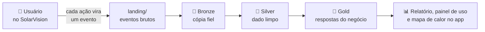

# Datalake de uso do SolarVision

Cada ação de um usuário no SolarVision (abrir uma tela, cadastrar uma placa, importar leituras, imprimir o relatório) vira um **evento de uso**: um pequeno registro em JSON que diz o que aconteceu, quando e em que tela. Este diretório constrói o **datalake em arquitetura medalhão** que transforma esses eventos em business intelligence do produto: funil de ativação, engajamento, aquisição e retenção, receita da assinatura Pro, previsão de ativação e mapa de calor das telas.

> **Base:** projeto-modelo de engenharia de dados do professor (datalake de tracking da DadosPro). Infraestrutura (Docker, floci, PySpark), `pipeline/comum.py`, `pipeline/bronze.py`, o `explorador/` e a base do `gerador/` vieram de lá; o catálogo de eventos, as jornadas simuladas, as regras da Silver, as Golds e a integração com o app são do SolarVision.

## O que há aqui

| Pasta | O que é |
| --- | --- |
| [`docs/`](docs/ENUNCIADO.md) | o [enunciado](docs/ENUNCIADO.md) adaptado e o [contrato do evento](docs/CONTRATO_EVENTO.md) |
| [`gerador/`](gerador/README.md) | simula semanas de uso do SolarVision (com defeitos) e importa o JSONL exportado pelo app |
| `coletor/` | leva os eventos reais da tabela `eventos_coletados` do Supabase para a landing |
| [`pipeline/`](pipeline/README.md) | os jobs PySpark: Bronze, Silver, as Golds (com a receita), exportação para o app e o script de sequência |
| [`workflows/`](workflows/README.md) | as etapas numeradas do medalhão (`01_bronze_eventos` … `10_exportar_mapa_calor`) e os workflows `medalhao.json` e `receita_aquisicao.json` |
| [`explorador/`](explorador/README.md) | console de estudo (S3, Glue, Athena) em http://localhost:8501: ver o bucket, rodar jobs e fazer consultas SQL sobre a Gold |
| [`RELATORIO.md`](RELATORIO.md) | as respostas às cinco perguntas e a qualidade do dado |
| [`evidencias/`](evidencias/README.md) | a entrega final: um `<job>_evidencias.pdf` e os CSVs de cada job, no formato do professor |

## Entrega final (trabalho individual: Luiz Gustavo)

O que o enunciado pede, onde está e como foi conferido:

| Pedido | Onde | Evidência |
| --- | --- | --- |
| `pipeline/`: PySpark que atende R1 a R11, e o `pipeline/README.md` dizendo como rodar | [`pipeline/`](pipeline/README.md), com a ordem em [`workflows/`](workflows/README.md) | um PDF por job em [`evidencias/`](evidencias/README.md), do Bronze à exportação |
| `RELATORIO.md`: as perguntas com a tabela Gold, os números e a recomendação | [`RELATORIO.md`](RELATORIO.md) (as quatro do enunciado e a da receita) | os CSVs das consultas, na mesma pasta |
| Seção "Qualidade do dado": duplicatas, rejeitados por motivo, dado legítimo rejeitado e armadilhas | [`RELATORIO.md`](RELATORIO.md#qualidade-do-dado) | `silver_evidencias.pdf` e `qualidade_evidencias.pdf` |
| Mapa de calor no "site" (R11) | `pipeline/gold_mapa_calor.py`, `pipeline/exportar_mapa_calor.py` e o overlay do app (`frontend/src/components/MapaCalor.jsx`) | `gold_mapa_calor_evidencias.pdf` e `exportar_mapa_calor_evidencias.pdf` |

**As ferramentas do professor, usadas sem mudança:** o `docker-compose.yml` com `floci`, `app` e `explorador`; o `pipeline/comum.py` (sessão Spark para o floci, `exigir_camada`, leitura e gravação das partições `event_name=…`); o `infra/verificar_ambiente.py`; o console `explorador/`, em que todos os jobs foram sincronizados para o `s3://glue-assets/`, rodados pelo workflow e conferidos no Data Catalog e no Athena; a base do `gerador/` (lotes, destinos, `importar_site.py`); e os testes no mesmo molde, inclusive o equivalente ao `tests/site` dele, que confere os `data-heat` do app contra o contrato.

**O que vai além do projeto-modelo, mantido na entrega:**
- **Silver:** regras próprias do SolarVision (ação sem id, exclusão órfã, reembolso órfão) e o portão de qualidade entre a Silver e as Golds, que para o workflow se o dado vier ruim.
- **Gold:** funil na ordem com o maior vazamento, adoção dos recursos e DAU/WAU/MAU, retenção e abandono, a receita da assinatura Pro e o ML com divisão por pessoa.
- **Mapa de calor:** no projeto-modelo é só a landing (`pagina = "/"`). Aqui ele cobre todas as telas do app, com a rolagem de cada uma. No app ele é desenhado como no site do professor: canvas com manchas difusas, a etiqueta da taxa de clique e a faixa de rolagem.
- **Ordem do pipeline:** fica em `workflows/`, com etapas numeradas e o `pipeline/rodar_tudo.py` guiado pelo mesmo grafo.

## Começar

1. Prepare o ambiente: [SETUP.md](SETUP.md) (só o Docker é necessário).
2. Popule a landing: `docker compose run --rm app python gerador/gerar_eventos.py`.
3. Rode o datalake inteiro: `docker compose run --rm app python pipeline/rodar_tudo.py`.
4. Abra o console: `docker compose up -d explorador` e http://localhost:8501.
5. No app (`frontend`, `npm run dev`), entre como ADMIN e abra **Uso da plataforma** e o botão **Mapa de calor**.
