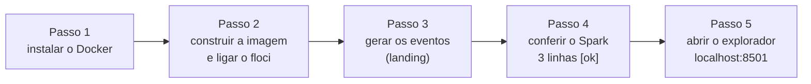
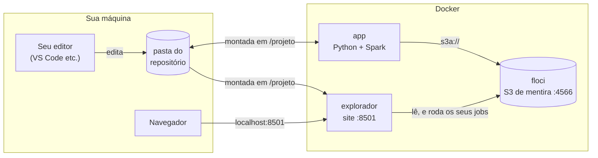

# Setup — o que instalar e configurar

Só é preciso o **Docker**. Python, Java, PySpark e o conector do Spark para S3 vêm dentro da imagem do projeto, e o S3 é emulado pelo floci. Nenhuma conta de nuvem é necessária.

Tempo total: **cerca de 20 minutos** na primeira vez, a maior parte baixando o que vai dentro da imagem (Spark, Java e o conector para o S3). Reserve uns **5 GB livres** no disco: a imagem do projeto tem perto de 3,5 GB.



Os cinco passos abaixo seguem esta ordem. Só avance quando o passo atual mostrar o resultado esperado.

## Antes de tudo: o que é o Docker

Se você nunca usou Docker, leia esta seção. Ela explica as quatro palavras que aparecem no resto do guia.

- **Docker** é um programa que roda outros programas dentro de "caixas" isoladas. Assim, todo mundo da turma usa exatamente as mesmas versões de Python, Java e Spark, sem instalar nada disso na própria máquina.
- **Imagem** é o "molde" de uma caixa: um pacote pronto com sistema, programas e bibliotecas. A imagem do projeto é descrita no arquivo `Dockerfile`.
- **Contêiner** é uma caixa em funcionamento, criada a partir de uma imagem. Você pode criar, parar e apagar contêineres sem afetar a sua máquina.
- **Docker Compose** é a ferramenta que liga vários contêineres de uma vez. O arquivo `docker-compose.yml` diz quais contêineres o projeto usa e como eles conversam. Todo comando `docker compose ...` lê esse arquivo, por isso você precisa estar na **raiz do repositório** (a pasta onde está o `docker-compose.yml`) ao digitá-lo.

> **Pense assim:** a **imagem** é a receita de uma marmita, com todos os ingredientes já na medida certa. O **contêiner** é a marmita pronta, aquecida e sendo comida. Você pode esquentar quantas marmitas quiser a partir da mesma receita, e jogar uma fora não estraga a receita nem a sua cozinha (a sua máquina). O **Docker Compose** é o cardápio do dia: diz quais marmitas servir juntas.

E mais dois termos do projeto:

- **S3** é o serviço de armazenamento de arquivos da AWS. Os arquivos ficam dentro de um **bucket** (um "disco" com nome). Aqui o bucket se chama `datalake-tracking`.
- **floci** é um programa que imita o S3 na sua máquina. Para o Spark, ele parece um S3 de verdade, mas tudo fica local e é gratuito.

> **Pense assim:** o floci é um **simulador de voo** do S3. O piloto (o seu código) usa os mesmos comandos de um avião de verdade, mas ninguém sai do chão e nada custa dinheiro. Como num simulador, ao desligar tudo volta ao começo: o floci guarda os arquivos **na memória**, então, se o Docker reiniciar, o bucket fica vazio e é preciso rodar o gerador (Passo 3) de novo.

## O que roda em cada contêiner

O projeto usa três contêineres, chamados de **serviços** no `docker-compose.yml`:

| Serviço | Imagem | O que tem |
| --- | --- | --- |
| `floci` | `floci/floci:latest` | S3 emulado em `http://floci:4566` (e `localhost:4566` na sua máquina) |
| `app` | construída pelo `Dockerfile` | Python 3.11, Java 17, PySpark 4.2.0 (com o Hadoop 3.5.0), conector `s3a` (`hadoop-aws` 3.5.0 e o AWS SDK v2), `boto3`, `pytest` |
| `explorador` | a mesma imagem do `app` | console Streamlit em `http://localhost:8501`: olhar os buckets, ver o catálogo, rodar os seus jobs e workflows e fazer consultas SQL |

Em outras palavras: o `floci` guarda os arquivos e o `app` roda o seu código. O `explorador` é um site para olhar os buckets e rodar os seus jobs sem digitar comandos (Passo 5). O conector `s3a` é a peça que permite ao Spark ler e gravar no S3 com caminhos que começam com `s3a://`.



O desenho mostra quem fala com quem: você edita os arquivos na sua máquina, o `app` enxerga a mesma pasta e conversa com o floci, e o navegador abre o explorador.

O repositório é montado em `/projeto` dentro do `app`: o que você edita na sua máquina vale na hora, sem reconstruir a imagem. Ou seja, você edita os arquivos no seu editor de sempre, e o contêiner enxerga a mesma pasta.

## Passo 1 — Docker

Instale o Docker Desktop (Windows ou macOS) ou o Docker Engine com o plugin Compose (Linux) e confira:

```bash
docker compose version
```

**O que faz:** pergunta ao Docker qual versão do Compose está instalada.

**O que você deve ver:** uma linha com `Docker Compose version` seguida de um número de versão (por exemplo, `v2.29.1` ou mais nova). Se aparecer "comando não encontrado", o Docker não está instalado ou não está no PATH (a lista de pastas onde o terminal procura os programas). No Windows e no macOS, deixe o Docker Desktop **aberto** enquanto trabalha: é ele que mantém o Docker funcionando.

## Passo 2 — Construir a imagem e subir o S3

Abra um terminal na raiz do repositório e rode:

```bash
docker compose build app
docker compose up -d floci
```

**O que faz cada comando:**

- `docker compose build app` monta a imagem do serviço `app` seguindo o `Dockerfile`. Na primeira vez ele baixa Python, Java e Spark, por isso demora alguns minutos. Nas próximas vezes é rápido, porque o Docker reaproveita o que já baixou.
- `docker compose up -d floci` liga o contêiner do S3 emulado. O `-d` significa "em segundo plano": o terminal fica livre e o floci continua rodando sozinho, até você pará-lo ou fechar o Docker.

**O que você deve ver:** o `build` imprime muitas linhas de progresso e termina sem mensagem de erro. O `up -d floci` mostra o contêiner `floci-datalake-tracking` como iniciado (`Started` ou `Running`).

O floci leva uns 20 segundos para ficar pronto. Antes do Passo 3, confira com `docker compose ps`: a coluna de status do `floci-datalake-tracking` precisa mostrar `(healthy)`. Enquanto aparecer `(health: starting)`, espere e rode de novo. Se o gerador rodar antes disso, ele falha.

## Passo 3 — Popular a landing do datalake

"Popular a landing" significa colocar os eventos brutos no prefixo `landing/` do bucket, que é a porta de entrada do datalake.

```bash
docker compose run --rm app python gerador/gerar_eventos.py
```

**O que faz:** `docker compose run app` cria um contêiner `app` só para rodar um comando, aqui `python gerador/gerar_eventos.py`. O `--rm` apaga esse contêiner quando o comando termina, para não acumular lixo. Você vai usar essa mesma forma para rodar todos os scripts do projeto.

**O que você deve ver:** o resumo impresso diz quantos eventos e defeitos foram gerados. Detalhes em [gerador/README.md](gerador/README.md).

## Passo 4 — Conferir o Spark falando com o S3

```bash
docker compose run --rm app python infra/verificar_ambiente.py
```

**O que faz:** abre uma sessão do Spark dentro do `app`, lê os eventos da landing, grava um arquivo de teste no bucket, lê esse arquivo de volta e apaga o teste.

**O que você deve ver:** precisa terminar com três linhas `[ok]`. No meio delas aparece uma tabela com a contagem de eventos por nome. A configuração `s3a` usada pelo Spark está em `pipeline/comum.py`, a mesma que os seus jobs vão usar. Se aparecer `[erro]`, veja a tabela de problemas comuns abaixo.

## Passo 5 — Explore o bucket

Este passo liga um site que mostra o que está dentro dos buckets, sem você escrever código: os arquivos, as partições (por nome do evento e por dia), o catálogo de tabelas e consultas SQL. Ele também roda os seus jobs, um de cada vez ou juntos num workflow.

```bash
docker compose up -d explorador
```

**O que faz:** liga o contêiner `explorador` em segundo plano. Ele é um site feito com Streamlit, que lê os buckets do floci e roda os seus jobs com o mesmo Spark do `app`.

**O que você deve ver:** abra **http://localhost:8501** no navegador. Deve aparecer a barra escura "Console do datalake" e, no menu lateral **Serviços**, as telas **S3 · Buckets** (arquivos e partições de todos os buckets do floci), **Glue · Data Catalog** (bancos e tabelas), **Glue · Jobs ETL** (rodar os seus jobs: o botão **⟳ Sincronizar** envia os scripts de `pipeline/` para o bucket `glue-assets` do floci, como no Glue, e eles rodam de lá), **Glue · Workflows** (juntar vários jobs num grafo com dependências e rodar tudo de uma vez) e **Athena · Editor de consultas** (SQL). Na primeira visita a cada tela, um tour em modal destaca as partes da tela e explica para que servem. No canto inferior direito ficam três botões redondos: **⬆** volta ao topo, **🎓** revê o tutorial e **♿** abre o menu com a chave **Mostrar tutorial** e as opções de acessibilidade (tamanho do texto, alto contraste, links sublinhados, espaçamento e menos movimento). O console também funciona só com o teclado e com leitores de tela. Para saber o que cada tela faz, leia [explorador/README.md](explorador/README.md).

## Como rodar qualquer coisa

Todo comando Python do projeto roda dentro do contêiner `app`, nesta forma:

```bash
docker compose run --rm app python <script.py>
docker compose run --rm app python -m pytest
```

A primeira linha roda um script (troque `<script.py>` pelo caminho dele, por exemplo `pipeline/bronze.py`). A segunda roda os testes automáticos com o `pytest`.

Para rodar vários jobs na ordem certa, monte um workflow na tela **Glue · Workflows** do explorador (ele fica salvo em `pipeline/workflows/<nome>.json`) e rode pelo console ou pelo terminal:

```bash
docker compose run --rm app python -m explorador.workflows pipeline/workflows/<nome>.json
```

## Problemas comuns

Se algo der errado, procure a mensagem na primeira coluna.

| O que você vê | Causa | Solução |
| --- | --- | --- |
| `Cannot connect to the Docker daemon` | Docker parado | abra o Docker Desktop |
| `Não consegui falar com o S3 em http://floci:4566` | floci parado | `docker compose up -d floci` |
| porta `4566` já em uso | outro emulador rodando | pare o outro contêiner |
| a página `localhost:8501` não abre | o serviço não está rodando ou a porta 8501 está ocupada | `docker compose up -d explorador`; veja `docker compose logs explorador` |
| `ClassNotFoundException: org.apache.hadoop.fs.s3a.S3AFileSystem` | imagem antiga, sem os jars | `docker compose build --no-cache app` |
| `ModuleNotFoundError: No module named 'streamlit'` (ou `'duckdb'`) | imagem antiga, de antes do explorador | `docker compose build app` |
| `[erro]` no `verificar_ambiente.py` lendo a landing | o gerador ainda não rodou, ou o Docker reiniciou e o floci perdeu os arquivos (ele guarda tudo na memória) | Passo 3 |
| o gerador falha logo depois de `docker compose up -d floci` | o floci ainda não terminou de ligar | espere `docker compose ps` mostrar `(healthy)` e rode o gerador de novo |
| um job ou workflow falha logo no começo com um erro longo do S3 (`listObjectsV2`, `AmazonS3Client`) | o bucket ainda não existe: o floci acabou de ligar (ou reiniciou) e o gerador ainda não rodou | Passo 3, depois rode de novo |
| no explorador, a tela S3 avisa que o `datalake-tracking` está vazio ou ainda não existe | mesmo motivo: o floci começou vazio | Passo 3 e clique em **Recarregar** |
| a tela **Jobs ETL** está vazia, um job novo não aparece ou roda a versão antiga do código | os jobs rodam da cópia no bucket `glue-assets` do floci, e ela ainda não foi atualizada (ou o floci reiniciou e perdeu a cópia) | clique em **⟳ Sincronizar**, nas telas Jobs ETL ou Workflows |

Dica: para ver quais contêineres estão ligados, use `docker compose ps`.

## Desinstalar

Quando terminar o projeto, estes comandos limpam tudo:

```bash
docker compose down -v
docker image rm datalake-tracking-app
```

- `docker compose down -v` desliga e apaga os contêineres do projeto. **Atenção:** os eventos e as camadas gravadas no floci se perdem.
- `docker image rm datalake-tracking-app` apaga a imagem do `app` para liberar espaço em disco.
