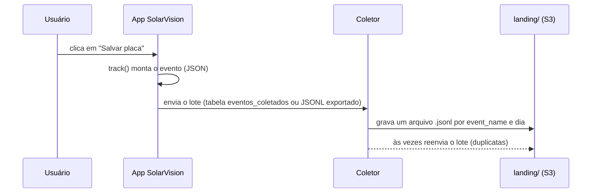

# Contrato do evento — SolarVision

Este documento descreve o formato dos eventos de uso do SolarVision e o layout da landing no S3. É a fronteira entre quem **produz** o dado (o app, pelo `frontend/src/lib/tracking.js`, e o gerador sintético) e quem **consome** (o pipeline do datalake).

O formato é o mesmo do projeto-modelo do professor (DadosPro): só mudam o catálogo de eventos, os `params` e os `element_id`, porque o "site" instrumentado agora é o próprio SolarVision.

> **Aviso:** o coletor pode reenviar um lote: o mesmo `event_id` pode aparecer mais de uma vez (a Silver deduplica, R5).



## Layout da landing no S3

```text
s3://solarvision-datalake/landing/event_name=<nome>/year=AAAA/month=MM/day=DD/<origem>-...jsonl
```

- Separados pelo **nome do evento** e pelo **dia de coleta** (UTC).
- `<origem>`: `coletor` (gerador sintético), `app` (eventos reais vindos da tabela `eventos_coletados` pelo `coletor/coletar_supabase.py`) ou `site` (JSONL exportado pelo painel de desenvolvedor do app e subido com `gerador/importar_site.py`).
- Evento sem `event_name` vai para `event_name=__HIVE_DEFAULT_PARTITION__`.
- Cada arquivo é JSON Lines: um evento por linha.

## O evento

Exemplo: o usuário cadastrou uma placa de 550 Wp no grupo 17.

```json
{
  "event_id": "69e0446a-5000-4c95-9a90-0195c8f66be1",
  "event_name": "create_panel",
  "event_ts": "2026-10-03T14:22:05.123Z",
  "user_pseudo_id": "anon-9a46b593",
  "user_id": "u-3f9a0c12",
  "session_hint": "s-289b523a",
  "page": { "location": "https://solarvision-senai.vercel.app/app/cadastro", "referrer": "https://solarvision-senai.vercel.app/app/home" },
  "traffic": { "source": "google", "medium": "organic", "campaign": null },
  "device": { "category": "desktop", "os": "Windows", "browser": "Chrome" },
  "params": { "panel_id": 10, "group_id": 17, "potencia_wp": 550, "element_id": "btn-salvar-placa" },
  "items": [ { "item_id": "placa-10", "item_category": "placa", "potencia_wp": 550, "quantity": 1 } ]
}
```

| Campo | Regra |
| --- | --- |
| `event_id` | UUID; único por evento **emitido**, mas pode chegar repetido (reenvio de lote) |
| `event_ts` | ISO-8601 UTC, horário do navegador |
| `user_pseudo_id` | id anônimo do navegador (`localStorage`); estável por navegador |
| `user_id` | `u-<hash>` do id do usuário no Supabase, depois de `sign_up`/`login`; nulo antes |
| `session_hint` | id de sessão do cliente; muda a cada recarga — **não é confiável** (a Silver calcula as sessões, R8) |
| `page` | `location` (URL da tela) e `referrer` (tela anterior) |
| `traffic` | `source`, `medium`, `campaign`: dos parâmetros `utm_*` da primeira visita, ou do referrer; `direct / (none)` sem nenhum |
| `device` | `category` (`desktop`, `tablet`, `mobile`), `os`, `browser` |
| `params` | varia por evento (tabela abaixo); números em número JSON |
| `items` | as **placas envolvidas** no evento; `[]` nos demais |
| dado pessoal | **nunca** há e-mail, nome, coordenadas, tarifa ou texto livre digitado pelo usuário (exceto o termo de busca do seletor, que é o nome de grupo/placa buscado) |

O `user_id` é um hash do id interno: o datalake liga os eventos da mesma pessoa sem saber quem ela é. Quem desliga o rastreamento em **Configurações** não gera eventos.

## As telas

`page.location` é sempre `https://solarvision-senai.vercel.app` + o caminho da tela. A **página** de um evento (usada no mapa de calor e no uso de telas) é esse caminho, sem domínio, `#` e `?`.

| Tela | Caminho |
| --- | --- |
| Login | `/login` |
| Criar conta | `/register` |
| Início | `/app/home` |
| Monitoramento | `/app/monitoramento` |
| Relatório | `/app/relatorio` |
| Limpeza | `/app/limpeza` |
| Cadastro | `/app/cadastro` |
| Configurações | `/app/configuracoes` |

## `params` por evento

| Evento | Chaves |
| --- | --- |
| `page_view` | `page_title` |
| `scroll` | `percent_scrolled` |
| `click` | `link_url`, `link_domain`, `link_text`, `link_id`, `outbound` |
| `site_search` | `search_term`, `search_results`, `search_area` (`seletor`) |
| `select_content` | `content_type` (`visao`, `grupo` ou `placa`), `content_id` |
| `view_alerts` | `unread` |
| `view_cleaning_recommendation` | `panel_id`, `loss_percent`, `recommend` |
| `file_download` | `file_name`, `file_extension`, `report_month` |
| `change_settings` | `setting` (`perfil`, `senha`, `tema`, `alertas`, `limpeza`, `cadastro`, `rastreamento`) |
| `create_group` | `group_id`, `has_location`, `has_tariff` |
| `create_panel` | `panel_id`, `group_id`, `potencia_wp` |
| `view_monitoring` | `group_id`, `panel_id` (nulos = todas as usinas), `view` (`dia`, `semana`, `mes`, `ano`) |
| `import_readings` | `panel_id`, `rows`, `rows_ignored` |
| `register_cleaning` | `panel_id`, `cleaning_id` |
| `generate_report` | `report_month`, `scope` (`todas`, `grupo` ou `placa`) |
| `delete_panel` | `panel_id`, `group_id` |
| `delete_group` | `group_id`, `panels_removed` |
| `sign_up`, `login` | `method` (`email`) |
| `logout` | `scope` (`local` ou `global`) |

Além das chaves da tabela, os eventos que nascem de um clique trazem `element_id`.

### `element_id`: onde foi o clique

`element_id` é o atributo `data-heat` do elemento clicado no app (ou do ancestral mais próximo que o tenha). É opcional: um evento sem ele continua válido. É a matéria-prima do mapa de calor (R11).

| Evento | `element_id` |
| --- | --- |
| `click` interno (`outbound=false`) | o `link_id` com `-` no lugar de `_`: `nav-home`, `nav-monitoramento`, `nav-relatorio`, `nav-limpeza`, `nav-cadastro`, `nav-configuracoes`, `cta-criar-conta`, `cta-entrar`, `cta-relatorio-mes`, `cta-registrar-limpeza`, `cta-importar` |
| `click` de saída (`outbound=true`) | `saida-open-meteo` |
| `site_search` | `busca-seletor` |
| `select_content` | `visao-dia`, `visao-semana`, `visao-mes`, `visao-ano`, `seletor-grupo`, `seletor-placa` |
| `view_alerts` | `btn-alertas` |
| `view_cleaning_recommendation` | `card-recomendacao` |
| `file_download` | `btn-imprimir` |
| `change_settings` | `cfg-` + o `setting` (`cfg-tema`, `cfg-alertas`, …) |
| `create_group` / `create_panel` | `btn-salvar-grupo` / `btn-salvar-placa` |
| `import_readings` | `btn-importar` |
| `register_cleaning` | `btn-registrar-limpeza` |
| `delete_panel` / `delete_group` | `btn-excluir-placa` / `btn-excluir-grupo` |
| `sign_up` / `login` / `logout` | `btn-signup` / `btn-login` / `btn-sair` |

`page_view`, `scroll`, `view_monitoring` e `generate_report` (abrir a tela) não trazem `element_id`.

## `items`: as placas do evento

Cada item é uma placa: `item_id` (`placa-<id>`), `item_category` (`placa`), `potencia_wp` e `quantity` (1). Aparecem em `create_panel`, `view_monitoring` (as placas da seleção), `view_cleaning_recommendation`, `import_readings`, `register_cleaning`, `generate_report` (as placas do relatório) e `delete_panel`. A Silver explode a lista numa tabela de itens (R10).

## Os 20 eventos

| Família | Evento | Quando dispara |
| --- | --- | --- |
| Engajamento | `page_view` | entrada em uma tela |
| | `scroll` | 25, 50, 75 e 90% da tela, uma vez por `page_view` |
| | `click` | link de menu, botão de atalho (CTA) ou saída para o Open-Meteo |
| | `site_search` | busca no seletor de usinas do Monitoramento |
| | `select_content` | troca de visão do gráfico (dia, semana, mês, ano) ou de grupo/placa |
| | `view_alerts` | abrir o sino de alertas |
| | `view_cleaning_recommendation` | abrir a recomendação de limpeza de uma placa |
| | `file_download` | "Imprimir / PDF" do relatório |
| | `change_settings` | salvar uma seção de Configurações |
| Ativação | `create_group` | grupo salvo no Cadastro |
| | `create_panel` | placa salva no Cadastro |
| | `view_monitoring` | Monitoramento carregado com uma seleção |
| | `import_readings` | leituras importadas por CSV |
| | `register_cleaning` | limpeza registrada |
| | `generate_report` | Relatório do mês aberto |
| | `delete_panel` | placa excluída |
| | `delete_group` | grupo excluído (com as placas) |
| Conta | `sign_up` | conta criada; passa a preencher `user_id` |
| | `login` | entrada; passa a preencher `user_id` |
| | `logout` | saída |

Um evento cujo `event_name` não está nesta tabela está fora do catálogo.
