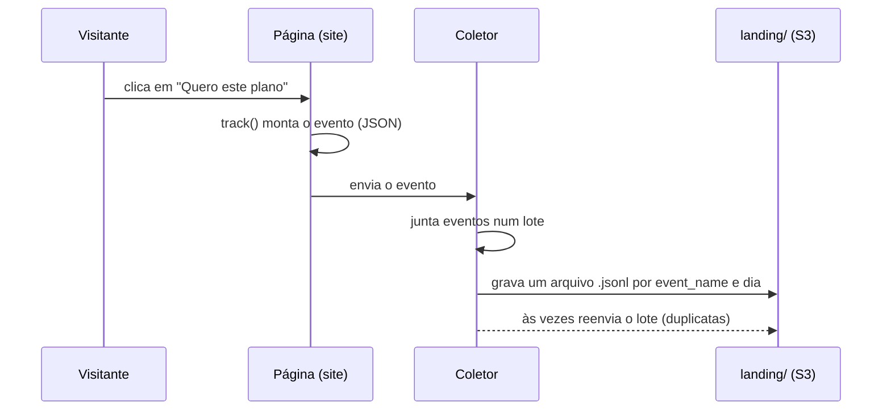
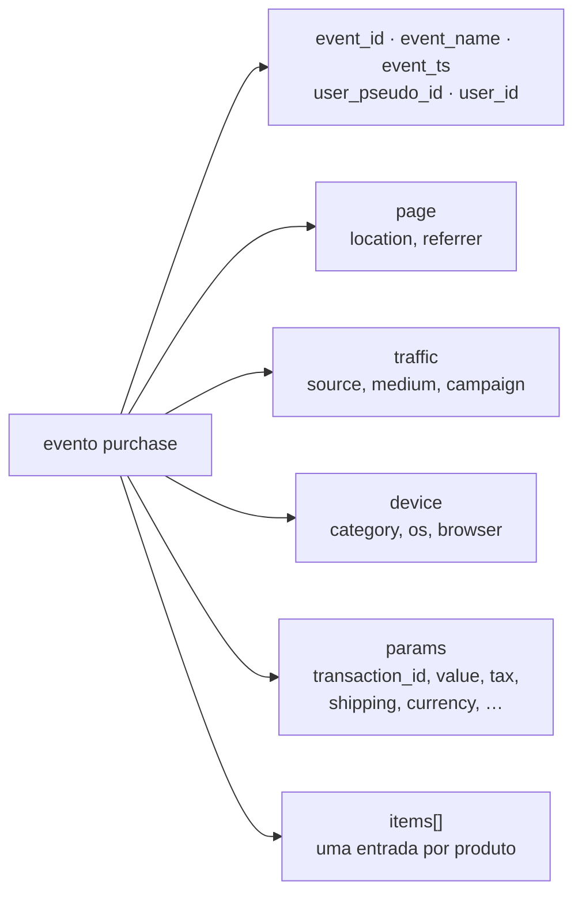

# Contrato do evento

Este documento descreve o formato dos eventos de tracking e o layout da landing no S3. É a fronteira entre o que você recebe pronto e o que você constrói.

Um **contrato** é um acordo entre quem produz o dado e quem consome. Aqui, quem produz é a página (e o gerador, que a simula); quem consome é o seu pipeline. Se um evento chega fora deste formato, ele quebrou o contrato, e o seu pipeline precisa saber o que fazer com ele.

Um **evento de tracking** é o registro de uma ação do visitante na página. Exemplo: quando alguém clica no Plano Pro, a página grava um evento `select_item` com o horário, o visitante e o plano escolhido.

> **Pense assim:** o contrato é o **formulário padrão dos Correios**. Todo envio precisa ter remetente, destinatário e CEP nos campos certos; assim, qualquer agência sabe processar. Cada evento é uma linha no **diário de bordo** da página ("às 14h22, o visitante anon-1 comprou o Plano Premium"), e o contrato diz como essa linha precisa ser escrita.

> **Aviso:** o coletor pode reenviar um lote: o mesmo `event_id` pode aparecer mais de uma vez.

Em outras palavras: o **coletor** junta os eventos e grava em arquivos, chamados de **lotes**. Às vezes ele grava o mesmo lote de novo, e o mesmo evento aparece duas vezes. Por isso a Silver precisa remover as cópias (deduplicação, requisito R5 do enunciado).

> **Pense assim:** o lote é um **malote** de correspondência. O coletor não leva cada carta na hora: junta as cartas de um intervalo e despacha o malote. Às vezes, achando que um malote se perdeu, despacha uma cópia, e algumas cartas chegam em dobro.



O diagrama acompanha um clique até virar arquivo na landing. A última seta tracejada é o reenvio que a Silver precisa desfazer.

## Layout da landing no S3

**Layout** é a forma como os arquivos estão organizados em pastas. A **landing** é o prefixo `landing/` do bucket, onde os eventos brutos chegam. Os arquivos ficam neste caminho:

```text
s3://datalake-tracking/landing/event_name=<nome do evento>/year=AAAA/month=MM/day=DD/<origem>-...jsonl
```

- Os arquivos são separados primeiro pelo **nome do evento** e depois pelo **dia de coleta**. Exemplo: as rolagens de 3 de setembro de 2026 ficam em `landing/event_name=scroll/year=2026/month=09/day=03/`.
- Cada dia tem de 3 a 6 lotes, como um coletor que descarrega em intervalos. Cada lote vira um arquivo em cada pasta `event_name=` que tem eventos dele, com o mesmo nome de arquivo (ex.: `coletor-s42-001.jsonl`). O dia seguinte ao último pode ter 1 ou 2 lotes (sessões que atravessam a meia-noite).
- Um evento sem `event_name` vai para a pasta `event_name=__HIVE_DEFAULT_PARTITION__`, que é o nome que o Spark usa para "valor vazio".
- `<origem>` é `coletor` (eventos do gerador) ou `site` (eventos que você exportou da página de exemplo e subiu com `gerador/importar_site.py`).
- Cada arquivo é JSON Lines: um evento por linha.

Uma **partição** é uma subpasta que agrupa arquivos por um valor. Aqui há duas: o nome do evento (`event_name=…`) e o dia de coleta (`year=…/month=…/day=…`). Quem quer só as compras lê só `event_name=purchase/`, sem abrir o resto. **JSON Lines** (extensão `.jsonl`) é um arquivo de texto em que cada linha é um objeto JSON completo e independente.

## O evento

Um evento por linha de JSON. É o mesmo formato que `site/index.html` produz e que o gerador grava.

O exemplo abaixo é uma compra (`purchase`) do Plano Premium paga com Pix. Repare que o evento é **aninhado**: alguns campos (`page`, `traffic`, `device`, `params`) são objetos com campos dentro, e `items` é uma lista.

```json
{
  "event_id": "69e0446a-5000-4c95-9a90-0195c8f66be1",
  "event_name": "purchase",
  "event_ts": "2026-10-03T14:22:05.123Z",
  "user_pseudo_id": "anon-9a46b593",
  "user_id": null,
  "session_hint": "s-289b523a",
  "page": { "location": "https://loja.exemplo/checkout", "referrer": "https://loja.exemplo/" },
  "traffic": { "source": "google", "medium": "cpc", "campaign": "formacao_dados" },
  "device": { "category": "mobile", "os": "Android", "browser": "Chrome" },
  "params": { "transaction_id": "T-5BA58C26", "value": 1086.8, "tax": 54.34, "shipping": 49.9,
              "currency": "BRL", "payment_type": "pix", "coupon": "PIX5" },
  "items": [ { "item_id": "PLANO-PREMIUM", "item_name": "Plano Premium", "item_category": "plano",
               "price": 997.0, "quantity": 1 } ]
}
```

> **Pense assim:** um evento aninhado é uma **caixa com caixinhas dentro**. A caixa grande tem etiquetas simples (`event_id`, `event_name`, `event_ts`) e caixinhas que você abre para ver o conteúdo: `page` (onde), `traffic` (de onde veio), `device` (com o quê), `params` (os detalhes do que aconteceu) e `items` (a lista de produtos).



A tabela a seguir diz a regra de cada campo do evento. Leia com atenção: são essas regras que o seu pipeline vai usar para limpar e validar os dados.

| Campo | Regra |
| --- | --- |
| `event_id` | UUID; único por evento **emitido**, mas pode chegar repetido (reenvio de lote) |
| `event_ts` | ISO-8601 UTC, horário do navegador |
| `user_pseudo_id` | cookie anônimo; estável por navegador |
| `user_id` | `u-<hash>` após `sign_up`/`login`; nulo antes |
| `session_hint` | id de sessão do cliente; muda a cada recarga de página — **não é confiável** |
| `params` | varia por evento (tabela abaixo); valores numéricos em número JSON |
| `items` | presente nos eventos de e-commerce; `[]` nos demais |
| dado pessoal | **nunca** há e-mail, nome ou documento no evento |

Algumas explicações:

- **UUID** é um identificador aleatório longo, como `69e0446a-5000-...`, praticamente impossível de repetir por acaso.
- **ISO-8601 UTC** é um formato padrão de data e hora, como `2026-10-03T14:22:05.123Z`. O `Z` no fim indica UTC, o horário de referência mundial (3 horas à frente de Brasília).
- **`user_pseudo_id`** identifica o navegador, não a pessoa. Se a mesma pessoa usa o celular e o notebook, ela tem dois `user_pseudo_id`. Pense numa **pulseira de visitante** que a loja põe no seu braço na entrada: ela reconhece a pulseira, não você.
- **`user_id`** identifica a pessoa, mas só existe depois que ela cria conta (`sign_up`) ou entra (`login`). Ligar os dois ids é o *identity stitching* (requisito R9 do enunciado).
- **`session_hint`** é um palpite de sessão gerado pelo navegador. Como muda a cada recarga, o enunciado proíbe usá-lo; você calcula as sessões por conta própria (requisito R8).

## `params` por evento

O campo `params` muda conforme o evento. A tabela abaixo lista quais chaves cada evento traz. Exemplo: um `scroll` traz só `percent_scrolled`; um `purchase` traz sete chaves. Na Silver, você transforma essas chaves em colunas com tipo definido (requisito R6).

| Evento | Chaves |
| --- | --- |
| `page_view` | `page_title` |
| `scroll` | `percent_scrolled` |
| `click` | `link_url`, `link_domain`, `link_text`, `link_id`, `outbound` |
| `site_search` | `search_term`, `search_results`, `search_area` |
| `video_*` | `video_title`, `video_provider`, `video_duration`, `video_current_time`, `video_percent` (0 no start, 100 no complete) |
| `file_download` | `file_name`, `file_extension`, `link_url` |
| `view_item_list`, `select_item` | `item_list_id`, `item_list_name` |
| `view_item`, `add_to_cart`, `remove_from_cart`, `view_cart`, `begin_checkout` | `currency`, `value` |
| `add_shipping_info` | `currency`, `value`, `shipping_tier`, `shipping` |
| `add_payment_info` | `currency`, `value`, `payment_type` |
| `purchase` | `transaction_id`, `value`, `tax`, `shipping`, `currency`, `payment_type`, `coupon` |
| `refund` | `transaction_id`, `value`, `tax`, `shipping`, `currency`, `reason` |
| `generate_lead` | `lead_source`, `currency`, `value` |
| `sign_up`, `login` | `method` |

`video_*` quer dizer os três eventos de vídeo: `video_start`, `video_progress` e `video_complete`.

Além das chaves da tabela, os eventos que nascem de um clique trazem `element_id` (veja a seção seguinte).

### `element_id`: onde foi o clique

`element_id` diz **em qual elemento da página** a pessoa clicou. O valor é o atributo `data-heat` daquele elemento no `site/index.html`. Exemplo: clicar em "Quero este plano" no cartão do Plano Pro grava `select_item` e `add_to_cart` com `"element_id": "plano-pro"`.

- Ele aparece só nos eventos disparados por clique (tabela abaixo). `page_view`, `scroll`, `video_progress`, `video_complete`, `view_item_list`, `view_item` e `view_cart` não trazem `element_id`.
- É **opcional**: um evento sem ele continua válido e **não** é motivo de rejeição.
- É a matéria-prima do mapa de calor (requisito R11 do enunciado).

| Evento | `element_id` |
| --- | --- |
| `click` de saída (`outbound=true`) | `social-instagram`, `social-youtube`, `social-whatsapp`, `social-linkedin` |
| `click` interno (`outbound=false`) | `cta-` + o `link_id` com `-` no lugar de `_`: `cta-hero-ver-planos`, `cta-hero-assistir`, `cta-logo` |
| `video_start` | `btn-play` |
| `file_download` | `dl-ementa` |
| `select_item` | o cartão do plano: `plano-basico`, `plano-pro`, `plano-premium` |
| `add_to_cart` / `remove_from_cart` de plano | o botão do próprio cartão (`plano-…`), ou `modal-comprar` quando a pessoa abriu o detalhe do plano antes (`add_to_cart` logo depois de `view_item`). Numa troca de plano, os dois eventos levam o cartão do plano novo |
| `add_to_cart` / `remove_from_cart` do order bump | `bump` |
| `generate_lead` | `form-lead` |
| `site_search` | `faq-busca` |
| `begin_checkout` | `btn-continuar` |
| `add_shipping_info` | `frete-pac`, `frete-sedex` |
| `add_payment_info` | `pagto-pix`, `pagto-cartao-avista`, `pagto-cartao-parcelado` |
| `purchase` | `btn-comprar` |
| `refund` | `btn-refund` |
| `login` / `sign_up` | `btn-login` / `btn-signup` |

## A regra do `value`

`value` é sempre a receita dos itens **sem frete**. Em `purchase` e `refund` ele já vem com o desconto do Pix; nas etapas anteriores (`view_cart` até `add_payment_info`) é o valor de tabela, porque o desconto só existe depois que o pagamento é escolhido.

Exemplo: no evento acima, o frete do SEDEX (`shipping` = `49.9`) vem num campo próprio e **não** está somado ao `value`.

## Os 20 eventos

O catálogo tem 20 eventos, separados em três famílias:

- **Engajamento:** o visitante interage com o conteúdo (rola, vê o vídeo, busca no FAQ).
- **E-commerce:** o visitante caminha rumo à compra (vê os planos, escolhe, paga).
- **Aquisição:** o visitante deixa um contato ou cria conta.

Um evento cujo `event_name` não está nesta tabela está fora do catálogo.

| Família | Evento | Quando dispara |
| --- | --- | --- |
| Engajamento | `page_view` | entrada em landing, checkout, obrigado ou membros |
| | `scroll` | 25, 50, 75 e 90% da página, uma vez por `page_view` |
| | `click` | saída para rede social (`outbound=true`) ou CTA interno (`outbound=false`) |
| | `site_search` | busca no FAQ, com `search_term` e `search_results` |
| | `video_start` / `video_progress` / `video_complete` | VSL; progresso em 10, 25, 50 e 75% |
| | `file_download` | ementa em PDF |
| E-commerce | `view_item_list` | tabela de planos entra na tela |
| | `select_item` | clique em um plano |
| | `view_item` | modal de detalhe do plano |
| | `add_to_cart` / `remove_from_cart` | escolha ou troca de plano; marcar ou desmarcar o order bump |
| | `view_cart` | resumo do pedido no checkout |
| | `begin_checkout` | "Continuar" no formulário de dados |
| | `add_shipping_info` | escolha de PAC ou SEDEX — **só no Premium** |
| | `add_payment_info` | escolha de Pix, cartão à vista ou cartão parcelado |
| | `purchase` | compra concluída |
| | `refund` | pedido de garantia em até 7 dias, referenciando o `transaction_id` da compra |
| Aquisição | `generate_lead` | e-mail em troca do e-book (o e-mail **não** entra no evento) |
| | `sign_up` / `login` | conta na área de membros; passa a preencher `user_id` |

Termos da tabela: **CTA** (*call to action*) é um botão que chama para a ação, como "Quero me inscrever". **VSL** (*video sales letter*) é o vídeo de vendas da landing. **Order bump** é uma oferta extra marcada no checkout, aqui a Mentoria em grupo (`BUMP-MENTORIA`). Um **lead** é um visitante que deixou o e-mail, aqui em troca do e-book gratuito.
