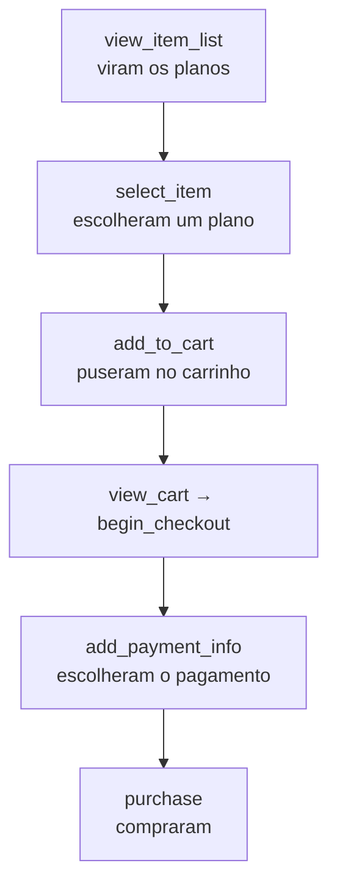
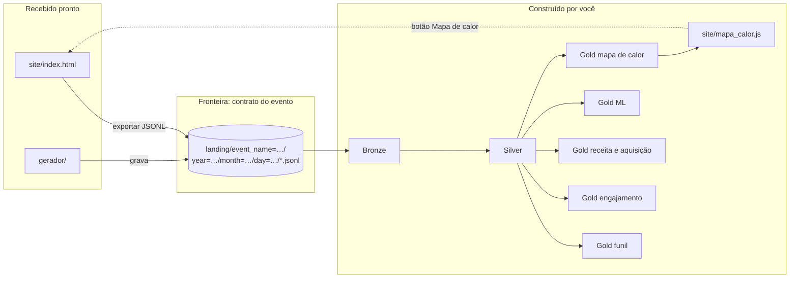
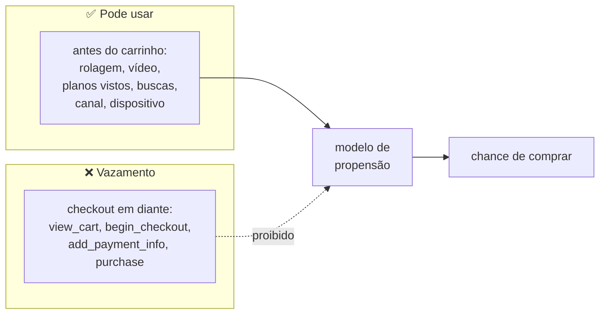

# Enunciado — datalake de tracking da DadosPro

> Este documento usa vários termos de engenharia de dados. Cada um é explicado na primeira vez que aparece, e todos estão reunidos no [Glossário](#glossário), no fim da página. Se travar numa palavra, consulte o glossário.

## 1. O problema

Uma empresa vende um curso online por meio de uma landing page de conversão. A página foi instrumentada com 20 eventos de tracking, que chegam a um bucket S3 como arquivos JSON Lines. Ninguém olha esses dados ainda.

Traduzindo:

- **Landing page de conversão** é uma página única feita para levar o visitante a uma ação, aqui comprar o curso.
- **Instrumentar** a página é colocar código nela para registrar o que o visitante faz. Cada registro é um **evento de tracking**. Exemplo: o visitante clicou no Plano Pro → nasce um evento `select_item`.
- **Bucket S3** é um espaço de armazenamento de arquivos na nuvem. Neste projeto ele é simulado na sua máquina.
- **JSON Lines** é um arquivo de texto com um objeto JSON por linha, ou seja, um evento por linha.

Você vai **construir do zero** um datalake em arquitetura medalhão que responda a quatro perguntas da empresa. Um **datalake** é um repositório central de dados guardados como arquivos. A **arquitetura medalhão** organiza esse repositório em três camadas: Bronze (dado cru), Silver (dado limpo) e Gold (tabelas prontas para responder perguntas).

> **Pense assim:** é a cozinha de um restaurante. A **Bronze** é a despensa: os ingredientes guardados exatamente como chegaram do fornecedor, até os amassados, com a nota fiscal de cada um. A **Silver** é a bancada de preparo: tudo lavado, cortado e separado, e o que estava estragado vai para uma caixa à parte com uma etiqueta dizendo por quê. A **Gold** é o prato servido: pronto para o cliente (o gerente da empresa) consumir sem saber como foi feito.

As quatro perguntas:

1. **Funil** — em que etapa a jornada de compra perde mais gente, por plano e por canal?
2. **Engajamento** — o vídeo de apresentação é visto até o fim? O que o visitante procura no FAQ e não encontra?
3. **Receita e aquisição** — quanto entrou de fato, descontados os reembolsos, e qual canal traz cliente que não desiste?
4. **Previsão** — quais sessões estão perto de comprar, e que perfis de visitante existem?

Um **funil** é a sequência de etapas até a compra (ver os planos → escolher → pagar). Em cada etapa, parte das pessoas desiste.

> **Pense assim:** um funil de cozinha é largo em cima e estreito embaixo. Muita gente entra no topo (vê os planos) e pouca chega ao fim (compra). O trabalho é descobrir em que altura o funil "vaza" mais.



O **canal** é de onde o visitante veio, por exemplo `google / cpc` (anúncio pago no Google).

Competências avaliadas:

- ingestão de dado semiestruturado (JSON aninhado, `map`, `array`) com schema explícito;
- arquitetura medalhão com um job por camada;
- validação com motivo de rejeição;
- deduplicação;
- sessionização com window functions;
- identity stitching;
- modelagem de métricas de funil e receita;
- Spark ML sem vazamento de informação;
- leitura e escrita em armazenamento de objetos (S3).

Em outras palavras, você vai praticar: ler JSON com campos dentro de campos; definir o formato das colunas (o **schema**) em vez de deixar o Spark adivinhar; separar dado bom de dado ruim, dizendo por que o ruim foi recusado; remover eventos repetidos; agrupar eventos em sessões; ligar o visitante anônimo à pessoa logada; calcular métricas; treinar modelos de machine learning sem "colar" a resposta; e ler e gravar arquivos no S3. Todos esses termos estão no [Glossário](#glossário).

## Por onde começar

Uma ordem sugerida de trabalho. Faça uma etapa de cada vez e só avance quando a anterior estiver funcionando.

1. **Suba o ambiente.** Siga o [`SETUP.md`](../SETUP.md) até ver as três linhas `[ok]`.
2. **Gere os dados.** Rode o gerador (Passo 3 do `SETUP.md`) e leia o resumo que ele imprime.
3. **Olhe alguns eventos.** Abra `site/index.html` no navegador e veja os eventos nascendo no painel lateral. Depois, leia algumas linhas da landing com o Spark, com o [`CONTRATO_EVENTO.md`](CONTRATO_EVENTO.md) aberto ao lado para entender cada campo.
4. **Construa a Bronze.** Leia a landing com schema explícito e grave em Parquet, com as colunas de proveniência (R1, R2, R4).
5. **Construa a Silver.** Deduplique, extraia os `params`, valide, sessionize, faça o stitching e exploda os itens (R5 a R10). Confira as contagens a cada passo.
6. **Construa a Gold, uma tabela por vez.** Comece pelas mais simples e confira cada número com uma consulta à mão antes de seguir (seção 5.3 e 5.4). Por último, exporte o mapa de calor e veja-o acender no site (seção 5.5).
7. **Escreva o script de sequência** que roda os oito jobs (R3) e teste-o do zero.
8. **Escreva o relatório.** Responda às quatro perguntas citando tabelas e números, e preencha a seção "Qualidade do dado".

## 2. O produto: DadosPro

**DadosPro — Formação em Análise de Dados** é um curso online vendido por uma landing page de página única.

**Seções da landing:** hero com CTA, vídeo de apresentação (VSL), módulos, depoimentos, tabela de planos, e-book gratuito, garantia de 7 dias, FAQ com busca e rodapé com redes sociais. Fora da landing ficam o checkout, a página de obrigado e a área de membros.

Termos: o **hero** é o topo da página, a primeira coisa que o visitante vê. **CTA** (*call to action*) é o botão que chama para a ação, como "Quero me inscrever". **VSL** (*video sales letter*) é o vídeo de vendas. O **checkout** é a página onde o visitante preenche os dados e paga.

A tabela abaixo lista os produtos à venda, com o código (`item_id`) que aparece nos eventos e o preço.

| Item | `item_id` | Preço | Observação |
| --- | --- | --- | --- |
| Plano Básico | `PLANO-BASICO` | R$ 297,00 | acesso por 1 ano |
| Plano Pro | `PLANO-PRO` | R$ 597,00 | acesso vitalício + mentoria |
| Plano Premium | `PLANO-PREMIUM` | R$ 997,00 | inclui **apostila impressa** enviada pelos Correios |
| Mentoria em grupo | `BUMP-MENTORIA` | R$ 147,00 | *order bump* oferecido no checkout |

O **order bump** é uma oferta extra, de valor menor, que aparece no checkout como uma caixa para marcar. Exemplo: quem compra o Plano Pro pode marcar a Mentoria em grupo e levar os dois no mesmo pedido.

- Frete só existe no Premium: PAC R$ 24,90 ou SEDEX R$ 49,90.
- Pix tem 5% de desconto (cupom `PIX5`).
- `tax` é o ISS: 5% sobre `value`.
- Moeda única: BRL.

Os 20 eventos, o formato de cada um e o layout dos arquivos no S3 estão em [`CONTRATO_EVENTO.md`](CONTRATO_EVENTO.md).

## 3. O que você recebe e o que entrega

### Você recebe (pronto)

Estes arquivos já existem no repositório. Você não precisa alterá-los.

| Item | Para quê |
| --- | --- |
| `site/index.html` | landing de exemplo que dispara os 20 eventos e exporta JSONL; serve para ver o evento nascer |
| `gerador/` | simulador do coletor: popula `landing/` no S3 com semanas de eventos sintéticos |
| `docker-compose.yml` + `Dockerfile` | três contêineres: `floci` (S3 emulado), `app` (Python 3.11, Java 17, PySpark 4.2.0 com o conector `s3a`, `boto3`, `pytest`) e `explorador` (um console em `http://localhost:8501`, feito com a mesma imagem do `app`, para olhar os buckets, ver o catálogo de tabelas, rodar os seus jobs, sozinhos ou juntos num workflow, e fazer consultas SQL). Nada é instalado na máquina além do Docker; nenhuma conta de nuvem é necessária |
| `pipeline/comum.py` | peças prontas para os seus jobs: a `SparkSession` configurada para o floci, caminhos `s3a://`, conferir se uma camada existe (R2), ler e gravar as partições `event_name=…` sem misturar nem apagar as pastas vizinhas. Importe em vez de reescrever; o [pipeline/README.md](../pipeline/README.md#comumpy-as-peças-prontas) mostra como |
| `infra/verificar_ambiente.py` | confere, de dentro do contêiner `app`, que o Spark lê e grava no floci por `s3a://` |
| `SETUP.md` | ambiente do zero com Docker |
| `docs/CONTRATO_EVENTO.md` | formato do evento e layout da landing no S3 |

Um **contêiner** é um ambiente isolado que já traz os programas necessários. O **floci** imita o S3 na sua máquina. `s3a://` é o prefixo de caminho que o Spark usa para ler e gravar no S3.

### Você entrega

1. **`pipeline/`** — código PySpark que atende aos requisitos da seção 5, e a atualização do `pipeline/README.md` (já existe, com o acesso ao S3) para dizer também como rodar o seu pipeline.
2. **`RELATORIO.md`** — respostas às quatro perguntas da seção 1. Cada resposta cita a tabela Gold e os números que a sustentam e termina com uma recomendação para a empresa.
3. **Seção "Qualidade do dado"** no relatório:
   - quantos eventos foram descartados como duplicata;
   - quantos foram rejeitados, por qual motivo;
   - se alguma regra rejeitou dado legítimo;
   - quais armadilhas você encontrou e como as tratou.

Por que isso importa: numa empresa, um número sem explicação não convence ninguém. O relatório mostra que você entendeu os dados, e a seção de qualidade mostra que você sabe o quanto pode confiar neles.

**Desafio opcional:** navegue pela página de `site/`, exporte o JSONL, suba-o com `gerador/importar_site.py`, reprocesse e localize a sua própria sessão nas tabelas Gold.

## 4. Arquitetura esperada

O desenho abaixo mostra o caminho do dado. À esquerda, o que você recebe pronto: a página e o gerador gravam eventos na landing. À direita, o que você constrói: as camadas Bronze, Silver e Gold.



A fronteira entre o que é pronto e o que é seu é a landing: tudo o que você precisa saber dela está no [CONTRATO_EVENTO.md](CONTRATO_EVENTO.md). As cinco Golds leem a Silver; a do mapa de calor ainda volta para o site, num arquivo que o próprio site carrega.

Todas as camadas ficam no **mesmo bucket**, em prefixos próprios, gravadas em Parquet:

```text
s3://datalake-tracking/
├── landing/   eventos brutos (já existe; você só lê)
├── bronze/
├── silver/
└── gold/
```

**Parquet** é um formato de arquivo para tabelas. Ele guarda os dados por coluna, com o tipo de cada uma, e é muito mais rápido de ler que JSON. Um **prefixo** é o começo do caminho de um arquivo no S3; funciona como uma pasta.

> **Pense assim:** o JSON é uma pilha de fichas de papel, cada uma com todos os campos escritos à mão. Para somar só os valores, você precisa ler ficha por ficha. O Parquet é uma planilha arquivada por coluna: para somar os valores, você puxa só a coluna `value` e ignora o resto.

## 5. Requisitos

Os requisitos são numerados de R1 a R11. Cada um vem com uma linha "Em outras palavras" que explica a ideia. A regra que vale é sempre o texto do requisito.

### 5.1 Obrigatórios de arquitetura

- **R1.** PySpark, lendo de `landing/` e gravando todas as camadas no mesmo bucket S3 (floci), em Parquet, **diretamente pelo Spark com `s3a://`**. O pipeline não usa `boto3` nem outro SDK de nuvem, não baixa arquivos para o disco local e roda no contêiner `app`.
  - *Em outras palavras:* todo acesso ao S3 é feito com `spark.read` e `df.write` em caminhos `s3a://datalake-tracking/...`. Nada de baixar arquivos para o seu computador.
- **R2.** **Um job por camada**, executáveis separadamente:
  - um job Bronze, um job Silver, **cinco jobs Gold, cada um num arquivo próprio** (funil, engajamento, receita e aquisição, ML, mapa de calor) e um job que exporta o mapa de calor para o site (R11);
  - cada job verifica que a camada de que depende existe e, se não existir, para com uma mensagem que diz o que rodar antes (a função `exigir_camada` do `pipeline/comum.py` já faz isso).
  - *Em outras palavras:* um **job** é um script que faz uma etapa inteira. São oito scripts. Exemplo: se alguém roda o job Silver antes do Bronze, o job Silver para e avisa "rode o job Bronze antes".

  > **Pense assim:** cada job é uma **receita** de uma etapa do cardápio. A receita da Silver começa com "pegue a Bronze": se a geladeira estiver vazia, ela não improvisa, avisa o que precisa ser feito antes.

  ```mermaid
  flowchart LR
      L[("landing")] --> B["job Bronze"]
      B --> S["job Silver"]
      S --> F["Gold funil"]
      S --> E["Gold engajamento"]
      S --> R["Gold receita e aquisição"]
      S --> M["Gold ML"]
      S --> C["Gold mapa de calor"]
      C --> X["job de exportação<br/>site/mapa_calor.js"]
  ```

  Cada seta é uma dependência: um job só roda se a caixa de onde vem a seta já existe. O script do R3 roda os oito nessa ordem.
- **R3.** Um script que roda os oito jobs em sequência. Ele **não** gera dados.
  - *Em outras palavras:* um único comando reconstrói o datalake inteiro, a partir da landing que já existe.
- **R4.** Bronze append-only, com schema explícito (sem inferência), particionada por nome do evento e por data no formato `event_name=<nome>/year=AAAA/month=MM/day=DD` (o dia de coleta, tirado do caminho da landing) e com colunas de proveniência: arquivo de origem e instante da ingestão.
  - *Em outras palavras:* **append-only** quer dizer que a Bronze só recebe dados novos; nunca apaga nem altera o que já está lá. **Schema explícito** quer dizer que você escreve no código o nome e o tipo de cada campo, em vez de deixar o Spark adivinhar. **Particionada por nome do evento e por data** quer dizer que cada evento, em cada dia, fica numa subpasta própria, como `bronze/event_name=scroll/year=2026/month=09/day=03/`. **Proveniência** é a "etiqueta de origem" de cada linha: de qual arquivo da landing ela veio e quando foi lida.

  > **Pense assim:** a Bronze é um **arquivo de cartório**: tudo o que chega é registrado, carimbado com a origem e a data, e nada é rasurado depois (append-only). As **partições** são as **gavetas etiquetadas** do arquivo: uma gaveta por tipo de evento e, dentro dela, uma pasta por dia. Quem procura "as compras de 3 de setembro" abre só uma gaveta e uma pasta.

  ```mermaid
  flowchart TB
      bronze["bronze/"] --> pv["event_name=page_view/"]
      bronze --> pu["event_name=purchase/"]
      bronze --> etc["… uma gaveta por evento"]
      pu --> y["year=2026/"] --> m["month=09/"] --> d1["day=03/<br/>part-….parquet"]
      m --> d2["day=04/<br/>part-….parquet"]
  ```

### 5.2 Silver

A Silver é a camada do dado limpo: sem repetições, com colunas tipadas, com o dado inválido separado e com sessões e identidades resolvidas.

- **R5.** Deduplicação por `event_id`.
  - *Em outras palavras:* o mesmo evento pode chegar duas vezes (reenvio de lote). Na Silver, cada `event_id` aparece uma vez só.

  > **Pense assim:** é como uma carta registrada que o carteiro entregou duas vezes por engano. O número de rastreio (`event_id`) é o mesmo nas duas: guarde uma e descarte a outra.
- **R6.** Extração dos `params` para colunas tipadas.
  - *Em outras palavras:* as chaves que estão dentro de `params` (como `value` ou `percent_scrolled`) viram colunas próprias, cada uma com o tipo certo (número, texto, booleano). Inclui `element_id`, que diz em que elemento da página foi o clique (veja o [contrato](CONTRATO_EVENTO.md#element_id-onde-foi-o-clique)).
- **R7.** Validação com **motivo de rejeição**. Os rejeitados são gravados numa tabela separada, um motivo por linha. As regras mínimas estão abaixo; você pode acrescentar outras, justificando no relatório.

  A tabela lista cada motivo de rejeição e a condição que o dispara.

  | Motivo | Condição |
  | --- | --- |
  | evento fora do catálogo | `event_name` fora dos 20 eventos do contrato |
  | timestamp ausente ou futuro | `event_ts` nulo ou posterior ao instante de ingestão |
  | transação sem id | `purchase` ou `refund` sem `transaction_id` |
  | valor monetário inválido | `value` negativo, ou `currency` diferente de `BRL` em evento que tem `value` |
  | marco fora do padrão | `percent_scrolled` ∉ {25, 50, 75, 90} ou `video_percent` ∉ {0, 10, 25, 50, 75, 100} |
  | reembolso sem compra | `refund` cujo `transaction_id` não existe em nenhum `purchase` válido |

  - *Em outras palavras:* um evento inválido não é jogado fora em silêncio. Ele vai para uma tabela de rejeitados com o motivo escrito. Exemplo: um `scroll` com `percent_scrolled = 40` vai para os rejeitados com o motivo "marco fora do padrão". O símbolo ∉ significa "não pertence a".

  > **Pense assim:** é o controle de qualidade da linha de produção. A peça com defeito não vai para o lixo escondida: ela sai da esteira para uma caixa separada, com uma etiqueta dizendo o defeito. Assim dá para contar quantas peças falharam e por quê.

  ```mermaid
  flowchart LR
      ev["evento da Bronze<br/>(sem duplicatas)"] --> q{"passa nas<br/>6 regras?"}
      q -->|sim| ok["silver/event_name=…"]
      q -->|não| rej["silver/eventos_rejeitados<br/>+ motivo_rejeicao"]
  ```
- **R8.** Sessionização própria: uma sessão nova começa quando o mesmo `user_pseudo_id` fica mais de 30 minutos sem evento. **`session_hint` não pode ser usado.**
  - *Em outras palavras:* uma **sessão** é uma visita. Você ordena os eventos de cada visitante pelo horário e corta onde houver uma pausa de mais de 30 minutos. Exemplo: eventos às 10h00, 10h05 e 10h50 do mesmo `user_pseudo_id` formam duas sessões (10h00–10h05 e 10h50), porque entre 10h05 e 10h50 passaram 45 minutos. As **window functions** do Spark ajudam a comparar cada evento com o anterior.

  > **Pense assim:** é uma visita a uma loja. Enquanto a pessoa anda pelos corredores, é a mesma visita. Se ela sai e volta depois de mais de meia hora, conta como uma visita nova, mesmo sendo a mesma pessoa.

  ```mermaid
  flowchart LR
      a["10h00<br/>page_view"] -->|5 min| b["10h05<br/>scroll"]
      b -->|"45 min: pausa > 30 min<br/>✂ corta aqui"| c["10h50<br/>page_view"]
      subgraph S1["sessão 1"]
          a
          b
      end
      subgraph S2["sessão 2"]
          c
      end
  ```
- **R9.** Identity stitching: todo evento de um `user_pseudo_id` que em algum momento tenha `user_id` recebe esse `user_id`, inclusive os eventos anteriores ao login.
  - *Em outras palavras:* **identity stitching** ("costura de identidade") é ligar o visitante anônimo à pessoa. Exemplo: o navegador `anon-9a46b593` visitou a página na segunda, sem login. Na quarta, fez `login` como `u-…`. Todos os eventos desse navegador, inclusive os de segunda, passam a ter esse `user_id`.

  > **Pense assim:** um cliente passeia pela loja sem se identificar, mas no caixa mostra o CPF. A partir do CPF, a loja consegue dizer que aquele mesmo cliente tinha passeado pelos corredores mais cedo, e liga todos os passos dele a uma pessoa só.
- **R10.** Uma tabela de itens com `items[]` explodido, uma linha por item por evento.
  - *Em outras palavras:* **explodir** uma lista é transformar cada elemento dela numa linha. Exemplo: um `purchase` com o Plano Pro e a Mentoria em grupo vira duas linhas na tabela de itens.

### 5.3 Gold: as 15 tabelas obrigatórias

A Gold é a camada das respostas: tabelas pequenas, já agregadas, prontas para o relatório. São cinco jobs, e cada job grava algumas tabelas.

Nomes de colunas são livres; o **conteúdo** é obrigatório, porque é o que a correção compara.

A tabela abaixo diz, para cada uma das 15 tabelas, o que ela precisa conter. As definições exatas de canal, plano, receita e outras estão na seção 5.4.

| Job | Tabela | Conteúdo mínimo |
| --- | --- | --- |
| Funil | `funil_compra` | sessões que atingiram cada etapa de `view_item_list → select_item → add_to_cart → view_cart → begin_checkout → add_payment_info → purchase`, conversão sobre a etapa anterior e sobre o topo; total e por plano × canal. `view_item` (abrir o detalhe do plano) é opcional na jornada e **não** entra na sequência: aparece como taxa à parte (sessões com `view_item` ÷ sessões com `select_item`). |
| | `funil_lead` | `page_view` da landing → `scroll` ≥ 50% → `generate_lead`, por canal |
| Engajamento | `sessoes` | uma linha por sessão: duração, eventos, scroll máximo, maior `video_percent`, fez lead, comprou, canal, dispositivo |
| | `retencao_video` | das sessões com `video_start`, percentual que atingiu 10, 25, 50, 75 e 100% |
| | `buscas_faq` | termo, total de buscas, buscas sem resultado |
| | `saidas_downloads` | cliques de saída por domínio; downloads por arquivo |
| Receita e aquisição | `receita_diaria` | por **data da compra**, plano e canal: receita bruta, reembolsada e líquida, pedidos, ticket médio |
| | `taxa_reembolso` | por plano e canal |
| | `adesao_order_bump` | percentual de compras com `BUMP-MENTORIA` |
| | `lead_para_compra` | leads, quantos compraram depois, mediana de dias entre lead e compra |
| ML | `propensao_sessao` | probabilidade de compra por sessão, com modelo de classificação |
| | `metricas_modelo` | AUC e F1 no conjunto de teste, e a lista de features usadas |
| | `segmentos_visitantes` | grupo de cada visitante (clusterização) e perfil médio de cada grupo |
| Mapa de calor | `mapa_calor_cliques` | uma linha por `pagina` (5.4) e `element_id`, só com eventos que têm `element_id` e `page_location` (sem página, não há onde desenhar): `cliques` (eventos), `sessoes` (sessões distintas que clicaram), `sessoes_na_pagina` (sessões com `page_view` na página), `taxa_clique` = `sessoes ÷ sessoes_na_pagina` (nulo se o divisor for 0) e `intensidade` = `cliques ÷` o maior `cliques` da mesma página (0 a 1). Taxas arredondadas a 4 casas. **Nomes de coluna exatos** (R11). |
| | `mapa_calor_rolagem` | uma linha por marco (0, 25, 50, 75, 90) da landing (`pagina = "/"`): entre as sessões com `page_view` na landing, `sessoes_que_chegaram` (marco 0 = todas; os outros = as que têm `scroll` na landing com `percent_scrolled` ≥ marco) e `pct_sessoes` = `sessoes_que_chegaram ÷` as do marco 0, a 4 casas. **Nomes de coluna exatos** (R11). |

Em outras palavras, a pergunta que cada tabela responde:

- `funil_compra` — de cada 100 sessões que viram os planos, quantas chegaram a cada etapa até a compra? **Conversão** é a fração que passou de uma etapa para outra. "Sobre o topo" quer dizer em relação à primeira etapa (`view_item_list`). Exemplo: se 1000 sessões viram os planos e 50 compraram, a conversão sobre o topo da compra é 5%.
- `funil_lead` — por canal, quantas sessões tiveram `page_view` da landing, quantas rolaram pelo menos 50% da página e quantas deixaram o e-mail?
- `sessoes` — um resumo de cada visita, uma linha por sessão.
- `retencao_video` — de quem deu play no vídeo, quantos chegaram a 10%, 25%, 50%, 75% e ao fim?
- `buscas_faq` — o que as pessoas procuram no FAQ, e o que procuram sem achar resposta?
- `saidas_downloads` — para quais sites as pessoas saem (redes sociais) e quais arquivos baixam?
- `receita_diaria` — quanto a empresa vendeu por dia, antes e depois dos reembolsos? O **ticket médio** é o valor médio de um pedido.
- `taxa_reembolso` — que fração das compras foi devolvida, por plano e por canal?
- `adesao_order_bump` — que fração das compras levou também a Mentoria em grupo?
- `lead_para_compra` — dos que baixaram o e-book, quantos compraram depois, e em quantos dias?
- `propensao_sessao` — para cada sessão, a chance de terminar em compra, segundo um modelo de machine learning.
- `metricas_modelo` — quão bom é esse modelo, medido em dados que ele não viu no treino.
- `segmentos_visitantes` — em que grupos os visitantes se dividem, e como é o visitante típico de cada grupo.
- `mapa_calor_cliques` — em que lugares da página as pessoas mais clicam? É o que o site pinta de quente (vermelho) a frio (azul).
- `mapa_calor_rolagem` — até onde as pessoas descem na landing? De cada 100 que abriram a página, quantas viram cada trecho?

**Restrição do modelo de propensão:** as features só podem usar o comportamento na landing **antes do primeiro `add_to_cart` da sessão**: rolagem, vídeo, tabela de planos vista, plano selecionado, detalhe aberto, buscas, downloads, cliques, canal e dispositivo. Qualquer evento do checkout (`view_cart` em diante) já praticamente revela a compra.

Por que isso importa: **features** são as informações que o modelo usa para prever. Se você der ao modelo um evento que só acontece em quem já está comprando, ele "acerta" sem aprender nada útil. Isso é **vazamento de informação**. Exemplo: um evento do checkout (de `view_cart` em diante) só aparece em quem já decidiu comprar; usá-lo daria um modelo com nota altíssima e inútil para a empresa, que quer prever a compra **antes** do checkout.

> **Pense assim:** é como um aluno que tira 10 na prova porque recebeu o gabarito junto. A nota é linda, mas na próxima prova, sem gabarito, ele não sabe nada. O modelo só pode olhar o que acontece **antes** do primeiro `add_to_cart`, do mesmo jeito que a empresa só vai ter essa informação na hora de agir.



**Recomendação:** como compradores são raros, registre também precisão e recall em `metricas_modelo`, além de AUC e F1. Isso ajuda a interpretar o modelo.

Por que isso importa: se só 5 de cada 100 sessões compram, um modelo que diz "ninguém compra" acerta 95% das vezes e não serve para nada. Precisão e recall mostram se o modelo acha os compradores de verdade (veja o [Glossário](#glossário)).

### 5.4 Definições que valem para a correção

Para que a sua tabela possa ser comparada com o esperado, use exatamente estas definições.

Por que isso importa: "receita" ou "canal" podem ser calculados de vários jeitos. Se cada pessoa escolher um jeito, os números não batem. Estas definições fixam um único jeito.

1. **Caminhos das camadas.** No bucket `datalake-tracking`, em Parquet:
   - os eventos da Bronze e da Silver ficam direto na raiz da camada, sem pasta `eventos`, particionados no formato `event_name=<nome>/year=AAAA/month=MM/day=DD` (mês e dia com dois dígitos), o mesmo da landing: `bronze/event_name=…/…` e `silver/event_name=…/…`;
   - `silver/itens/` (particionada por `year=AAAA/month=MM/day=DD`), `silver/eventos_rejeitados/` e `gold/<nome da tabela>/` ficam em pastas próprias. Na Silver, elas ficam **ao lado** das pastas `event_name=`.
   - *Exemplo:* a tabela `funil_compra` fica em `s3a://datalake-tracking/gold/funil_compra/`. As compras limpas de 3 de setembro de 2026 ficam em `silver/event_name=purchase/year=2026/month=09/day=03/`.
   - *Atenção:* como `silver/itens/` mora ao lado das partições, ler ou gravar a raiz `silver/` direto dá problema. O [pipeline/README.md](../pipeline/README.md#partições-por-nome-do-evento-e-por-dia) mostra como ler só as pastas `event_name=` e como regravar sem apagar as vizinhas.
2. **Receita.**
   - Bruta: soma de `value` dos `purchase` válidos (sem frete, já com o desconto do Pix, incluindo o order bump).
   - Reembolsada: soma de `value` dos `refund` válidos, atribuída à compra pelo `transaction_id`.
   - Líquida: bruta − reembolsada.
   - Ticket médio: bruta ÷ pedidos.
   - *Em outras palavras:* a **receita bruta** é tudo o que foi vendido; a **receita líquida** é o que ficou depois de devolver o dinheiro dos reembolsos. "Atribuída à compra" quer dizer que cada reembolso é somado junto da compra que ele referencia, encontrada pelo `transaction_id`.
3. **Canal e plano.**
   - Canal de uma sessão: `"<source> / <medium>"` do primeiro evento da sessão.
   - Plano de uma sessão: `item_id` do primeiro `select_item` da sessão (`(nenhum)` se não houver).
   - Plano de uma compra: o item de categoria `plano` no `items` do `purchase`.
   - Canal de uma compra: o canal da sessão em que ela aconteceu.
   - *Exemplo:* se o primeiro evento da sessão tem `traffic.source = "google"` e `traffic.medium = "cpc"`, o canal é `google / cpc`.
4. **Funil.** Uma sessão conta numa etapa se teve aquele evento em qualquer momento, sem exigir as etapas anteriores. Conversão sobre a etapa anterior = sessões da etapa ÷ sessões da etapa anterior.
   - *Em outras palavras:* para contar uma sessão em `add_to_cart`, basta ela ter um `add_to_cart`; não importa se teve `select_item` antes.
5. **Lead → compra.** A unidade é a pessoa (`user_id` resolvido; se não houver, `user_pseudo_id`). Vale o primeiro `generate_lead` da pessoa e a primeira compra estritamente depois dele. Dias = diferença em segundos ÷ 86400 (fracionário); use a mediana desses dias.
   - *Exemplo:* lead em 01/09 às 10h00 e primeira compra depois disso em 03/09 às 22h00 → 216000 segundos ÷ 86400 = 2,5 dias. "`user_id` resolvido" é o `user_id` depois do identity stitching (R9).
6. **Propensão.** Uma linha por sessão (todas as sessões da Silver). O rótulo é verdadeiro quando a sessão contém um `purchase`.
   - *Em outras palavras:* o **rótulo** é a resposta certa que o modelo tenta prever: "esta sessão comprou?" (sim ou não).
7. **Reembolso.** Taxa de reembolso = pedidos com reembolso ÷ pedidos (por plano e canal da compra).
   - *Exemplo:* 100 pedidos de um plano e canal, dos quais 8 tiveram reembolso → taxa de 8%.
8. **Mediana de dias.** Use `percentile_approx(dias, 0.5)` do Spark.
   - *Em outras palavras:* a **mediana** é o valor do meio quando os números estão em ordem. `percentile_approx` é a função do Spark que a calcula; o `0.5` pede o ponto de 50%.
9. **Canal de um lead.** É o canal da sessão do primeiro `generate_lead` da pessoa. A tabela `lead_para_compra` traz o total e uma linha por canal do lead.
10. **Datas.** Datas (data da compra etc.) em UTC.
    - *Em outras palavras:* a data de um evento é o dia no fuso UTC, não no horário de Brasília.
11. **Métricas do modelo.** F1, precisão e recall referem-se à classe positiva (sessão com compra).
    - *Em outras palavras:* as métricas medem o quão bem o modelo acha as sessões que **compraram**.
12. **Página.** É o caminho de `page_location`, sem o domínio, sem `#` e sem `?`. A raiz vira `/`.
    - *Exemplo:* `https://loja.exemplo/checkout` → `/checkout`; `https://loja.exemplo/#planos` → `/`.

### 5.5 Mapa de calor no site

- **R11.** Um job lê as duas tabelas do mapa de calor (`mapa_calor_cliques` e `mapa_calor_rolagem`) e grava o arquivo `site/mapa_calor.js` com uma única linha neste formato:

  ```js
  window.MAPA_CALOR = {"gerado_em": "2026-10-10T21:00:00Z", "cliques": [ ...linhas de mapa_calor_cliques... ], "rolagem": [ ...linhas de mapa_calor_rolagem... ]};
  ```

  - Cada linha é um objeto JSON com os nomes de coluna **exatos** da tabela 5.3: `pagina`, `element_id`, `cliques`, `sessoes`, `sessoes_na_pagina`, `taxa_clique`, `intensidade` em `cliques`; `pagina`, `marco`, `sessoes_que_chegaram`, `pct_sessoes` em `rolagem`. O site lê esses nomes; com outro nome, o mapa não acende.
  - Se a sua landing foi gerada antes do campo `element_id` existir, o mapa sai sem cliques. Rode de novo o gerador (`python gerador/gerar_eventos.py`) e o pipeline inteiro.

  > **Pense assim:** o mapa de calor é a **câmera térmica** da página. Onde muita gente clica, a imagem fica vermelha; onde quase ninguém clica, fica azul. O seu job de exportação é o fio que liga a câmera (a Gold) à tela (o site).

  ```mermaid
  sequenceDiagram
      participant S as Silver
      participant G as Gold mapa de calor
      participant X as Job de exportação
      participant A as site/mapa_calor.js
      participant N as Navegador
      S->>G: eventos com element_id e page_location
      G->>X: mapa_calor_cliques e mapa_calor_rolagem (pelo Spark)
      X->>A: collect() + json.dumps → window.MAPA_CALOR = {...}
      N->>A: abre site/index.html (carrega o arquivo)
      N->>N: botão "Mapa de calor" desenha as manchas
  ```
  - O job lê a Gold pelo Spark (R1) e só grava o arquivo local no fim. `site/mapa_calor.js` é um resultado gerado: não entra no git.
  - *Em outras palavras:* o site de exemplo já tem o botão **Mapa de calor** pronto no painel lateral. Ele só precisa de um arquivo com os números da sua Gold. As duas tabelas têm poucas dezenas de linhas, então o job pode trazê-las do Spark para o Python com `collect()` e escrever o arquivo com `json.dumps`. O [pipeline/README.md](../pipeline/README.md#exportar-um-resultado-pequeno-para-o-site) mostra como.

## 6. Como rodar

Todo comando roda no contêiner `app`; a única coisa instalada na máquina é o Docker. Detalhes do ambiente em [`SETUP.md`](../SETUP.md).

Os comandos abaixo são digitados no terminal, na raiz do repositório. O `SETUP.md` explica o que cada parte deles faz.

```bash
# 1. subir o S3 emulado (floci)
docker compose up -d floci

# 2. popular a landing com os eventos
docker compose run --rm app python gerador/gerar_eventos.py

# 3. conferir que o Spark lê e grava no S3 por s3a://
docker compose run --rm app python infra/verificar_ambiente.py

# 4. rodar um job seu
docker compose run --rm app python pipeline/<seu_job>.py
```

Depois que o job de exportação (R11) rodar, abra `site/index.html` no navegador e clique em **Mapa de calor**, no painel lateral.

O código do pipeline vai em `pipeline/`, e o [`pipeline/README.md`](../pipeline/README.md) explica como acessar o S3 pelo Spark.

Sem digitar comandos, o explorador (`docker compose up -d explorador`, em http://localhost:8501) roda um job seu na tela **Glue · Jobs ETL** (depois de clicar em **⟳ Sincronizar**, que envia os seus scripts para o bucket `glue-assets` do floci) e vários jobs na ordem certa na tela **Glue · Workflows**, onde você monta o grafo de dependências. É uma ajuda para testar enquanto constrói: o **R3** continua pedindo o seu script de sequência. Veja [`explorador/README.md`](../explorador/README.md).

## 7. Avaliação

Rubrica de 100 pontos. A tabela mostra cada critério, quantos pontos vale e como ele é conferido.

| Critério | Pontos | Como se verifica |
| --- | --- | --- |
| Arquitetura (R1–R4): jobs separados, verificação de camada, Bronze append-only com proveniência | 15 | leitura do código + rodar o script de sequência do zero |
| Silver (R5–R10) | 25 | contagens de duplicatas, aprovados e rejeitados por motivo dentro da tolerância esperada; sessões calculadas sem `session_hint`; stitching presente |
| Gold (seção 5.3) | 30 | as 15 tabelas existem e batem com os valores esperados dentro da tolerância; modelo sem vazamento de informação; o mapa de calor acende no site (R11) |
| Relatório: respostas às quatro perguntas, sustentadas por números da Gold | 20 | cada resposta cita tabela e número; recomendação coerente com os dados |
| Qualidade do dado: duplicatas, rejeições e armadilhas identificadas | 10 | identifica ao menos três armadilhas escondidas no dado e explica como as tratou |

**Tolerância** é a pequena diferença aceita entre o seu número e o esperado. Uma **armadilha** é um problema no dado que não aparece à primeira vista; parte do trabalho é encontrá-las.

O formato (individual ou em dupla) e o prazo ficam a combinar com a turma.

## Glossário

Os termos estão agrupados por assunto. Os exemplos usam a landing da DadosPro.

### Dados e eventos

- **Evento de tracking** — registro de uma ação do visitante na página, em JSON. Exemplo: clicar no Plano Pro gera um `select_item`.
- **Landing** — tem dois sentidos neste projeto. A *landing page* é a página de vendas da DadosPro. A *landing do datalake* é o prefixo `landing/` do bucket, onde os eventos brutos chegam antes de qualquer tratamento.
- **Coletor e lote** — o coletor é o sistema que recebe os eventos da página e os grava no S3. Cada arquivo que ele grava de uma vez é um lote.
- **JSON aninhado, `map` e `array`** — JSON aninhado tem campos dentro de campos, como `traffic.source`. No Spark, um `map` é um conjunto de pares chave → valor (como `params`) e um `array` é uma lista (como `items`).
- **Schema** — a descrição das colunas de uma tabela: nome e tipo de cada uma. Exemplo: `event_ts` é timestamp, `value` é número decimal. "Schema explícito" é escrever isso no código em vez de deixar o Spark adivinhar.
- **Parquet** — formato de arquivo para tabelas, organizado por coluna e com os tipos gravados. É o formato de todas as camadas do datalake.
- **`event_id`** — identificador único de cada evento. Se dois eventos têm o mesmo `event_id`, são cópias do mesmo evento.
- **`event_ts`** — data e hora em que o evento aconteceu, em UTC.
- **UTC** — horário de referência mundial, 3 horas à frente do horário de Brasília. Todas as datas do projeto estão em UTC.

### Arquitetura

- **Datalake** — repositório central onde os dados ficam guardados como arquivos, prontos para análise.
- **Arquitetura medalhão** — forma de organizar o datalake em camadas de qualidade crescente: Bronze, Silver e Gold, como medalhas.
- **Bronze** — primeira camada: o que chegou na landing, já em Parquet e com schema, mais as colunas de proveniência. A limpeza fica para a Silver.
- **Silver** — dado limpo: sem duplicatas, com colunas tipadas, com inválidos separados e com sessões e identidades resolvidas. Exemplo: `silver/event_name=…/`, `silver/itens/` e `silver/eventos_rejeitados/`.
- **Gold** — tabelas agregadas que respondem perguntas de negócio. Exemplo: `gold/receita_diaria/`.
- **Job** — script que executa uma etapa inteira do pipeline. Exemplo: o job Bronze lê a landing e grava a Bronze.
- **Pipeline** — o conjunto de jobs que leva o dado da landing até a Gold.
- **Partição** — subpasta que agrupa os dados por um valor. Exemplo: `year=2026/month=09/day=03/` guarda só os dados de 3 de setembro de 2026. No Spark, a gravação particionada usa `partitionBy`.
- **Append-only** — tabela que só recebe linhas novas; nada do que já foi gravado é apagado ou alterado. A Bronze é append-only.
- **Proveniência** — informação sobre a origem de cada linha: o arquivo da landing de onde veio e o instante em que foi ingerida.
- **Ingestão** — o ato de ler os dados de uma fonte e trazê-los para dentro do datalake. O job Bronze faz a ingestão.

### Limpeza e preparação

- **Deduplicação** — remover cópias do mesmo registro. Aqui, deixar cada `event_id` uma vez só na Silver.
- **Validação e motivo de rejeição** — conferir se cada evento segue as regras do contrato. O que falha vai para `silver/eventos_rejeitados/` com o motivo escrito, como "evento fora do catálogo".
- **Explodir** — transformar cada elemento de uma lista numa linha própria. Exemplo: um `purchase` com dois itens vira duas linhas em `silver/itens/`.
- **Sessão** — uma visita do visitante. Começa uma sessão nova quando o mesmo `user_pseudo_id` fica mais de 30 minutos sem evento.
- **Sessionização** — o cálculo que agrupa os eventos em sessões.
- **Window function** — função do Spark que olha para linhas vizinhas dentro de um grupo ordenado. Exemplo: com `lag`, cada evento enxerga o horário do evento anterior do mesmo visitante.
- **`user_pseudo_id`** — identificador anônimo do navegador, guardado num cookie. O mesmo visitante no celular e no notebook tem dois `user_pseudo_id`.
- **`user_id`** — identificador da pessoa, preenchido depois de `sign_up` ou `login`.
- **Identity stitching** — ligar o `user_pseudo_id` ao `user_id` da pessoa e aplicar esse `user_id` a todos os eventos daquele navegador, inclusive os de antes do login.

### Negócio

- **Mapa de calor** — desenho por cima da página que mostra onde as pessoas clicam (cores do azul, pouco clique, ao vermelho, muito clique) e até onde rolam. No site de exemplo, é o botão **Mapa de calor** do painel.
- **Funil** — sequência de etapas até a compra, como ver os planos → escolher → pôr no carrinho → pagar. Em cada etapa, parte das pessoas desiste.
- **Conversão** — número de sessões de uma etapa dividido pelo número de sessões da etapa anterior (como na regra 5.4). Exemplo: 200 sessões com `select_item` e 100 com `add_to_cart` → conversão de 50%.
- **Canal** — de onde o visitante veio, no formato `"<source> / <medium>"`. Exemplo: `google / cpc`.
- **Lead** — visitante que deixou o e-mail, aqui em troca do e-book gratuito (evento `generate_lead`).
- **Order bump** — oferta extra marcada no checkout. Aqui é a Mentoria em grupo (`BUMP-MENTORIA`, R$ 147,00).
- **Reembolso** — devolução do dinheiro dentro da garantia de 7 dias (evento `refund`). Ele aponta para a compra pelo `transaction_id`.
- **Receita bruta** — soma do `value` das compras válidas.
- **Receita líquida** — receita bruta menos a receita reembolsada.
- **Ticket médio** — receita bruta dividida pelo número de pedidos.

### Machine learning

- **Propensão** — a chance de algo acontecer. Aqui, a probabilidade de uma sessão terminar em compra.
- **Classificação** — tipo de modelo que prevê uma categoria. Aqui, "comprou" ou "não comprou".
- **Feature** — informação usada pelo modelo para prever. Exemplo: o maior `video_percent` da sessão.
- **Rótulo** — a resposta certa que o modelo aprende a prever. Aqui, se a sessão teve `purchase`.
- **Conjunto de teste** — parte dos dados separada antes do treino, usada só para medir o modelo em casos que ele não viu.
- **Classe positiva** — a categoria de interesse. Aqui, sessão com compra.
- **Precisão** — das sessões que o modelo disse que iam comprar, quantas compraram de fato. Exemplo: o modelo apontou 10 sessões e 7 compraram → precisão de 70%.
- **Recall** — das sessões que compraram de fato, quantas o modelo encontrou. Exemplo: 20 sessões compraram e o modelo apontou 7 delas → recall de 35%.
- **F1** — uma nota única que combina precisão e recall (a média harmônica dos dois). Só é alta quando os dois são altos.
- **AUC** — mede o quanto o modelo consegue colocar as sessões que compram acima das que não compram, numa escala de 0 a 1. 0,5 é chute; 1 é perfeito.
- **Vazamento de informação** — quando o modelo recebe, como feature, algo que já entrega a resposta. Exemplo: usar `begin_checkout` para prever compra. O modelo parece ótimo no teste, mas não serve para prever nada na prática.
- **Clusterização e K-Means** — clusterização é dividir os visitantes em grupos parecidos sem um rótulo prévio. K-Means é um algoritmo de clusterização: você escolhe o número de grupos (K) e ele agrupa cada visitante com o centro mais próximo.
- **Silhueta** — nota de -1 a 1 que diz se os grupos de uma clusterização estão bem separados. Quanto mais perto de 1, melhor. Ajuda a escolher o K.

### Ambiente

- **Contêiner** — ambiente isolado, criado a partir de uma imagem Docker, que já traz os programas necessários. O projeto usa três: `floci` (o S3), `app` (onde o seu código roda) e `explorador` (o console para olhar os buckets e rodar os seus jobs).
- **S3 e bucket** — o S3 é o serviço de armazenamento de arquivos da AWS. Um bucket é um "disco" com nome dentro dele. Aqui o bucket é `datalake-tracking`.
- **Prefixo** — o começo do caminho de um arquivo no S3. Funciona como uma pasta. Exemplo: `silver/`.
- **Workflow** — um conjunto de jobs com a ordem entre eles: cada job diz de quais outros depende, e quem não depende um do outro pode rodar ao mesmo tempo. No explorador, fica salvo em `pipeline/workflows/<nome>.json`.
- **floci** — programa que imita o S3 na sua máquina, em `http://floci:4566`. Para o Spark, ele parece um S3 de verdade.
- **`s3a://`** — prefixo de caminho que faz o Spark ler e gravar no S3 pelo conector `s3a`. Exemplo: `s3a://datalake-tracking/bronze/event_name=scroll/`.
- **SDK** — biblioteca para conversar com um serviço. O `boto3` é o SDK da AWS para Python; o gerador usa, mas o seu pipeline não pode usar (R1).
