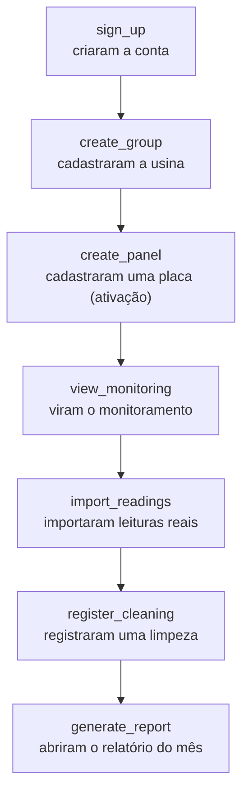
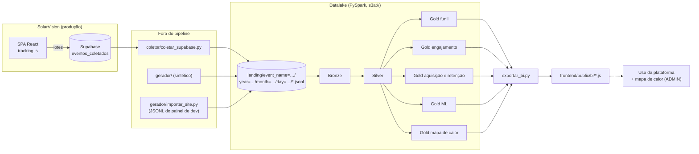

# Enunciado — datalake de uso do SolarVision

> Adaptação do enunciado do projeto-modelo do professor (datalake de tracking da DadosPro) para a nossa plataforma. A arquitetura, os requisitos (R1 a R11) e a forma de avaliar são os mesmos; o que muda é o produto instrumentado: em vez de uma landing de curso, **o próprio SolarVision**. Um glossário resumido dos termos está no fim desta página.

## 1. O problema

O SolarVision é uma plataforma web de monitoramento de energia solar (React na Vercel + Supabase). Sabemos quantas usinas e placas estão cadastradas, mas **não sabemos como as pessoas usam a plataforma**: onde desistem do cadastro, quais telas usam, de onde vêm os usuários que ficam e quem está perto de abandonar.

O app foi instrumentado com **20 eventos de uso** (o `frontend/src/lib/tracking.js`), que chegam a um bucket S3 como arquivos JSON Lines. Vamos construir um **datalake em arquitetura medalhão** (Bronze → Silver → Gold) que transforme esses eventos em **business intelligence do produto**, respondendo a quatro perguntas:

1. **Funil de ativação** — em que etapa entre criar a conta e tirar o primeiro relatório perdemos mais usuários, por canal e por dispositivo?
2. **Engajamento** — quais telas e recursos são usados de verdade? O que as pessoas procuram no seletor de usinas e não encontram?
3. **Aquisição e retenção** — qual canal traz usuários que ativam e voltam, e quem abandona a plataforma?
4. **Previsão** — quais sessões estão perto de ativar (cadastrar a primeira placa), e que perfis de uso existem?

**Ativar** é o momento em que o usuário cadastra a primeira placa: a partir dela o SolarVision passa a estimar a geração e a plataforma começa a entregar valor.



Competências avaliadas (as mesmas do projeto-modelo): ingestão de dado semiestruturado com schema explícito; arquitetura medalhão com um job por camada; validação com motivo de rejeição; deduplicação; sessionização com window functions; identity stitching; modelagem de métricas de funil e retenção; Spark ML sem vazamento de informação; leitura e escrita em armazenamento de objetos (S3).

## 2. O produto

As telas, os 20 eventos, os `params` e os elementos clicáveis estão no [CONTRATO_EVENTO.md](CONTRATO_EVENTO.md).

**Canais de aquisição** (`traffic.source / traffic.medium`): `google / organic`, `google / cpc`, `instagram / social`, `linkedin / social`, `indicacao / referral`, `newsletter / email` e `direct / (none)`.

**Dispositivos:** `desktop`, `tablet`, `mobile`.

## 3. O que recebemos e o que entregamos

### Recebido pronto (projeto-modelo do professor, em `datalake/`)

| Item | Para quê |
| --- | --- |
| `docker-compose.yml` + `Dockerfile` | `floci` (S3 emulado), `app` (Python 3.11, Java 17, PySpark 4.2 com `s3a`) e `explorador` (console em http://localhost:8501) |
| `pipeline/comum.py` | SparkSession para o floci, caminhos `s3a://`, `exigir_camada`, leitura e gravação das partições `event_name=…` |
| `explorador/` | console estilo S3/Glue/Athena: ver o bucket, rodar jobs e workflows, consultas SQL |
| `gerador/` (base) | lotes, destinos (S3 ou pasta), eventos e importação de JSONL |

### Construído por nós

| Item | Para quê |
| --- | --- |
| `frontend/src/lib/tracking.js` | a `track()` do app: identidade, contexto, `element_id` e envio em lotes |
| `supabase/migrations/…_coletor_eventos.sql` | tabela `eventos_coletados` (só insert) e o opt-out do rastreamento |
| `coletor/coletar_supabase.py` | leva os eventos reais do Supabase para a landing |
| `gerador/` (catálogo, jornadas, elementos, sujeira) | simula semanas de uso do SolarVision, com defeitos, para dar volume |
| `pipeline/` | os jobs Bronze, Silver, cinco Golds, a exportação para o app e o script de sequência |
| `RELATORIO.md` | as respostas às quatro perguntas e a seção "Qualidade do dado" |
| Página **Uso da plataforma** e overlay do **mapa de calor** no app | o BI de volta para o produto |

## 4. Arquitetura



Todas as camadas ficam no bucket `solarvision-datalake`, em Parquet: `landing/`, `bronze/`, `silver/`, `gold/`.

## 5. Requisitos

### 5.1 Arquitetura (iguais ao projeto-modelo)

- **R1.** PySpark lendo de `landing/` e gravando todas as camadas no mesmo bucket, em Parquet, **só pelo Spark com `s3a://`** (sem `boto3` no pipeline), no contêiner `app`.
- **R2.** Um job por camada: Bronze, Silver, cinco Golds (funil, engajamento, aquisição e retenção, ML, mapa de calor) e a exportação para o app. Cada job confere a camada de que depende com `exigir_camada`.
- **R3.** Um script que roda os oito jobs em sequência (`pipeline/rodar_tudo.py`). Ele não gera dados.
- **R4.** Bronze append-only, schema explícito, particionada `event_name=/year=/month=/day=` (dia de coleta) e com proveniência (`arquivo_origem`, `ingerido_em`).

### 5.2 Silver

- **R5.** Deduplicação por `event_id`.
- **R6.** `params` extraídos para colunas tipadas, incluindo `element_id`.
- **R7.** Validação com **motivo de rejeição**, gravada em `silver/eventos_rejeitados/`, um motivo por linha:

  | Motivo | Condição |
  | --- | --- |
  | evento fora do catálogo | `event_name` fora dos 20 eventos do contrato |
  | timestamp ausente ou futuro | `event_ts` nulo ou posterior ao instante de ingestão |
  | ação sem id | `create_group`/`delete_group` sem `group_id`; `create_panel`, `import_readings`, `register_cleaning` ou `delete_panel` sem `panel_id` |
  | valor numérico inválido | `rows` ou `rows_ignored` negativos em `import_readings`; `potencia_wp` ≤ 0 em `create_panel` |
  | marco fora do padrão | `percent_scrolled` ∉ {25, 50, 75, 90} |
  | exclusão órfã | `delete_panel`/`delete_group` cujo id não existe em nenhum `create_panel`/`create_group` válido |

- **R8.** Sessionização própria: sessão nova quando o mesmo `user_pseudo_id` fica mais de 30 minutos sem evento. **`session_hint` não pode ser usado.**
- **R9.** Identity stitching: todo evento de um `user_pseudo_id` que em algum momento tenha `user_id` recebe esse `user_id`, inclusive os anteriores ao login.
- **R10.** `silver/itens/`: `items[]` explodido, uma linha por placa por evento.

### 5.3 Gold: as 15 tabelas

| Job | Tabela | Conteúdo mínimo |
| --- | --- | --- |
| Funil | `funil_ativacao` | pessoas com `sign_up` que atingiram cada etapa de `sign_up → create_group → create_panel → view_monitoring → import_readings → register_cleaning → generate_report`, conversão sobre a etapa anterior e sobre o topo; total e por canal × dispositivo |
| | `funil_login` | sessões com `page_view` de `/login` ou `/register` → sessões com `login` ou `sign_up`, por canal |
| Engajamento | `sessoes` | uma linha por sessão: duração, eventos, telas distintas, scroll máximo, ativou (`create_panel`), canal, dispositivo |
| | `uso_telas` | por página: visualizações, sessões, tempo médio na tela e scroll médio |
| | `buscas_seletor` | termo, total de buscas, buscas sem resultado |
| | `saidas_downloads` | cliques de saída por domínio; relatórios impressos por mês de referência |
| Aquisição e retenção | `ativacao_diaria` | por **data do sign_up** e canal: novos usuários, ativados, taxa de ativação |
| | `retencao` | por canal do sign_up: pessoas elegíveis e retidas em D1, D7 e D14 |
| | `taxa_abandono` | por canal: pessoas que ativaram e quantas abandonaram (excluíram todas as placas que criaram) |
| | `cadastro_para_ativacao` | pessoas com sign_up, quantas ativaram depois e a mediana de dias entre sign_up e a primeira placa; total e por canal |
| ML | `propensao_ativacao` | probabilidade de ativação por sessão, com modelo de classificação |
| | `metricas_modelo` | AUC, F1, precisão e recall no teste, e a lista de features |
| | `segmentos_usuarios` | grupo de cada pessoa (K-Means) e o perfil médio de cada grupo |
| Mapa de calor | `mapa_calor_cliques` | por `pagina` e `element_id`: `cliques`, `sessoes`, `sessoes_na_pagina`, `taxa_clique`, `intensidade` (nomes exatos, R11) |
| | `mapa_calor_rolagem` | por `pagina` e `marco` (0, 25, 50, 75, 90): `sessoes_que_chegaram`, `pct_sessoes` (nomes exatos, R11) |

**Restrição do modelo de propensão:** as features só podem usar o comportamento da sessão **antes do primeiro `create_group`**: telas vistas, rolagem, cliques, buscas, alertas, canal, dispositivo, se a conta foi criada na sessão e o histórico de sessões anteriores. Qualquer evento de cadastro (`create_group` em diante) já praticamente revela a ativação: usá-lo é vazamento.

### 5.4 Definições

1. **Caminhos:** eventos da Bronze e da Silver direto na raiz da camada (`event_name=…/year=…/month=…/day=…`); `silver/itens/` (particionada por `year/month/day`), `silver/eventos_rejeitados/` e `gold/<tabela>/` em pastas próprias.
2. **Pessoa:** `user_id` resolvido (R9); sem ele, `user_pseudo_id`.
3. **Canal de uma sessão:** `"<source> / <medium>"` do primeiro evento da sessão. **Dispositivo:** `device.category` do primeiro evento.
4. **Canal de uma pessoa:** o canal da sessão do seu primeiro `sign_up`.
5. **Funil:** uma pessoa conta numa etapa se teve o evento em qualquer momento, sem exigir as anteriores. Conversão sobre a etapa anterior = pessoas da etapa ÷ pessoas da etapa anterior.
6. **Ativação:** primeiro `create_panel` válido da pessoa. Dias até ativar = diferença em segundos entre o primeiro `sign_up` e o primeiro `create_panel` estritamente depois dele ÷ 86400; mediana com `percentile_approx(dias, 0.5)`.
7. **Retenção Dn:** a pessoa voltou se teve uma sessão iniciada pelo menos *n* dias depois do primeiro `sign_up`. Só entram como **elegíveis** em Dn as pessoas cujo `sign_up` foi pelo menos *n* dias antes do último evento do datalake (sem isso, quem chegou no fim do período parece que não voltou).
8. **Abandono:** pessoa que ativou e cujas placas criadas foram todas excluídas (por `delete_panel` ou `delete_group`).
9. **Propensão:** uma linha por sessão; rótulo verdadeiro quando a sessão contém `create_panel`. A divisão treino/teste é **por pessoa** (todas as sessões de uma pessoa no mesmo lado), para o modelo não "reconhecer" a pessoa.
10. **Datas:** UTC.
11. **Métricas do modelo:** F1, precisão e recall referem-se à classe positiva (sessão que ativou).
12. **Página:** caminho de `page_location` sem domínio, `#` e `?`; a raiz vira `/`.

### 5.5 Mapa de calor no app (R11)

Um job lê `mapa_calor_cliques` e `mapa_calor_rolagem` e grava `frontend/public/bi/mapa_calor.js` numa linha:

```js
window.MAPA_CALOR = {"gerado_em": "2026-10-20T21:00:00Z", "cliques": [ ... ], "rolagem": [ ... ]};
```

O botão **Mapa de calor** (só ADMIN) pinta, na tela atual do app, os elementos `data-heat` com a intensidade da Gold. O mesmo job grava `frontend/public/bi/bi.js` com as tabelas pequenas da Gold para a página **Uso da plataforma**. Os dois arquivos são resultado gerado e não entram no git (são dados de negócio).

## 6. Como rodar

```bash
cd datalake
docker compose up -d floci
docker compose run --rm app python gerador/gerar_eventos.py      # uso sintético (landing)
docker compose run --rm app python pipeline/rodar_tudo.py        # Bronze → Silver → Golds → exportação
docker compose up -d explorador                                  # console em http://localhost:8501
```

Eventos reais: `docker compose run --rm app python coletor/coletar_supabase.py` (com `SUPABASE_URL` e `SUPABASE_SERVICE_KEY` no `datalake/.env`) ou o JSONL do painel de desenvolvedor com `gerador/importar_site.py`.

## 7. Avaliação (a mesma rubrica do projeto-modelo)

| Critério | Pontos |
| --- | --- |
| Arquitetura (R1–R4) | 15 |
| Silver (R5–R10) | 25 |
| Gold (5.3) e mapa de calor no app (R11) | 30 |
| Relatório: respostas às quatro perguntas com números da Gold | 20 |
| Qualidade do dado: duplicatas, rejeições e armadilhas | 10 |

## Glossário (resumo)

- **Evento de uso:** registro de uma ação do usuário no app, em JSON.
- **Landing / Bronze / Silver / Gold:** dado bruto que chegou / cópia fiel em Parquet com proveniência / dado limpo, sem duplicatas, com sessões e identidades / tabelas que respondem às perguntas.
- **Ativação:** cadastrar a primeira placa.
- **Retenção Dn:** voltar à plataforma *n* dias ou mais depois de criar a conta.
- **Abandono:** excluir todas as placas que criou.
- **Sessão:** uma visita; nova sessão após 30 min sem evento.
- **Identity stitching:** ligar o navegador anônimo à pessoa logada.
- **Propensão:** probabilidade de a sessão terminar em ativação.
- **Vazamento de informação:** usar como feature algo que já entrega a resposta (aqui, os eventos de cadastro).
- **Clusterização (K-Means) e silhueta:** dividir as pessoas em grupos parecidos; a silhueta (−1 a 1) diz se os grupos estão bem separados.
