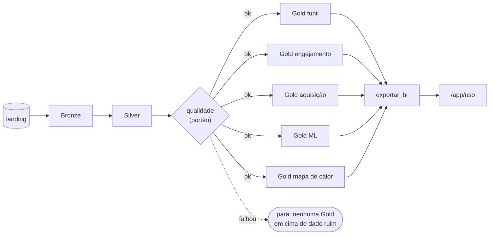

# Funil, engajamento e workflow no datalake de uso

Este documento liga três conceitos do curso a decisões concretas no datalake do SolarVision. O material de referência é o da pasta `aula-big-data`:
- a arquitetura medalhão, ETL/ELT e Data Storytelling (*Introdução ao ETL*);
- estratégias de carga, CDC e orquestração (*Engenharia de Dados para Iniciantes*);
- o enunciado do projeto-modelo do professor.

Para cada conceito há quatro partes: o que é, o que já tínhamos, o que entrou nesta versão e por quê.



## 1. Funil: onde a jornada vaza

**Conceito.** Um funil é a sequência de etapas até um objetivo. Em cada etapa parte das pessoas desiste. No projeto-modelo a jornada é de compra (`view_item_list → … → purchase`) e a unidade é a sessão. A regra 5.4.4 do enunciado diz que uma sessão conta numa etapa se teve aquele evento **em qualquer momento**, sem exigir as anteriores.

**Adaptação ao SolarVision.** O nosso "comprar" é **ativar**: criar a conta, cadastrar a usina e a primeira placa, e passar a usar o monitoramento. Isso leva mais de uma sessão (cria a conta hoje, cadastra a placa amanhã), então a unidade é a **pessoa** (`user_id` resolvido pelo identity stitching, R9), não a sessão:

`sign_up → create_group → create_panel → view_monitoring → import_readings → register_cleaning → generate_report`

**O que já tínhamos.**
- `funil_ativacao`: pessoas por etapa, com a regra "qualquer momento", e conversão sobre a etapa anterior e sobre o topo, no total e por canal × dispositivo.
- `funil_login`: de quem abriu `/login` ou `/register`, quantos entraram. É o equivalente ao `funil_lead` do professor.

**O que entrou: `funil_ordenado`.** A regra "qualquer momento" diz *quantos* chegaram a cada etapa, mas não *por onde* passaram. Quem cadastra uma placa sem ter criado a usina antes aparece em `create_panel` mesmo tendo pulado `create_group`. No funil ordenado, a pessoa só conta na etapa *k* se passou pelas anteriores **nessa ordem** (o primeiro evento da etapa *k* em ou depois da etapa *k − 1*). Cada etapa também ganha:
- `perdidas`: quantas pessoas pararam ali (o "vazamento", em número absoluto);
- `mediana_horas_desde_anterior`: quanto tempo quem seguiu levou desde a etapa anterior, para saber se a etapa é difícil ou só demorada;
- `maior_vazamento`: a etapa que mais perde gente em cada recorte, a resposta direta à pergunta do funil.

A diferença entre os dois funis também é informação: um `create_panel` "em qualquer momento" bem maior que "na ordem" quer dizer que muita gente chega lá por um caminho que o funil não previa.

**Como foi feito.** Repetir `join` etapa por etapa dobrava o plano do Spark a cada passo e estourava a memória do driver. A versão final faz **uma passada só** por pessoa: `collect_list` dos eventos do funil, `array_sort` por tempo e `aggregate` (função de ordem superior) com o estado *próxima etapa esperada + instantes alcançados*. Depois, um `explode` das sete etapas monta a grade completa por recorte sem nenhum `join`.

## 2. Engajamento: o que é usado e com que frequência

**Conceito.** Engajamento mede a intensidade do uso, não a conversão. No projeto-modelo são quatro tabelas:
- `sessoes`: um resumo de cada visita;
- `retencao_video`: de quem deu play, quantos chegaram a 10, 25, 50, 75 e 100 %;
- `buscas_faq`: o que se procura e não se acha;
- `saidas_downloads`.

**O que já tínhamos.**
- `sessoes`;
- `uso_telas` (views, tempo médio e rolagem por tela);
- `buscas_seletor` (buscas sem resultado: lacunas do produto);
- `saidas_downloads`.

**O que entrou.** O SolarVision não tem vídeo. O equivalente do `retencao_video` num produto de uso recorrente é saber **quem adota cada recurso** e **quem volta**:

- `adocao_recursos`: para cada recurso do produto (monitoramento, troca de visão, busca, importação de leituras, limpeza, recomendação de limpeza, relatório, impressão, alertas e configurações), mostra das pessoas ativas:
  - quantas usaram e a taxa de adoção;
  - os usos e os dias de uso por pessoa.

  Um recurso com adoção baixa é candidato a sair ou a ficar mais visível. Um recurso adotado mas usado num dia só não criou hábito.
- `atividade_diaria`: o **DAU** (pessoas ativas no dia), o **WAU** e o **MAU** (janelas móveis de 7 e 28 dias) e a **aderência DAU/MAU** (de quem usa no mês, que fração aparece num dia qualquer).

  A coluna `janela_completa` avisa quando a janela de 28 dias ainda não fechou. Sem ela, os primeiros dias do período mostrariam um MAU falsamente baixo e uma aderência falsamente alta, uma armadilha clássica dessa métrica.

## 3. Workflow: a ordem, o portão e o reprocessamento

**Conceito.** Um workflow é o grafo de dependências entre os jobs: cada job só roda quando os de que depende terminaram com sucesso, e quem não depende de ninguém pode rodar em paralelo. No projeto-modelo esse grafo é a tela *Glue · Workflows* do explorador ("se uma etapa queima, você não serve o resto"). O curso aponta o **Apache Airflow** como o passo seguinte para orquestrar e agendar os jobs PySpark.

**O que já tínhamos.**
- `pipeline/workflows/medalhao.json` (hoje em [`workflows/`](../workflows/README.md), com as etapas numeradas): Bronze → Silver → as cinco Golds em paralelo, duas por vez → exportação;
- `rodar_tudo.py` (R3): uma lista fixa com os oito jobs.

**O que entrou.**

1. **Portão de qualidade (`qualidade.py`).** Um job entre a Silver e as Golds, com estas regras:

   | Regra | Tipo | Por quê |
   | --- | --- | --- |
   | silver tem eventos válidos | bloqueante | sem dado, toda Gold sairia vazia e pareceria "zero uso" |
   | reconciliação: bronze única = silver + rejeitados | bloqueante | nenhum evento pode sumir entre as camadas sem motivo registrado |
   | `event_id` único na silver | bloqueante | duplicata infla funil e engajamento |
   | pessoa e sessão preenchidas | bloqueante | são as chaves de todas as Golds |
   | taxa de rejeição ≤ 10 % | bloqueante | a sujeira esperada do coletor é ~3 %: acima disso, o problema é de coleta |
   | taxa de duplicatas ≤ 5 % | alerta | o coletor reenvia ~1 % dos lotes; mais que isso é sinal, mas a dedup resolve |

   Se uma regra bloqueante falha, o job sai com código 1: o `rodar_tudo` e o workflow param ali e **as Golds do último dia bom continuam valendo**, em vez de serem trocadas por números errados. O resultado vai para `gold/qualidade_dados` em **append**, uma linha por regra a cada execução. É a estratégia *Incremental Append* da aula aplicada à saúde do dado: o histórico mostra quando a coleta começou a piorar. As outras Golds usam *Full Replace*, porque são recalculadas inteiras a partir da Silver.

2. **Uma fonte só para a ordem.** O `rodar_tudo.py` não tem mais a lista fixa. Ele lê o mesmo `medalhao.json` que o explorador roda e ordena os jobs por dependência (ordenação topológica em níveis). Dependência desconhecida ou ciclo são erros com mensagem. Antes, incluir um job exigia mudar dois arquivos que podiam divergir; agora o grafo é o contrato.

3. **Reprocessamento parcial.** `--a-partir-de JOB` roda aquele job e todos os que dependem dele, direta ou indiretamente. Mudou só a regra do funil? `--a-partir-de gold_funil` roda `gold_funil` e `exportar_bi` em vez de refazer Bronze e Silver. O `--limpar` junto com ele é recusado, porque apagaria as camadas de que o reprocessamento depende.

```bash
docker compose run --rm app python pipeline/rodar_tudo.py                          # tudo, na ordem do grafo
docker compose run --rm app python pipeline/rodar_tudo.py --a-partir-de gold_funil # só o funil e a exportação
docker compose run --rm app python pipeline/qualidade.py                           # só o portão
```

## 4. Do Gold à decisão (Data Storytelling)

A aula termina em "o trabalho não termina na camada Gold; ele termina na mente da audiência". A página **Uso da plataforma** (`/app/uso`, só ADMIN) ganhou:
- o KPI de **aderência DAU/MAU**;
- o funil com as duas leituras lado a lado e uma frase com o **maior vazamento** e o tempo mediano até ele;
- a linha de **pessoas ativas** (DAU/WAU/MAU), com aviso quando o mês ainda não fechou;
- a lista de **adoção dos recursos**;
- o cartão de **qualidade do dado**, com o resultado do portão na última execução: quem lê os números sabe se pode confiar neles.

As séries novas usam três cores fixas (azul, âmbar, magenta), validadas para daltonismo e contraste nos temas claro e escuro. Cada gráfico tem legenda, e nenhuma informação depende só da cor.

## 5. Números desta execução

Execução no Docker, de 04/11/2026, com o gerador padrão (3.000 usuários e 28 dias). **Os eventos são sintéticos:** os números mostram que as tabelas respondem às perguntas, mas as conclusões sobre o produto valem como hipóteses a confirmar com o uso real, que chega pelo coletor do Supabase.
- 57.094 eventos na Bronze;
- 54.789 válidos na Silver, em 6.450 sessões de 2.997 pessoas.

### Portão de qualidade

As seis regras passaram:

| Regra | Valor | Limite |
| --- | --- | --- |
| reconciliação (eventos sumidos) | 0 | = 0 |
| `event_id` repetido na silver | 0 | = 0 |
| pessoa ou sessão vazias | 0 | = 0 |
| taxa de rejeição | 3,06 % | ≤ 10 % |
| taxa de duplicatas | 1,01 % | ≤ 5 % (alerta) |

**Teste do bloqueio.** Rodamos o mesmo job com o limite de rejeição em 1 %. Ele marcou `[FALHOU] taxa de rejeição 0.0306`, saiu com código 1 e escreveu "as Golds não foram recalculadas". Depois, `rodar_tudo.py --a-partir-de qualidade` refez só o portão, as cinco Golds e a exportação, sem tocar em Bronze e Silver.

### Funil de ativação (total)

| Etapa | Em qualquer momento | Na ordem | Perdidas | Conversão (na ordem) | Mediana desde a anterior |
| --- | ---: | ---: | ---: | ---: | ---: |
| `sign_up` | 1.500 | 1.500 | — | — | — |
| `create_group` | 765 | 765 | **735** | 51,0 % | 5 min |
| `create_panel` | 663 | 632 | 133 | 82,6 % | 1 min |
| `view_monitoring` | 491 | 456 | 176 | 72,2 % | 62,6 h |
| `import_readings` | 213 | 201 | 255 | 44,1 % | 42,1 h |
| `register_cleaning` | 223 | 86 | 115 | 42,8 % | 36,4 h |
| `generate_report` | 299 | 23 | 63 | 26,7 % | 83,1 h |

**Como ler.**
- **O maior vazamento é logo depois do cadastro.** Metade de quem cria a conta não cadastra a usina. Quem cadastra, faz isso em minutos. É a etapa mais barata de atacar: um assistente de primeiro acesso, ou cadastrar usina e placa no mesmo formulário.
- Essa etapa é o maior vazamento em quase todos os recortes de canal × dispositivo. As exceções têm pouca gente: indicação e newsletter no desktop perdem mais na **importação de leituras**, ou seja, quem chega bem informado trava no CSV.
- **Entre `create_panel` e `view_monitoring` a pessoa leva cerca de 2,6 dias** (mediana). Ela cadastra e só volta quando há geração para ver. Um e-mail "sua primeira semana de geração" no D2 encurtaria esse caminho.
- **A ordem estrita derruba o fim do funil:** 299 pessoas abrem o relatório, mas só 23 chegam a ele passando por todas as etapas anteriores.
  - Isso não quer dizer que 276 pessoas "erraram o caminho". `register_cleaning` e `import_readings` são recursos opcionais, não degraus obrigatórios.
  - **Leitura crítica:** o funil estrito vale para a parte linear da jornada (conta → usina → placa → monitoramento). Depois disso, a pergunta certa é de adoção, e por isso existe `adocao_recursos`.

### Engajamento

- **Adoção dos recursos** (das 2.997 pessoas ativas):

  | Recurso | Adoção | Usos por pessoa |
  | --- | ---: | ---: |
  | Monitoramento | 29,7 % | 3,1 |
  | Troca de visão | 25,2 % | 2,7 |
  | Alertas | 18,2 % | 1,6 |
  | Relatório | 17,6 % | 1,6 |
  | Recomendação de limpeza | 14,6 % | 1,4 |
  | Registro de limpeza | 13,9 % | 1,4 |
  | Importação de leituras | 13,0 % | 1,1 |
  | Configurações | 10,6 % | 1,1 |
  | Busca no seletor | 10,3 % | 1,3 |
  | Impressão do relatório | 8,1 % | 1,2 |

  - O monitoramento é o recurso que cria hábito: 3,1 usos em 3,1 dias diferentes por pessoa.
  - A importação de leituras é usada uma vez só (1,1 uso por pessoa). Hipótese: subir o CSV à mão não se sustenta. Se o uso real confirmar, é o argumento para integrar direto com o inversor.
  - A recomendação de limpeza (14,6 %) e o registro da limpeza (13,9 %) têm adoções próximas. Para dizer que "quem vê a recomendação, limpa", falta cruzar por pessoa; fica como próxima análise.
- **Atividade:** na última data com a janela de 28 dias completa, foram 313 pessoas no dia, 1.287 na semana e 2.997 no mês, uma aderência DAU/MAU de 10,4 %.
  - O último dia do período (29/09) teve só 3 pessoas, porque ainda estava em andamento.
  - Ele derrubava o KPI para 0,1 %. Por isso a tabela ganhou `dia_completo` e o painel usa o último dia fechado.
