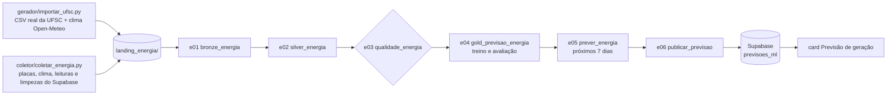

# Previsão da energia dos próximos 7 dias

O card "Previsão de geração" do app mostrava só a **estimativa física**: a previsão do tempo do Open-Meteo no plano da placa × Wp × PR fixo de 0,82 (`potencia_estimada`). Contra a medição real, essa conta erra cerca de 15% no dia e 6% no mês ([validação](../../docs/validacao/RESULTADO.md)).

O modelo deste datalake **não substitui a física: corrige**.
- Ele aprende, dia a dia, a **razão entre a geração real e a estimada**: o PR de verdade da placa, a sujeira, a degradação, o efeito da temperatura e dos dias nublados.
- A previsão é `estimado físico × razão prevista`, com uma faixa provável (P10 a P90).
- Onde não há leitura real, a razão fica perto de 1 e vale a física.

## O caminho do dado



Workflow: [`workflows/previsao_energia.json`](../workflows/previsao_energia.json). Roda pelo console (Glue · Workflows) ou por `python pipeline/rodar_tudo.py --workflow previsao_energia`.

| Camada | O que guarda |
| --- | --- |
| `landing_energia/<tabela>/fonte=<ufsc\|app>/` | JSON Lines de `placas`, `clima` (início da hora em UTC; `previsao` marca as horas que ainda não aconteceram), `leituras` (potência média e intervalo) e `limpezas`. O layout está em `gerador/landing_energia.py` |
| `bronze_energia/` | o mesmo dado em Parquet, append-only, com `arquivo_origem` e `ingerido_em` |
| `silver_energia/horas` | uma linha por placa e hora com clima: irradiância, temperatura, chuva, a estimativa física (a mesma fórmula do banco) e o real medido, quando a hora tem pelo menos 45 min de leitura |
| `silver_energia/dias_medidos` | o real por dia local e se o dia foi medido por inteiro: começa até as 9h, vai além das 16h e não tem buraco maior que 15 min. É o critério da validação, porque o datalogger só grava quando há geração |
| `silver_energia/rejeitados` | leitura de placa desconhecida, potência negativa ou acima de 1,2 × Wp, geração sem sol |
| `gold/qualidade_energia` | o portão: horas com clima, pelo menos 180 dias completos para treinar, rejeição ≤ 10% (bloqueantes) e placas do app com a previsão do tempo da semana (alerta) |
| `gold/energia_diaria` | uma linha por placa e dia: features, estimado, real, razão e o conjunto (`treino`, `teste` ou `previsao`) |
| `gold/metricas_previsao`, `gold/importancia_features` | o erro de cada método no teste e o peso de cada feature |
| `gold/previsao_7dias` | a previsão de cada placa do app, de hoje a hoje + 6 |

## O modelo

- **Alvo:** `razao = real ÷ estimado` do dia, só em dias medidos por inteiro e com sol o bastante (estimado ≥ 0,5 × Wp em Wh), limitada a 1,6.
- **Features**, todas conhecidas na hora de prever a semana:
  - irradiação do dia (kWh/m² no plano da placa) e temperatura média com sol;
  - chuva do dia;
  - dia do ano (seno e cosseno);
  - idade da placa;
  - dias desde a última lavagem (limpeza registrada ou chuva de 5 mm ou mais, o limiar do app);
  - `razao_ref`: a razão média dos dias completos **entre 37 e 8 dias antes**;
  - `tem_historico`: se essa janela teve ao menos 10 dias.
- **Sem vazamento:** a janela de 37 a 8 dias antes já está no passado para qualquer dia até 7 à frente, então o treino e a previsão da semana usam a mesma definição. Inclinação, azimute e Wp ficam de fora, porque na referência eles são constantes (a física já os usa no estimado).
- **Algoritmo:** `GBTRegressor` do Spark ML num `Pipeline`, como o `gold_ml.py` do uso.
- **Divisão no tempo:** o último ano medido é o **teste**, e o resto é o treino.
  - A profundidade, as iterações e o passo do GBT saem de uma grade pequena, escolhidos pelo erro semanal numa **validação** (o último ano do treino). O teste só é usado uma vez, no fim.
  - Com menos de dois anos medidos, o teste é o último quinto.
- **Faixa:** os quantis 10% e 90% do erro relativo do modelo no teste viram o P10 e o P90 da previsão.

## Resultado na referência da UFSC

Dado de treino e teste: o sistema real do laboratório Fotovoltaica-UFSC, de 2018-01 a 2023-03. São 1.266 dias medidos por inteiro: 1.148 de treino e 118 de teste. O teste é pequeno porque o último ano tem meses de falha e poucos dias completos até dezembro de 2022.

| Método | nMAE no dia | nMAE na semana | MAPE no mês |
| --- | ---: | ---: | ---: |
| Física pura (PR 0,82, o que o app mostra hoje) | 15,5% | 6,6% | 5,2% |
| Física com k calibrado no treino | 15,9% | 8,1% | 7,3% |
| Física × razão dos dias recentes | 18,0% | 8,8% | 5,2% |
| **Modelo (GBT sobre a física)** | **11,9%** | **5,1%** | **2,8%** |

Os números saem de [`previsao_energia/metricas_previsao.csv`](previsao_energia/metricas_previsao.csv), exportado da `gold/metricas_previsao` desta execução, com os pesos das features em [`importancia_features.csv`](previsao_energia/importancia_features.csv) e o portão em [`qualidade_energia.csv`](previsao_energia/qualidade_energia.csv). Hiperparâmetros escolhidos na validação: profundidade 2, 100 iterações, passo 0,1. Faixa: P10 = −20,3% e P90 = +26,1% em torno da previsão do dia.

- O modelo erra **23% menos no dia** e **22% menos na semana** que a física que o app mostra hoje.
- Calibrar um k fixo no treino piora: o sistema perde ~2% ao ano (degradação e sujeira acumulada). Por isso a idade da placa entra no modelo.
- As features que mais pesam são a irradiação do dia (0,27), a chuva (0,18), a idade (0,13) e a estação do ano (seno 0,11 e cosseno 0,10). O modelo aprende que, em dia nublado e chuvoso, a física superestima, e que a razão cai com o tempo.

## Limites

- **Um sistema só de referência.** A UFSC é um sistema CdTe, com orientação e Wp inferidos na validação. Nas placas do app sem leituras, o modelo aplica o que aprendeu ali, e a razão fica perto de 1. Quanto mais gente importar o CSV do inversor, mais a correção vira da própria placa (`razao_ref`).
- **Clima do treino ≠ clima da previsão.** O treino e o teste usam o clima que aconteceu (arquivo do Open-Meteo). Na semana que vem, o clima é a previsão do tempo, e o erro dela soma ao do modelo. O app já mede esse erro (`acerto_previsao`). O próximo passo é treinar com a previsão histórica do Open-Meteo.
- **Faltam dados por hora:** cobertura de nuvens e vento, que o Open-Meteo tem e o app ainda não guarda (`docs/PREDICAO-E-SENSORES.md`, fase 1).

## Como rodar

```bash
cd datalake
docker compose run --rm app python gerador/importar_ufsc.py          # a referência real (uma vez)
.\segredo.ps1 run --rm app python coletor/coletar_energia.py     # as placas do app (precisa da chave)
docker compose run --rm app python pipeline/rodar_tudo.py --workflow previsao_energia
```

A publicação (`e06`) precisa da `SUPABASE_URL` no `datalake/.env`, da service key guardada pelo `segredo.ps1` ([SETUP](../SETUP.md)) e da migration `20261124100000_previsoes_ml.sql` aplicada. Sem elas, a previsão fica só na Gold.
