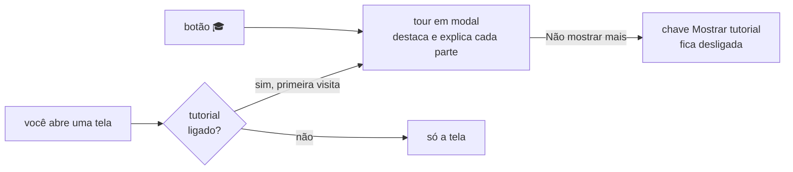
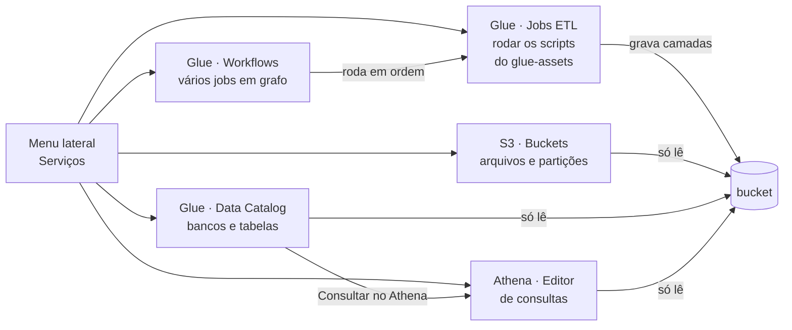
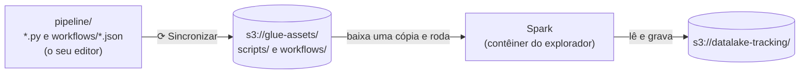
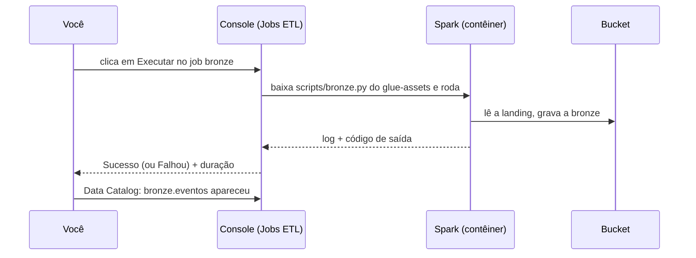
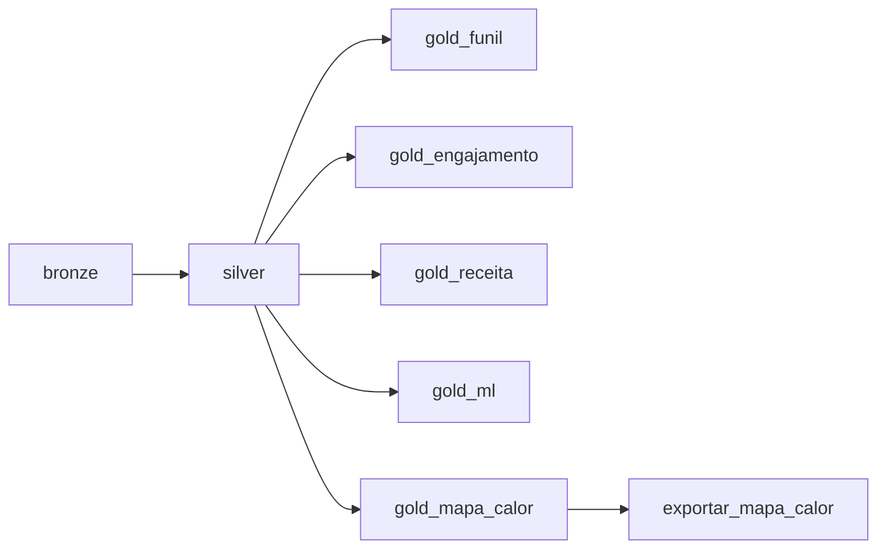
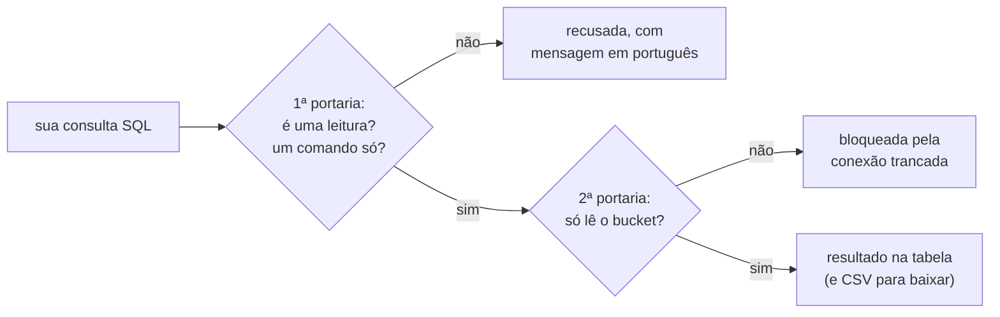

# Explorador do datalake (console de estudo)

Um site que roda no seu computador para **olhar os buckets** sem escrever código: ver os arquivos que o gerador e o seu pipeline gravaram, ver o catálogo de tabelas, **rodar os seus jobs** (um a um ou juntos num **workflow**) e fazer **consultas SQL** sobre os dados.

> **Pense assim:** o explorador é uma **vitrine de vidro** na frente do bucket, com uma bancada de trabalho ao lado. Pela vitrine (S3, Data Catalog e Athena) você vê tudo e faz perguntas, mas não mexe em nada. Na bancada (Jobs ETL e Workflows) você manda rodar os jobs que você mesmo escreveu.

## Como abrir

Antes, construa a imagem uma vez (é o Passo 2 do [SETUP.md](../SETUP.md)): `docker compose build app`. O explorador usa essa mesma imagem; sem ela, ele não sobe.

```bash
docker compose up -d floci explorador
```

Abra **http://localhost:8501** no navegador. Para desligar: `docker compose stop explorador`.

## Tutorial em cada tela

Na primeira vez que você abre cada tela, aparece um **tour em modal**: a tela escurece, um contorno laranja destaca um elemento (o menu, a lista de buckets, o editor de SQL…) e um balão explica para que ele serve. Use **Próximo** e **Anterior** para andar pelos passos e **✕** (ou a tecla Esc) para fechar.

> **Pense assim:** é o **guia de um museu** que para em frente a cada peça e conta para que ela serve. Na primeira visita ele te acompanha; depois você anda sozinho e chama o guia só quando quiser.

- **Rever o tour:** clique no botão redondo **🎓**, no canto inferior direito. Funciona mesmo com o tutorial desligado.
- **Desligar:** marque **Não mostrar mais o tutorial** no balão, ou abra o botão **♿** (canto inferior direito) e desligue a chave **Mostrar tutorial**. A escolha fica gravada em `.explorador/preferencias.json` (fora do git) e vale também depois de reiniciar o explorador. Para religar, ligue a chave de novo.



## Botões flutuantes e acessibilidade

No canto inferior direito ficam três botões redondos, sempre à mão:

| Botão | Para que serve |
|---|---|
| **⬆** | volta ao topo da página. Só aparece depois que você rola a tela. |
| **🎓** | abre o tutorial da tela em que você está. |
| **♿** | abre o menu **Tutorial e acessibilidade**. |

No menu **♿** você ajusta o console ao seu jeito de ler e navegar:

- **Tamanho do texto:** A, A+ ou A++ (100%, 115% ou 130%).
- **Alto contraste:** textos e bordas mais escuros; os links continuam azuis.
- **Sublinhar links:** mostra o que é clicável sem depender da cor.
- **Mais espaço entre letras e linhas:** facilita a leitura, por exemplo para quem tem dislexia.
- **Reduzir movimento:** tira animações e a rolagem suave. Se o seu sistema já pede menos movimento, o console obedece sozinho.
- **Voltar ao padrão:** desfaz as opções acima (não mexe no tutorial).

As escolhas ficam gravadas no mesmo `.explorador/preferencias.json` do tutorial.

> **Pense assim:** é a **rampa e o corrimão** de um prédio. Quem precisa usa; para quem não precisa, eles não atrapalham em nada.

O console também foi feito para quem usa **só o teclado** ou um **leitor de tela** (NVDA, JAWS, VoiceOver):

- O primeiro **Tab** da página mostra **Pular para o conteúdo**, que leva direto à tela, sem passar pelo menu.
- O foco do teclado sempre aparece com um contorno azul.
- A página é lida em português e tem regiões com nome: topo, menu de serviços, conteúdo, caminho (breadcrumb) e ajuda.
- Títulos de página e de painel são lidos como títulos, e as tabelas são lidas como tabelas, com linhas, colunas e cabeçalhos.
- Botões só com ícone (⬆, 🎓, ♿, ＋, ✕) têm nome. Os ícones dos status (✔, ✖) são pulados e o leitor diz só "Sucesso" ou "Falhou".
- O que muda sozinho é anunciado sem tirar o foco do lugar: o status das execuções de um job e os resultados de uma consulta do Athena.
- O tutorial em modal recebe o foco ao abrir, prende o Tab dentro do balão, esconde o resto da página do leitor de tela, fecha com Esc e devolve o foco para onde estava.

## As cinco telas: S3, Glue e Athena

O explorador imita o jeito de trabalhar do console da AWS, para você treinar o fluxo que vai usar no mercado. O menu lateral (**Serviços**) tem cinco telas:

> **Pense assim:** é um **simulador de cabine**. Os botões estão no mesmo lugar dos do avião de verdade (o console da AWS), mas tudo roda no seu computador: o floci no lugar do S3, o DuckDB no lugar do Athena e o Spark do contêiner no lugar do Glue. Nada aqui usa nem cobra serviços da AWS.



### S3 · Buckets

- **Lista de buckets:** a tabela mostra **todos os buckets** do floci, com a região, quantos objetos cada um tem, o tamanho total e quem usa o bucket. O `datalake-tracking` vem primeiro: é o do projeto. O `glue-assets` guarda os scripts e workflows dos jobs (veja Jobs ETL) e fica fora do Data Catalog. Os outros (por exemplo, um bucket que você criou para testar) também entram no Data Catalog e no Athena, cada um como um banco com o nome dele. Clique no nome para entrar. Se o `datalake-tracking` estiver vazio ou ainda não existir, um aviso lembra de rodar o gerador.
- **Caminho no topo (breadcrumb):** `Buckets › datalake-tracking › silver › event_name=purchase`. Clique em qualquer parte para voltar até ela.
- **Aba Objetos:** as pastas (📁) e os arquivos (📄) da pasta atual, com tipo, última modificação e tamanho. Clique numa pasta para entrar; clique num `.parquet` ou `.jsonl` para ver as primeiras 100 linhas logo abaixo.
- **Aba Partições:** escolha um dataset e veja uma linha por partição (`event_name`, `year`, `month`, `day`) com quantos arquivos e quantos bytes ela tem. Quando o dataset não tem uma dessas partições, a coluna mostra `—`. O botão "Contar linhas por partição" conta as linhas de cada uma.
- **Aba Propriedades:** nome, região, endpoint, total de objetos, tamanho, quantos datasets e quem usa o bucket.
- Tudo aqui é **somente leitura**, em qualquer bucket: a prévia e a contagem de linhas usam uma conexão trancada no bucket aberto, que não lê nada fora dele.

### Glue · Data Catalog

O **Data Catalog** é a lista de "o que existe no lake": quais bancos, quais tabelas, onde ficam os arquivos e quais colunas cada uma tem.

> **Pense assim:** é o **catálogo de uma biblioteca**. Os livros (os arquivos) estão nas estantes (o bucket); o catálogo diz em que estante está cada livro, de que assunto ele é e como ele é organizado, sem você precisar andar pelos corredores.

- **Bancos de dados:** um por camada do medalhão: `landing`, `bronze`, `silver` e `gold`, cada um com a sua localização `s3://datalake-tracking/<banco>/`. Depois deles vem **um banco para cada outro bucket** do floci, com o nome do bucket (`rascunho-turma` vira o banco `rascunho_turma`, em `s3://rascunho-turma/`). A coluna **Bucket** diz de onde vem cada banco.
- Se uma tabela de algum bucket não puder ser lida (um arquivo estragado, por exemplo), ela fica de fora e um aviso no topo diz qual e por quê; o resto do catálogo continua funcionando.
- **Tabelas do banco:** nome, formato (Parquet ou JSON), localização, quantas partições e quantas colunas.
- **Detalhe da tabela:** no topo, o painel **Visão geral da tabela** (banco, localização, classificação, chaves de partição, quantos arquivos e o nome para usar no Athena); embaixo, duas abas:
  - **Esquema:** as colunas e os tipos; as chaves de partição aparecem marcadas. Um tipo `struct` (ou `struct[]`, uma lista de structs) aparece só com essa palavra, em azul: clique nele para abrir um **overlay com a tipagem interna** (os campos de dentro, em árvore), em vez de ver o tipo inteiro numa linha enorme;
  - **Partições:** uma linha por partição, com arquivos e tamanho.
- O botão **Consultar no Athena** abre uma aba nova no editor já com `SELECT * FROM <banco>.<tabela> LIMIT 10`.

### Glue · Jobs ETL

Aqui ficam os **seus jobs**. Como no Glue de verdade, onde o script de um job fica guardado no S3, os jobs do console moram **dentro do floci**, num bucket só para eles: o `glue-assets`, separado do datalake.

```
s3://glue-assets/scripts/<job>.py          os seus jobs (e o comum.py, que eles importam)
s3://glue-assets/workflows/<nome>.json     os seus workflows
```

Você continua escrevendo os arquivos em `pipeline/`, no seu editor. Para eles chegarem ao floci, clique em **⟳ Sincronizar**, no topo das telas Jobs ETL e Workflows. Passe o mouse no botão (ou chegue nele com o Tab) para ver a explicação e quantos arquivos estão esperando; o botão fica laranja quando há algo para enviar. Ele funciona como um espelho:

- o que é **novo ou mudou** em `pipeline/*.py` e `pipeline/workflows/*.json` é enviado;
- o que você **apagou** da pasta sai do floci;
- o `comum.py` também vai, para os jobs conseguirem fazer `from comum import …`.

> **Pense assim:** a pasta `pipeline/` é o seu **caderno de receitas**; o bucket `glue-assets` é a **cozinha do restaurante**. O cozinheiro (o console) só cozinha o que está na cozinha. Mudou a receita no caderno? Leve a página nova para a cozinha (Sincronizar) antes de mandar cozinhar.



> **Pense assim (o forno):** cada job é uma receita; você aperta **Executar**, acompanha pela janelinha (o log) e, no fim, o painel diz se deu certo (**Sucesso**) ou não (**Falhou**) e quanto tempo levou.

- **Lista de jobs:** os scripts que estão no floci, com o caminho `s3://glue-assets/scripts/<job>.py`, o status da última execução e a hora em que ela começou. Job criado em `pipeline/` só aparece aqui depois do Sincronizar.
- **Detalhe do job:**
  - **Executar:** baixa os scripts do floci para uma pasta temporária e roda o job dali, no contêiner do explorador, que já tem o Spark. É o mesmo que `docker compose run --rm app python pipeline/<job>.py`, mas com a cópia que está no floci. Enquanto o job roda, o botão fica desligado: um job por vez.
  - **Execuções:** status (**Em execução**, **Sucesso** ou **Falhou**), início, duração e código de saída de cada execução, com o **log** logo abaixo. Enquanto um job roda, o painel se atualiza sozinho a cada 3 segundos.
  - **Script:** o código que está no floci, só para leitura. Para mudar, edite o arquivo em `pipeline/` e sincronize.
- Como o script roda de uma pasta temporária, um job que grava um arquivo do projeto (como o `site/mapa_calor.js`) deve usar `arquivo_do_projeto("site/mapa_calor.js")`, do `comum.py`, e não `Path(__file__)`. Veja o [pipeline/README.md](../pipeline/README.md#exportar-um-resultado-pequeno-para-o-site).
- O floci guarda tudo na memória: se ele reiniciar, o `glue-assets` some junto com o datalake. É só clicar em Sincronizar de novo.
- O histórico de execuções fica dentro do contêiner do explorador, com as 30 execuções mais recentes de cada job (as mais antigas saem sozinhas). Se o contêiner for recriado (`docker compose down` ou depois de um `build`), o histórico zera; os dados gravados no bucket continuam lá.
- As primeiras linhas de todo log são o Spark ligando e são normais: `Using incubator modules`, `Using Spark's default log4j profile`, `Setting default log level to "WARN"` e `WARN NativeCodeLoader: Unable to load native-hadoop library`. O que importa vem depois delas.
- Esta tela e a de Workflows são as únicas que **gravam** no bucket, e só através do código dos seus jobs. As outras três só leem.
- A coluna **Origem** diz quem começou a execução: `console` (o botão Executar desta tela) ou `workflow <nome>`.



### Glue · Workflows

Um **workflow** junta vários jobs num **grafo**: cada job diz de quais outros depende. Ao executar, o console roda cada job assim que todas as dependências dele terminam com **Sucesso**. É como rodar os jobs um depois do outro no terminal, só que automático e, em vez de uma fila fixa, quem não depende um do outro pode rodar ao mesmo tempo.

> **Pense assim:** é a **receita de um almoço**. O arroz e o feijão podem ir ao fogo juntos; a salada só depois de lavar as folhas; a mesa só se põe quando tudo está pronto. O workflow é essa receita escrita: o que espera o quê. Se uma etapa queima, você não serve o resto.



*Um exemplo de grafo para o pipeline do projeto (os nomes dos jobs são os que você escolher): as Golds só dependem da Silver, então podem rodar lado a lado.*

- **Criar workflow:** dê um **nome** (letras minúsculas, números, `_` ou `-`), escolha os **jobs** que estão no floci e, para cada um, de quais outros ele **depende**. O botão **Encadear em sequência** monta uma fila simples (cada job depende do anterior), na ordem em que você escolheu os jobs. A **prévia** desenha o grafo enquanto você preenche e avisa se algo estiver errado, por exemplo um **ciclo** (A espera B e B espera A).
- **Jobs ao mesmo tempo:** quantos jobs independentes podem rodar juntos (de 1 a 4; o padrão é 2). Cada job abre um Spark, e mais de 2 ao mesmo tempo pode faltar memória.
- **Onde fica salvo:** no floci, em `s3://glue-assets/workflows/<nome>.json`, e numa cópia local em `pipeline/workflows/<nome>.json`, junto com os seus scripts. A cópia local entra no git e garante que o próximo Sincronizar não apague o workflow (o floci perde tudo quando reinicia). Um workflow escrito à mão em `pipeline/workflows/` chega ao floci pelo Sincronizar.
- **Executar:** baixa os scripts do floci e começa uma execução nova. A aba **Execução** mostra o grafo com as cores do status de cada job (azul rodando, verde sucesso, vermelho falhou, tracejado não executado), a tabela de **Etapas** (dependências, status, início e duração) e o **log** da etapa escolhida. Tudo se atualiza sozinho a cada 2 segundos.
- **Se um job falha:** nenhum job novo começa. Os que já estavam rodando terminam, e quem dependia do que falhou fica como **Não executado**. O log da etapa que falhou já aparece escolhido.
- **Parar:** não começa jobs novos; os que já rodam terminam. A execução termina como **Parado**.
- **Histórico:** as 30 execuções mais recentes do workflow, com status, duração e quantos jobs terminaram com sucesso. Cada etapa também aparece no histórico do job, na tela Jobs ETL, com a origem `workflow <nome>`.
- **Definição:** o `.json` que está no floci e o comando para rodar a cópia local pelo terminal, sem o explorador:

```bash
docker compose run --rm app python -m explorador.workflows pipeline/workflows/medalhao.json
```

Pelo terminal, o progresso aparece na tela (`>>>` quando um job começa, `<<<` quando termina) e, se algo falhar, as últimas linhas do log. Essa execução roda num contêiner à parte, então não entra no **Histórico** do console. Os dados gravados no bucket são os mesmos.

O workflow é uma ajuda para rodar e testar o pipeline; o **R3** do enunciado continua pedindo o seu script de sequência.

### Athena · Editor de consultas

- **À esquerda, a árvore de dados:** escolha o **banco de dados** (`landing`, `bronze`, `silver`, `gold` e os dos outros buckets) e veja as **tabelas** dele. Abra uma tabela para ver as colunas e os tipos (um `struct` abre a tipagem interna num overlay, como no Data Catalog); o botão **Inserir no editor** escreve `<banco>.<tabela>` no fim da sua consulta. Ali também ficam as **consultas de exemplo**.
- **Abas de consulta:** "Consulta 1", "Consulta 2"… Cada aba guarda a própria SQL e o próprio resultado. O **＋** abre uma aba nova; o **✕** fecha a aba atual (a última nunca fecha).
- **Editor:** escreva a SQL e clique em **Executar**. O campo **Limite de linhas** diz quantas linhas trazer: o padrão é 1 000 e o máximo é 50 000. Se a consulta tiver mais linhas que o limite, o resultado é cortado e aparece um aviso.
- **Resultados:** a faixa verde mostra os **detalhes da execução**, como o Athena: status, tempo de execução, número de linhas e **dados lidos (estimado)**. Embaixo, a tabela e o botão **Baixar resultados (CSV)**.
  - O Athena cobra pelos dados que lê, por isso mostra esse número. Aqui ele é uma **estimativa**: a soma do tamanho dos arquivos das tabelas que a sua SQL usa. Se a SQL filtra a partição com valores fixos (`WHERE event_name = 'purchase'` ou `event_name IN (...)`), só entram os arquivos dessas partições, como o Athena faz ao pular pastas inteiras ("partition pruning"). Compare `SELECT count(*) FROM landing.eventos` com a mesma consulta filtrando `event_name`: o número cai, e no Athena de verdade a conta também.
- **Erros:** a faixa vermelha explica em português o que costuma causar o erro (nome de tabela ou coluna errado, erro de escrita…) e mostra embaixo a mensagem original do DuckDB, que vem em inglês.
- **Consultas recentes:** a lista das consultas desta sessão, com hora, status, tempo, linhas e dados lidos. Clique numa delas para abri-la de novo no editor. O histórico vale enquanto a aba do navegador estiver aberta; recarregar a página zera.

## Bancos e tabelas: os nomes que você usa no SQL

Cada pasta com dados vira uma **tabela** do catálogo, no formato `<banco>.<tabela>`. O banco é a camada (a primeira pasta); a tabela é o resto do caminho, antes das partições `k=v`. As partições `event_name=` que ficam direto na raiz da camada formam a tabela `eventos`.

> **Pense assim:** a tabela é um **atalho na área de trabalho**. Ela não guarda uma cópia dos dados; quando você abre (`SELECT … FROM silver.eventos`), ela vai até a pasta e lê os arquivos naquela hora. Por isso, depois de rodar um job, a consulta já mostra os dados novos (clique em **Recarregar** se for uma pasta nova).

| Pasta no bucket | Tabela |
| --- | --- |
| `landing/event_name=…/` | `landing.eventos` |
| `bronze/event_name=…/` | `bronze.eventos` |
| `silver/event_name=…/` | `silver.eventos` |
| `silver/itens/` | `silver.itens` |
| `silver/eventos_rejeitados/` | `silver.eventos_rejeitados` |
| `gold/funil_compra/` | `gold.funil_compra` |
| `s3://rascunho-turma/notas/` (outro bucket) | `rascunho_turma.notas` |
| arquivos soltos na raiz de `s3://rascunho-turma/` | `rascunho_turma.raiz` |

A tabela `silver.eventos` lê só as pastas `event_name=…`: as vizinhas `silver/itens/` e `silver/eventos_rejeitados/` são tabelas próprias.

Nos **outros buckets**, o banco é o nome do bucket (com `_` no lugar de `-`) e a tabela é o caminho da pasta. Se um bucket tiver o mesmo nome de uma camada (um bucket chamado `gold`, por exemplo), o banco dele ganha o final `_bucket` (`gold_bucket`), para não se misturar com a camada. Uma consulta pode juntar tabelas de buckets diferentes.

Se uma pasta tiver arquivos `.parquet` e `.jsonl` misturados, ela vira duas tabelas, com o formato no fim do nome (ex.: `landing.mista_jsonl` e `landing.mista_parquet`).

As tabelas das pastas particionadas têm as colunas de partição (`event_name`, `year`, `month`, `day`), como texto (`month` é `'09'`).

Exemplos:

```sql
SELECT event_name, count(*) AS eventos FROM landing.eventos GROUP BY event_name ORDER BY eventos DESC;
SELECT year, month, day, count(*) AS linhas FROM silver.eventos WHERE event_name = 'purchase' GROUP BY ALL ORDER BY ALL;
SELECT * FROM gold.funil_compra;
DESCRIBE silver.eventos;
```

## Somente leitura (S3, Data Catalog e Athena)

Três das cinco telas só **leem**. As consultas do Athena têm duas proteções:

1. Aceita consultas que começam com `SELECT`, `WITH`, `DESCRIBE`, `SHOW`, `SUMMARIZE`, `FROM`, `EXPLAIN` ou `PRAGMA table_info`, uma por vez. Comandos que mudam dados (`COPY`, `CREATE`, `DROP`, `INSERT`…) são recusados. `EXPLAIN ANALYZE` também é recusado, porque ele executa o comando de verdade; use só `EXPLAIN`.
2. A conexão com o DuckDB é **trancada** nos buckets do floci: ela não lê arquivos do computador nem muda configurações. Na tela S3, cada bucket aberto ganha uma conexão própria, trancada só nele.

> **Pense assim:** é um prédio com **duas portarias**. A primeira (a validação) confere se o seu pedido é só de leitura; a segunda (a trava da conexão) garante que, mesmo que algo escape da primeira, ninguém sai do andar do bucket.



As telas **Jobs ETL** e **Workflows** são a exceção: elas rodam os scripts que você sincronizou de `pipeline/` para o `glue-assets`, e quem grava é o código desses scripts, exatamente como no terminal. O Sincronizar só mexe no `glue-assets`, nunca no datalake. O console nunca roda um comando digitado: só os arquivos que aparecem na lista de jobs (um workflow só aceita jobs dessa lista).

Se algo inesperado acontecer, o site mostra uma mensagem amigável e, embaixo dela, uma linha curta de "Detalhe técnico" para ajudar a achar a causa.

As consultas usam o **DuckDB**, um motor SQL rápido para arquivos. Ele serve só para explorar. O seu pipeline continua sendo construído com o Spark, como pede o enunciado.

Depois de rodar um job novo, clique em **Recarregar** para o explorador encontrar as pastas novas e as colunas novas das tabelas. (Sem clicar, a lista de arquivos se atualiza sozinha a cada 30 segundos, mas a lista de colunas não.)
