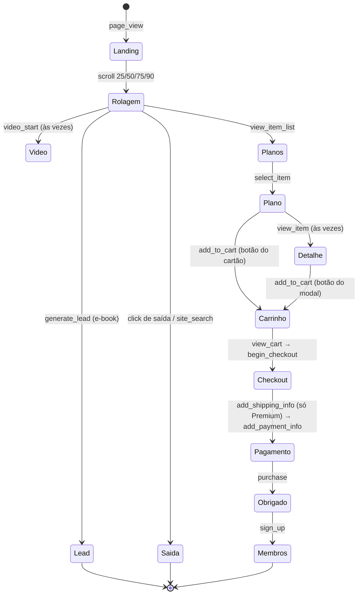

# Gerador de eventos — o coletor de tracking simulado

Este diretório faz o papel do **mundo lá fora**: a landing page DadosPro e o coletor de tracking que grava os eventos dela no S3. O pipeline do datalake não conhece este código. A única coisa que os dois compartilham é o **formato do evento** (`docs/CONTRATO_EVENTO.md`) e o prefixo `landing/` do bucket.

Em outras palavras: numa empresa real, os eventos chegariam de milhares de visitantes de verdade. Aqui, este gerador inventa visitantes e jornadas para que você tenha dados para trabalhar. O **coletor** é o sistema que recebe os eventos da página e os grava em arquivos no S3.

> **Pense assim:** o gerador é um **simulador de clientes** num jogo de loja. Ele cria 6000 visitantes de mentira, cada um com um jeito de se comportar, e anota tudo o que eles fazem, como se fossem de verdade.

Não usa Spark: é Python puro mais `boto3` (o SDK da AWS para Python, que grava arquivos no S3).

## Uso

Os dois comandos abaixo ligam o S3 local e geram os eventos com os valores padrão. Se você nunca usou Docker, veja antes o [SETUP.md](../SETUP.md).

```bash
docker compose up -d floci                                      # S3 local
docker compose run --rm app python gerador/gerar_eventos.py     # 6000 visitantes, 14 dias, seed 42
```

O gerador aceita opções na linha de comando. Para o projeto, rode sem opções, com os valores padrão.

| Opção | Padrão | O que faz |
| --- | --- | --- |
| `--dias` | 14 | dias simulados a partir de `--data-inicial` |
| `--visitantes` | 6000 | visitantes únicos (cada um faz de 1 a 4 sessões) |
| `--seed` | 42 | mesma seed, mesmos arquivos, byte a byte |
| `--sujeira` | 0.03 | fração de eventos com defeito (0 a 0.5) |
| `--data-inicial` | 2026-09-01 | primeiro dia, em UTC |
| `--saida-local PASTA` | — | grava numa pasta, com a mesma árvore de chaves, em vez do S3 |

A **seed** (semente) é o número que controla o sorteio aleatório. Com a mesma seed, o gerador sorteia sempre os mesmos visitantes e eventos, então todos da turma recebem os mesmos dados.

> **Pense assim:** a seed é o **número de série de um baralho já embaralhado**. Duas pessoas que pedem o baralho nº 42 recebem as cartas exatamente na mesma ordem. É assim que o gabarito do professor bate com os números da turma.

Rodar de novo com a **mesma** seed sobrescreve os mesmos arquivos. Uma seed **diferente** acrescenta arquivos novos (`coletor-s<seed>-*.jsonl`), como um segundo coletor gravando no mesmo bucket.

### Importar os eventos da página de exemplo

Navegue por `site/index.html`, clique em **Exportar JSONL** no painel lateral e copie o arquivo exportado para dentro da pasta do repositório (por exemplo, `saida/`), porque o comando roda no contêiner e só enxerga o repositório:

```bash
docker compose run --rm app python gerador/importar_site.py saida/eventos_2026-10-10.jsonl
```

Troque `saida/eventos_2026-10-10.jsonl` pelo nome do arquivo que você exportou.

O arquivo é separado por nome do evento: cada `event_name` vira um arquivo em `landing/event_name=<nome>/year=…/month=…/day=… (data do primeiro evento)/site-<instante com microssegundos>.jsonl`. Eventos sem `event_name` vão para `event_name=__HIVE_DEFAULT_PARTITION__`. Arquivos com BOM e quebras de linha CRLF são aceitos. (BOM e CRLF são detalhes de como o Windows às vezes salva arquivos de texto; o importador aceita os dois formatos.)

## O que é gravado

Cada execução grava arquivos neste caminho:

`s3://datalake-tracking/landing/event_name=<nome>/year=AAAA/month=MM/day=DD/coletor-s<seed>-<lote>.jsonl` — um evento JSON por linha, de 3 a 6 lotes por dia; o dia seguinte ao último (ex.: `year=2026/month=09/day=15`) pode ter 1 ou 2 lotes, com sessões que viram a meia-noite.

Um **lote** é um pacote de eventos que o coletor descarregou de uma vez. Cada lote é separado por nome do evento: o lote 1 de um dia vira `event_name=page_view/…/coletor-s42-001.jsonl`, `event_name=scroll/…/coletor-s42-001.jsonl` e assim por diante, um arquivo para cada evento que aparece nele.

## Como a jornada é simulada

A **jornada** é o caminho que o visitante faz na página, do primeiro acesso até (talvez) a compra. Cada visitante recebe um canal de origem e um dispositivo, que mudam as chances de rolar a página, ver o vídeo, escolher um plano e comprar. Na ordem da página: hero → vídeo → módulos → tabela de planos → checkout → obrigado → área de membros.

O **canal de origem** é de onde o visitante veio, como Google, Instagram ou a newsletter. O **dispositivo** é o tipo de aparelho, como celular ou computador.



O diagrama é a "máquina de estados" da jornada: cada caixa é um ponto da página e cada seta é um evento. Em toda seta há um sorteio, e por isso a maioria dos visitantes para no meio do caminho, como no mundo real.

- **Parte dos leads** volta outro dia, em geral pela newsletter, com mais intenção de compra.
- **Quem compra** pode criar conta (`sign_up`) e, em visitas seguintes, faz `login`.
- **Reembolsos:** cerca de 8% das compras recebem `refund` de 1 a 7 dias depois — bem mais nas que vieram do Instagram, bem menos nas de newsletter e acesso direto (compras da última semana podem ficar sem reembolso, porque ele cairia fora da janela).
- **Frete:** só o plano Premium tem `add_shipping_info`, porque inclui apostila impressa.
- **`session_hint`:** muda em cerca de 25% das trocas de página, como uma recarga do navegador, e também quando o visitante recarrega a landing (cerca de 1 em 4 sessões). Por isso não serve para contar sessões.

## Defeitos injetados

> **Pense assim:** é um **jogo dos sete erros** preparado de propósito. O gerador estraga alguns eventos de jeitos conhecidos, e a sua Silver precisa achar e separar cada um deles, dizendo o motivo.

| Tipo | O que acontece |
| --- | --- |
| `purchase_sem_id` | `purchase` sem `transaction_id` (no máximo 5% das compras) |
| `valor_negativo` | `value` negativo |
| `moeda_usd` | `currency = "USD"` |
| `scroll_33` | `percent_scrolled = 33`, fora dos marcos |
| `ts_nulo` | `event_ts` nulo |
| `ts_futuro` | `event_ts` dez anos à frente |
| `refund_orfao` | `refund` de uma transação que não existe (no máximo 5% das compras) |
| `evento_fora_catalogo` | `event_name = "add_to_wishlist"` |
| reenvio de lote | cerca de 1% dos eventos aparece de novo, com o mesmo `event_id`, no lote vizinho |

Os tipos que alteram um evento existente atingem no máximo 5% dos candidatos; a cota que sobra vai para `ts_futuro`. Nenhum tipo de evento tem mais de 5% das suas ocorrências alterado.

Um `purchase` que perde o `transaction_id` ou o valor deixa o `refund` dele sem compra válida. Esse efeito em cascata é proposital.

## Saída com os parâmetros padrão

Ao terminar, o gerador imprime um resumo como este. Use-o para conferir se a geração rodou certo.

```text
Destino:            s3://datalake-tracking (http://floci:4566)
Período:            2026-09-01 a 2026-09-14   seed: 42
visitantes              6000
sessões simuladas       8805
eventos limpos         63414
duplicatas (lote)        656
linhas gravadas        64372   em 1381 arquivos

Eventos por nome (antes da sujeira):
  page_view              13235
  scroll                 20035
  click                   2952
  site_search              307
  video_start             2940
  video_progress          7495
  video_complete           905
  file_download            343
  view_item_list          5335
  select_item             1755
  view_item               1037
  add_to_cart             1789
  remove_from_cart         251
  view_cart               1322
  begin_checkout           961
  add_shipping_info        188
  add_payment_info         721
  purchase                 604
  refund                    52
  generate_lead            550
  sign_up                  453
  login                    184

Defeitos injetados:
  purchase_sem_id           31
  valor_negativo           272
  moeda_usd                 77
  scroll_33                272
  ts_nulo                  272
  ts_futuro                676
  refund_orfao              31
  evento_fora_catalogo     271
```

## Testes

Para rodar os testes automáticos do gerador:

```bash
docker compose run --rm app python -m pytest tests/gerador
```
