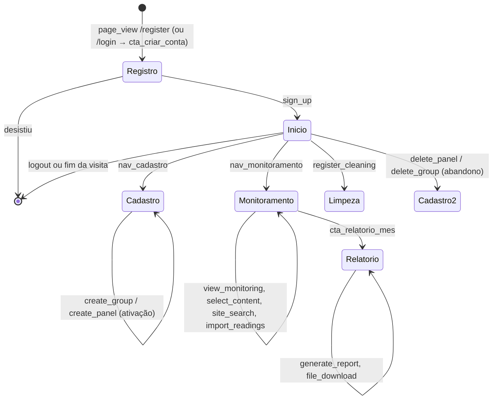

# Gerador de eventos — o uso simulado do SolarVision

Este diretório faz o papel do **mundo lá fora**: os usuários do SolarVision e o coletor que grava os eventos de uso no S3. O pipeline do datalake não conhece este código; os dois compartilham só o **formato do evento** ([`docs/CONTRATO_EVENTO.md`](../docs/CONTRATO_EVENTO.md)) e o prefixo `landing/` do bucket.

O app de verdade também gera eventos (o `frontend/src/lib/tracking.js`), mas uma plataforma acadêmica tem poucos usuários. O gerador inventa **semanas de uso realista**, com defeitos, para o pipeline e o modelo de ML terem volume.

> Estrutura herdada do gerador do projeto-modelo do professor: `eventos.py`, `lotes.py`, `destinos.py`, `importar_site.py` e `gerar_eventos.py` vieram de lá quase sem mudança; `catalogo.py`, `jornadas.py`, `elementos.py` e `sujeira.py` foram reescritos para o SolarVision.

Não usa Spark: é Python puro mais `boto3` (que grava no S3).

## Uso

```bash
docker compose up -d floci                                      # S3 local
docker compose run --rm app python gerador/gerar_eventos.py     # 3000 usuários, 28 dias, seed 42
```

| Opção | Padrão | O que faz |
| --- | --- | --- |
| `--dias` | 28 | dias simulados a partir de `--data-inicial` |
| `--visitantes` | 3000 | usuários simulados (cada um faz de 1 a 14 sessões) |
| `--seed` | 42 | mesma seed, mesmos arquivos, byte a byte |
| `--sujeira` | 0.03 | fração de eventos com defeito (0 a 0.5) |
| `--data-inicial` | 2026-09-01 | primeiro dia, em UTC |
| `--saida-local PASTA` | — | grava numa pasta, com a mesma árvore de chaves, em vez do S3 |

### Subir os eventos que você mesmo gerou no app

Com o app rodando (`npm run dev` no `frontend`), entre como ADMIN, use o app e clique em **Exportar JSONL** no painel de desenvolvedor. Copie o arquivo para dentro de `datalake/` (o contêiner só enxerga essa pasta) e suba:

```bash
docker compose run --rm app python gerador/importar_site.py saida/eventos.jsonl
```

Os eventos vão para a landing com origem `site`. Rode o pipeline e procure a sua sessão nas tabelas Gold.

## As jornadas



- **Usuário novo (85%)** chega pelo canal de aquisição na tela de criar conta. Cerca de metade cria a conta; dos que criam, a chance de **ativar** (cadastrar a primeira placa) depende do canal (indicação ativa mais, Instagram bem menos) e do dispositivo (no celular, o cadastro é mais difícil).
- **Usuário antigo (15%)** já tinha conta e usinas antes do rastreamento: entra pelo login e suas placas têm id abaixo de 1000, sem `create_panel` no período. Quando ele exclui uma placa, a exclusão parece "órfã" — é a armadilha de dado legítimo rejeitado.
- **Voltar:** quem ativou volta bem mais, e indicação e newsletter retêm mais. A maioria das voltas é direta (favorito). Em 70% das voltas no mesmo navegador a sessão do Supabase ainda está salva: os eventos já vêm com `user_id`, sem `login`.
- **Outro navegador:** 12% das voltas são noutro aparelho, com outro `user_pseudo_id` e passando pelo login. É o que o identity stitching (R9) costura.
- **`session_hint`:** muda em cerca de 20% das trocas de tela. Não serve para contar sessões (R8).

## Defeitos injetados (a sujeira)

| Tipo | O que acontece |
| --- | --- |
| `acao_sem_id` | `create_group`, `create_panel`, `import_readings`, `register_cleaning` ou `delete_*` sem o id da entidade |
| `linhas_negativas` | `import_readings` com `rows` negativo |
| `potencia_zero` | `create_panel` com `potencia_wp = 0` |
| `scroll_33` | `scroll` com `percent_scrolled = 33` |
| `ts_nulo` | `event_ts` nulo |
| `ts_futuro` | `event_ts` dez anos no futuro |
| `exclusao_orfa` | `delete_panel` de uma placa que nunca existiu (no máximo 5% dos cadastros de placa) |
| `evento_fora_catalogo` | `share_report`, que não está no contrato |

Além disso, cerca de 1% dos eventos é **reenviado** no lote vizinho com o mesmo `event_id` (deduplicação, R5). Uma placa cujo `create_panel` foi rejeitado deixa a exclusão dela sem cadastro válido: o efeito em cascata é proposital.

## Resumo de uma execução (seed 42)

```text
usuários                3000
sessões simuladas       6455
eventos limpos         56194
duplicatas (lote)        574
linhas gravadas        57094   em 2325 arquivos
```
