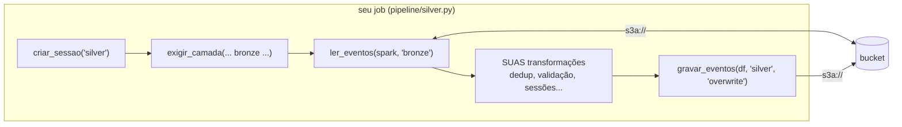
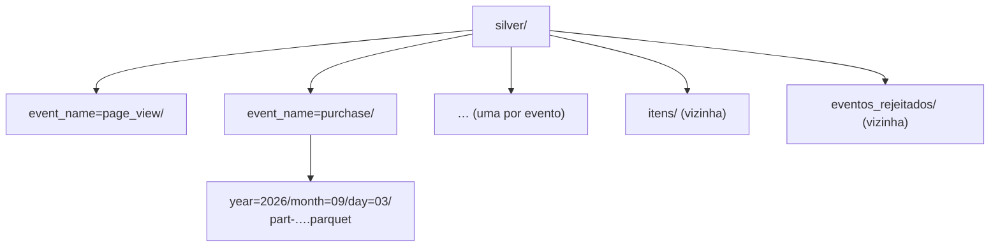
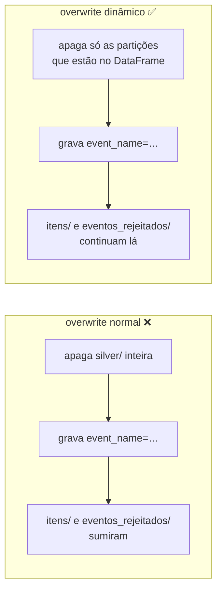

# pipeline/ — o datalake de uso do SolarVision

Um job por camada, como pede o [enunciado](../docs/ENUNCIADO.md) (R1 a R11). A base (`comum.py`, o `bronze.py` e este guia de acesso ao S3) veio do projeto-modelo do professor.

## Os jobs

| Job | Lê | Grava |
| --- | --- | --- |
| `bronze.py` | `landing/` (JSON, schema explícito) | `bronze/event_name=…/year=…/month=…/day=…`, append-only, com `arquivo_origem` e `ingerido_em` (R4) |
| `silver.py` | `bronze/` | `silver/event_name=…` (dedup R5, params tipados R6, sessões R8, pessoa R9), `silver/eventos_rejeitados/` com o motivo (R7) e `silver/itens/` (R10) |
| `gold_funil.py` | `silver/` | `gold/funil_ativacao`, `gold/funil_login` |
| `gold_engajamento.py` | `silver/` | `gold/sessoes`, `gold/uso_telas`, `gold/buscas_seletor`, `gold/saidas_downloads` |
| `gold_aquisicao.py` | `silver/` | `gold/ativacao_diaria`, `gold/retencao`, `gold/taxa_abandono`, `gold/cadastro_para_ativacao` |
| `gold_ml.py` | `silver/` | `gold/propensao_ativacao`, `gold/metricas_modelo`, `gold/segmentos_usuarios` (Spark ML) |
| `gold_mapa_calor.py` | `silver/` | `gold/mapa_calor_cliques`, `gold/mapa_calor_rolagem` (nomes de coluna do R11) |
| `exportar_bi.py` | as 15 Golds | `frontend/public/bi/mapa_calor.js` e `bi.js` (montado em `/projeto/app-bi`) |
| `rodar_tudo.py` | — | roda os oito em ordem e para no primeiro que falhar (R3); `--limpar` recomeça do zero |

```bash
docker compose run --rm app python pipeline/rodar_tudo.py --limpar   # reconstrói o datalake inteiro
docker compose run --rm app pytest                                    # gerador, coletor, jobs e explorador
```

Cada job tem as transformações em funções puras de DataFrame (`deduplicar`, `validar`, `sessionizar`, `funil_ativacao`, `base_propensao`…) e um `main()` que só lê, chama e grava. Os testes em `tests/pipeline/` montam DataFrames pequenos (`tests/pipeline/fabrica.py`) e conferem as funções sem o S3. O workflow `workflows/medalhao.json` roda o mesmo grafo no explorador, com as Golds em paralelo.

Um **job** é um script Python que faz uma etapa do trabalho do começo ao fim: lê uma camada, transforma os dados e grava a camada seguinte. Por exemplo, o job Bronze lê a `landing/` e grava a `bronze/`.

## Como rodar um job

Todo código Python roda no contêiner `app`, que já tem PySpark 4.2.0 e o conector `s3a`:

```bash
docker compose run --rm app python pipeline/<seu_job>.py
```

Troque `<seu_job>` pelo nome do seu arquivo. Se você nunca usou Docker, o [SETUP.md](../SETUP.md) explica o que cada parte desse comando faz.

Outra forma: abra o explorador (http://localhost:8501) e vá em **Glue · Jobs ETL**. Como no Glue, os jobs do console moram no S3 (no bucket `glue-assets` do floci): clique primeiro em **⟳ Sincronizar** para enviar os seus `.py` de `pipeline/` para lá, depois escolha o job e clique em **Executar**. Ele roda a cópia do floci e mostra o status (**Sucesso** ou **Falhou**), a duração e o log. Mudou o arquivo? Sincronize de novo. Veja [explorador/README.md](../explorador/README.md#glue--jobs-etl).

Para rodar **vários jobs de uma vez**, na ordem certa, monte um workflow em **Glue · Workflows**: você escolhe os jobs e diz de quem cada um depende (a Silver depende da Bronze, as Golds dependem da Silver…). Ele fica salvo no floci (`s3://glue-assets/workflows/<nome>.json`) e numa cópia em `pipeline/workflows/<nome>.json`, e a cópia local também roda pelo terminal:

```bash
docker compose run --rm app python -m explorador.workflows pipeline/workflows/<nome>.json
```

Veja [explorador/README.md](../explorador/README.md#glue--workflows).

## Falando com o S3

O pipeline acessa o bucket **só pelo Spark**, com caminhos `s3a://solarvision-datalake/...`. Nada de `boto3` aqui.

- `s3a://` é o prefixo que diz ao Spark "este caminho está num S3". É o conector `s3a` (biblioteca `hadoop-aws`) que faz a conversa com o floci.
- `boto3` é o SDK da AWS para Python. O gerador usa `boto3`, mas o seu pipeline não pode usar (requisito R1).

> **Pense assim:** `s3a://solarvision-datalake/silver/` é um **endereço com CEP**: o `s3a://` diz "isto fica no S3", `solarvision-datalake` é a cidade (o bucket) e o resto é a rua e o número (a pasta). O conector `s3a` é o carteiro que sabe entregar nesse endereço.

## `comum.py`: as peças prontas

A parte repetitiva já vem pronta em [`comum.py`](comum.py), nesta mesma pasta. **Não reescreva:** importe. Como os seus jobs rodam como `python pipeline/<job>.py`, o Python já encontra o `comum.py` ao lado deles.

| Função | Para que serve |
| --- | --- |
| `criar_sessao("bronze")` | a `SparkSession` configurada para o floci (s3a) e para manter `month=09` com dois dígitos. A `SparkSession` é o objeto de entrada do Spark: todo `spark.read` e todo `df.write` passam por ela |
| `caminho("silver/itens")` | `s3a://solarvision-datalake/silver/itens`. Para outro bucket do floci: `caminho("notas", bucket="rascunho-turma")` dá `s3a://rascunho-turma/notas` (a mesma `SparkSession` lê e grava em qualquer bucket) |
| `glob_eventos("bronze")` | `bronze/event_name=*`: só as pastas de eventos da camada |
| `ler_eventos(spark, "bronze")` | lê as pastas `event_name=…` da camada, com `event_name`, `year`, `month` e `day` como colunas. Para a landing: `ler_eventos(spark, "landing", "json", schema=SEU_SCHEMA)` |
| `gravar_eventos(df, "silver", "overwrite")` | grava particionado por `event_name/year/month/day` na raiz da camada, sem apagar as pastas vizinhas |
| `exigir_camada(spark, glob_eventos("bronze"), "python pipeline/bronze.py")` | para o job com "… não existe. Rode antes: …" se a camada anterior não existe (R2) |
| `apagar_camada(spark, "gold")` | apaga a pasta inteira, para recomeçar do zero |
| `titulo("Bronze")` | imprime um título destacado na saída |
| `arquivo_do_projeto("app-bi/mapa_calor.js")` | um arquivo do repositório, fora do S3 (`/projeto/app-bi/mapa_calor.js`, que é o `frontend/public/bi` montado pelo docker-compose). Funciona igual no terminal e no explorador |

Um job Bronze fica assim:

```python
from comum import criar_sessao, exigir_camada, glob_eventos, gravar_eventos, ler_eventos, titulo

SCHEMA = ...   # o schema explícito da landing (R4): escreva o seu

spark = criar_sessao("bronze")
exigir_camada(spark, glob_eventos("landing"), "python gerador/gerar_eventos.py")
landing = ler_eventos(spark, "landing", "json", schema=SCHEMA)
bronze = ...   # proveniência e partições year/month/day (R4): é aqui que está o seu trabalho
gravar_eventos(bronze, "bronze", "append")
titulo("Bronze")
spark.stop()
```

O `comum.py` usa só o Spark (R1). As seções abaixo explicam o que ele faz por baixo, para você entender e conseguir depurar.

> **Pense assim:** a `SparkSession` é a **chave da cozinha**: sem ela, nada se lê nem se grava. O `comum.py` é a **caixa de ferramentas** que vem com a cozinha: em vez de forjar uma faca nova a cada receita, você pega a que já está afiada e gasta o tempo cozinhando.



Só a caixa do meio é trabalho seu; as outras são uma linha cada, vindas do `comum.py`.

### Como `exigir_camada` confere se uma camada existe

Ele usa o `FileSystem` do Hadoop pela JVM do Spark:

```python
caminho = spark._jvm.org.apache.hadoop.fs.Path("s3a://solarvision-datalake/silver/event_name=*")
existe = bool(caminho.getFileSystem(spark._jsc.hadoopConfiguration()).globStatus(caminho))
```

O `*` é um **glob**, um "curinga": `event_name=*` casa com qualquer pasta que comece com `event_name=`. Por isso o trecho usa `globStatus` (que entende curingas) em vez de `exists`.

> **Pense assim:** é o **coringa do baralho**, que vale qualquer carta. `event_name=*` vale `event_name=scroll`, `event_name=purchase` e todas as outras.

## Partições por nome do evento e por dia

Uma **partição** é uma subpasta que agrupa os dados por um valor. Aqui há dois níveis: primeiro o nome do evento, depois o dia. Todas as rolagens de 3 de setembro de 2026 ficam em `event_name=scroll/year=2026/month=09/day=03/`. Assim, quem quer ler só as compras, ou só um dia, não precisa abrir o resto.

> **Pense assim:** as partições são **gavetas etiquetadas** num arquivo de aço. A etiqueta da gaveta é o nome do evento; dentro dela, uma pasta por ano, mês e dia. Para achar as compras de 3 de setembro, você abre uma gaveta e uma pasta, e não o arquivo inteiro.

A landing, a Bronze e a Silver guardam os eventos assim, **direto na raiz da camada** (não existe pasta `eventos`):

```text
landing/event_name=scroll/year=2026/month=09/day=03/coletor-s42-001.jsonl
bronze/event_name=scroll/year=2026/month=09/day=03/part-….parquet
silver/event_name=scroll/year=2026/month=09/day=03/part-….parquet
silver/itens/year=2026/month=09/day=03/part-….parquet      ← vizinha das pastas event_name=
silver/eventos_rejeitados/part-….parquet                   ← vizinha também
```



Na raiz da Silver convivem dois tipos de pasta: as partições de eventos (`event_name=…`) e as vizinhas (`itens/`, `eventos_rejeitados/`). É por isso que ler e gravar a raiz exige os cuidados abaixo.

### Os dois dígitos do mês

Ao ler pastas `k=v`, o Spark descobre `event_name`, `year`, `month` e `day` como colunas e, por padrão, converte os valores que parecem número: `month=09` vira `9`, e ao regravar sai `month=9`. Para manter tudo como texto, desligue essa inferência na `SparkSession`:

```python
.config("spark.sql.sources.partitionColumnTypeInference.enabled", "false")
```

### Ler só os eventos (o que `ler_eventos` faz)

Se você ler a raiz `s3a://solarvision-datalake/silver/` direto, o Spark encontra `event_name=…` ao lado de `itens/` e `eventos_rejeitados/` e para com o erro *Conflicting directory structures*. Leia só as pastas `event_name=` com um glob e diga ao Spark onde fica a raiz das partições (`basePath`), para ele devolver `event_name` como coluna:

```python
raiz = "s3a://solarvision-datalake/silver"
eventos = spark.read.option("basePath", raiz).parquet(f"{raiz}/event_name=*")
```

A landing é igual, com `.json(...)` no lugar de `.parquet(...)`. O `event_name` que vem do caminho é o mesmo que está dentro de cada evento.

> **Pense assim:** o `basePath` diz ao Spark **a partir de qual gaveta começar a contar**. Sem ele, o Spark acha que `event_name=scroll` é só o nome de uma pasta qualquer; com ele, entende que `event_name` é uma coluna e `scroll` é o valor dela.

### Gravar sem apagar as vizinhas (o que `gravar_eventos` faz)

Na gravação, use `.partitionBy("event_name", "year", "month", "day")` com as quatro colunas como texto. O `partitionBy` cria uma subpasta por combinação de valores dessas colunas.

Cuidado com o `mode("overwrite")` na Silver: por padrão ele **apaga a pasta inteira** antes de gravar, e `silver/` inteira inclui `itens/` e `eventos_rejeitados/`. Use o modo **dinâmico**, que troca só as partições que estão no DataFrame:

```python
(silver.write.mode("overwrite")
    .option("partitionOverwriteMode", "dynamic")
    .partitionBy("event_name", "year", "month", "day")
    .parquet("s3a://solarvision-datalake/silver"))
```

Na Bronze, que é append-only (R4), use `mode("append")` com o mesmo `partitionBy`.

> **Pense assim:** o `overwrite` normal **esvazia o armário inteiro** para guardar as roupas novas, inclusive as gavetas que você nem ia mexer (`itens/`, `eventos_rejeitados/`). O modo dinâmico **troca só as gavetas que mudaram** e deixa o resto onde estava.



## Spark 4: erro em vez de `null` (modo ANSI)

O projeto usa o PySpark 4.2, que liga o **modo ANSI** por padrão. Nele, uma conta impossível **para o job com erro**, em vez de devolver `null` como no Spark 3:

- dividir por zero: `F.col("compras") / F.col("sessoes")` com `sessoes = 0` dá `DIVIDE_BY_ZERO`;
- converter texto que não é número ou data: `F.col("valor").cast("double")` com `"abc"`, ou `F.to_timestamp(...)` com uma data mal escrita, dá `CAST_INVALID_INPUT`.

> **Pense assim:** o modo ANSI é um **caixa que confere cada nota**. Antes, uma nota falsa passava em branco (virava `null`) e você só descobria depois, no relatório. Agora o caixa para a fila e avisa na hora. É mais seguro, mas, quando você **sabe** que o dado pode vir sujo e quer o `null`, precisa dizer isso.

Quando o `null` é o que você quer, use as funções `try_`:

| Em vez de | Use | O que acontece com o dado ruim |
| --- | --- | --- |
| `a / b` | `F.try_divide(a, b)` | `null` quando `b` é zero |
| `F.col("x").cast("double")` | `F.col("x").try_cast("double")` | `null` quando `x` não é número |
| `F.to_timestamp("ts", formato)` | `F.try_to_timestamp("ts", F.lit(formato))` | `null` quando a data não segue o formato |

Na Silver, isso é útil para **rejeitar** o dado sujo: converta com `try_`, e o que virou `null` vai para os rejeitados com o motivo. Na Gold, use `F.try_divide` nas taxas cujo denominador pode ser zero.

## Antes de começar

Rode estes três comandos, nesta ordem:

1. `docker compose up -d floci` (liga o S3 local)
2. `docker compose run --rm app python gerador/gerar_eventos.py` (grava os eventos na landing)
3. `docker compose run --rm app python infra/verificar_ambiente.py`, que precisa mostrar três linhas `[ok]`

## Exportar um resultado pequeno para o app (R11)

O `exportar_bi.py` lê as Golds pelo Spark e, no fim, grava dois arquivos comuns com Python, cada um numa linha `window.<VARIÁVEL> = {...};`:

- `app-bi/mapa_calor.js` → `window.MAPA_CALOR = {"gerado_em", "cliques", "rolagem"}`, com os nomes de coluna exatos das duas Golds do mapa de calor. O botão **Mapa de calor** do app (ADMIN) pinta os elementos `data-heat` da tela atual.
- `app-bi/bi.js` → `window.SOLARVISION_BI = {...}`: KPIs, as tabelas pequenas da Gold, a propensão por faixa de probabilidade e o perfil médio dos segmentos, para a página **Uso da plataforma**. Só agregados: nenhuma linha por pessoa ou por sessão sai do datalake.

`app-bi/` é o `frontend/public/bi` do repositório, montado pelo docker-compose; o Vite serve a pasta em `/bi/`. Os arquivos são resultado gerado (dados de negócio) e ficam fora do git.

- **Trazer o resultado para o Python:** `collect()` só em tabelas pequenas, como as Golds. **Nunca** na Bronze ou na Silver: são dezenas de milhares de linhas.
- **Onde gravar:** `arquivo_do_projeto(...)`, do `comum.py`, e não `Path(__file__)`: no explorador o script roda de uma cópia baixada do floci, numa pasta temporária.
- Datas e `Decimal` viram texto e número antes do `json.dumps` (`exportar_bi.linhas`).

Depois, com o app rodando (`npm run dev` no `frontend`), entre como ADMIN, abra **Uso da plataforma** e ligue o **Mapa de calor** no cabeçalho. Rodou o job de novo? Recarregue a página.
