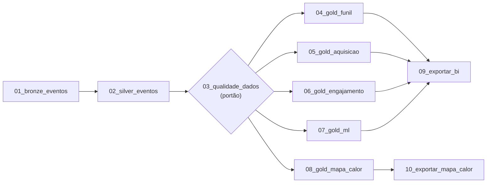

# workflows/ — as etapas e os workflows do datalake, numa pasta só

Aqui fica **a ordem** do datalake: cada etapa numerada é um arquivo de três linhas que chama um ou mais jobs de [`pipeline/`](../pipeline/README.md), e os `.json` dizem de quais etapas cada uma depende. A lógica (as transformações e os testes) continua nos jobs; esta pasta só dá nome, número e dependência a cada passo.

| Etapa | Roda | Depende de |
| --- | --- | --- |
| `01_bronze_eventos` | `pipeline/bronze.py` | — |
| `02_silver_eventos` | `pipeline/silver.py` | `01_bronze_eventos` |
| `03_qualidade_dados` | `pipeline/qualidade.py` (o portão: sai com código 1 se uma regra bloqueante falha) | `02_silver_eventos` |
| `04_gold_funil` | `pipeline/gold_funil.py` | `03_qualidade_dados` |
| `05_gold_aquisicao` | `pipeline/gold_aquisicao.py` | `03_qualidade_dados` |
| `06_gold_engajamento` | `pipeline/gold_engajamento.py` | `03_qualidade_dados` |
| `07_gold_ml` | `pipeline/gold_ml.py` | `03_qualidade_dados` |
| `08_gold_mapa_calor` | `pipeline/gold_mapa_calor.py` | `03_qualidade_dados` |
| `09_exportar_bi` | `pipeline/exportar_bi.py` (o `bi.js` do painel Uso da plataforma) | `04`, `05`, `06` e `07` |
| `10_exportar_mapa_calor` | `pipeline/exportar_mapa_calor.py` (o `mapa_calor.js` do overlay, R11) | `08_gold_mapa_calor` |

O número segue a ordem do projeto-modelo do professor (funil, aquisição, engajamento, ML, mapa de calor), com o portão de qualidade em 03.

## Os workflows

| Arquivo | O que roda |
| --- | --- |
| [`medalhao.json`](medalhao.json) | tudo: as dez etapas, duas Golds por vez; é o grafo que o `pipeline/rodar_tudo.py` segue (R3) |



As cinco Golds esperam o portão de qualidade. As exportações esperam as Golds que leem, então um dado reprovado pelo portão nunca chega ao app.

A exportação do mapa de calor é uma etapa própria, como o `exportar_mapa_calor` do projeto-modelo do professor: a `10_exportar_mapa_calor` depende só da `08_gold_mapa_calor`, então o overlay do app é atualizado sem esperar o funil, a aquisição e o ML. A `09_exportar_bi` grava só o `bi.js` do painel.

## Como rodar

```bash
docker compose run --rm app python pipeline/rodar_tudo.py                                   # medalhão inteiro
docker compose run --rm app python pipeline/rodar_tudo.py --a-partir-de 05_gold_aquisicao
docker compose run --rm app python workflows/05_gold_aquisicao.py                           # uma etapa
docker compose run --rm app python -m explorador.workflows workflows/medalhao.json          # o workflow
```

No explorador (http://localhost:8501), o `docker-compose.yml` aponta a pasta de jobs para cá (`EXPLORADOR_JOBS=workflows`): **⟳ Sincronizar** leva as etapas, o `_etapa.py` e os `.json` para o `s3://glue-assets/`, a tela **Jobs ETL** lista as etapas numeradas e a tela **Workflows** mostra o `medalhao`. Um workflow criado pelo console também é salvo aqui.

## Como uma etapa chama o pipeline

```python
from _etapa import rodar

rodar("gold_aquisicao")
```

`_etapa.rodar` roda cada `pipeline/<job>.py` como `python pipeline/<job>.py`, um depois do outro, e para no primeiro que falhar com o código dele. O arquivo começa com `_`, então o explorador não o lista como job, mas o Sincronizar o leva junto, e as etapas o importam da cópia do floci. As etapas rodam sempre da pasta `datalake/` (no terminal e no explorador), por isso o `pipeline/` é achado pelo diretório atual, como no `comum.arquivo_do_projeto`.
