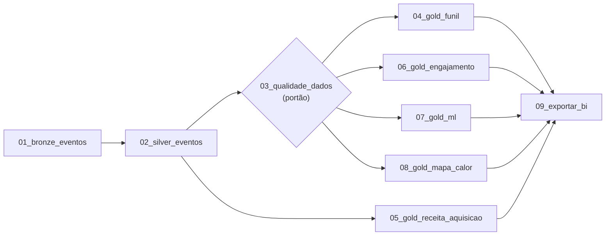

# workflows/ — as etapas e os workflows do datalake, numa pasta só

Aqui fica **a ordem** do datalake: cada etapa numerada é um arquivo de três linhas que chama um ou mais jobs de [`pipeline/`](../pipeline/README.md), e os `.json` dizem de quais etapas cada uma depende. A lógica (as transformações e os testes) continua nos jobs; esta pasta só dá nome, número e dependência a cada passo.

| Etapa | Roda | Depende de |
| --- | --- | --- |
| `01_bronze_eventos` | `pipeline/bronze.py` | — |
| `02_silver_eventos` | `pipeline/silver.py` | `01_bronze_eventos` |
| `03_qualidade_dados` | `pipeline/qualidade.py` (o portão: sai com código 1 se uma regra bloqueante falha) | `02_silver_eventos` |
| `04_gold_funil` | `pipeline/gold_funil.py` | `03_qualidade_dados` |
| `05_gold_receita_aquisicao` | `pipeline/gold_aquisicao.py` e `pipeline/gold_receita.py` | `02_silver_eventos` |
| `06_gold_engajamento` | `pipeline/gold_engajamento.py` | `03_qualidade_dados` |
| `07_gold_ml` | `pipeline/gold_ml.py` | `03_qualidade_dados` |
| `08_gold_mapa_calor` | `pipeline/gold_mapa_calor.py` | `03_qualidade_dados` |
| `09_exportar_bi` | `pipeline/exportar_bi.py` | as cinco Golds |

O número segue a ordem do projeto-modelo do professor (funil, engajamento, **receita e aquisição**, ML, mapa de calor), com o portão de qualidade em 03. A etapa 05 junta as duas Golds de negócio, como o job "receita e aquisição" do projeto-modelo: a ativação e a retenção (`gold_aquisicao`) e a assinatura Pro (`gold_receita`).

## Os workflows

| Arquivo | O que roda |
| --- | --- |
| [`medalhao.json`](medalhao.json) | tudo: as nove etapas, duas Golds por vez; é o grafo que o `pipeline/rodar_tudo.py` segue (R3) |
| [`receita_aquisicao.json`](receita_aquisicao.json) | só o caminho da receita: `01_bronze_eventos → 02_silver_eventos → 05_gold_receita_aquisicao` |



A etapa `05_gold_receita_aquisicao` depende **só da Silver**, como pede o workflow do professor (`{"job": "05_gold_receita_aquisicao", "depende_de": ["02_silver_eventos"]}`): no explorador ela roda ao lado do portão. As outras Golds esperam o portão. A exportação espera todas, então um dado reprovado pelo portão nunca chega ao app.

## Como rodar

```bash
docker compose run --rm app python pipeline/rodar_tudo.py                                   # medalhão inteiro
docker compose run --rm app python pipeline/rodar_tudo.py --a-partir-de 05_gold_receita_aquisicao
docker compose run --rm app python workflows/05_gold_receita_aquisicao.py                   # uma etapa
docker compose run --rm app python -m explorador.workflows workflows/receita_aquisicao.json  # um workflow
```

No explorador (http://localhost:8501), o `docker-compose.yml` aponta a pasta de jobs para cá (`EXPLORADOR_JOBS=workflows`): **⟳ Sincronizar** leva as etapas, o `_etapa.py` e os `.json` para o `s3://glue-assets/`, a tela **Jobs ETL** lista as etapas numeradas e a tela **Workflows** mostra `medalhao` e `receita_aquisicao`. Um workflow criado pelo console também é salvo aqui.

## Como uma etapa chama o pipeline

```python
from _etapa import rodar

rodar("gold_aquisicao", "gold_receita")
```

`_etapa.rodar` roda cada `pipeline/<job>.py` como `python pipeline/<job>.py`, um depois do outro, e para no primeiro que falhar com o código dele. O arquivo começa com `_`, então o explorador não o lista como job, mas o Sincronizar o leva junto, e as etapas o importam da cópia do floci. As etapas rodam sempre da pasta `datalake/` (no terminal e no explorador), por isso o `pipeline/` é achado pelo diretório atual, como no `comum.arquivo_do_projeto`.
