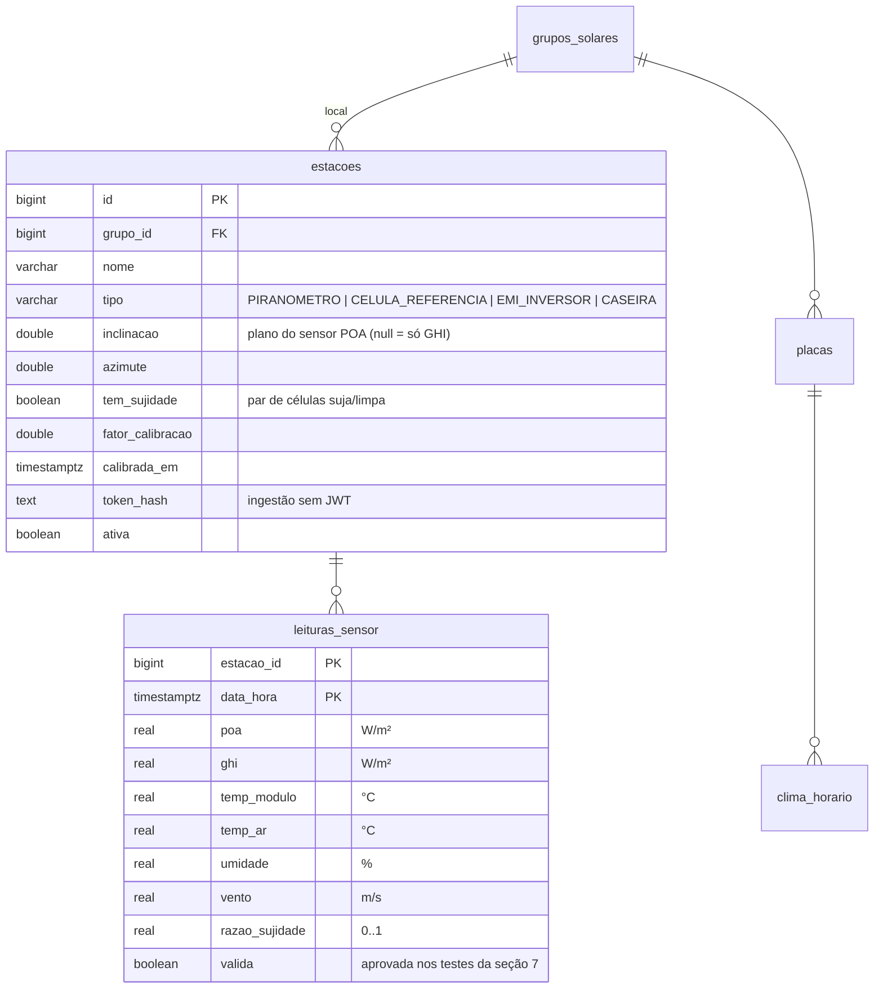

# Predição e sensores - SolarVision

O que muda quando a usina tem **estação solarimétrica**, onde ela é comum, como integrá-la e como o modelo de geração passa de *inferido* para *medido*. É o cenário ideal; o público-alvo inicial do SolarVision é o **sem estação** (Open-Meteo + datasheet + leituras do inversor/CSV), cujo plano está nas fases 1 a 4 do modelo (seção 9).

> Modelo atual: [ARQUITETURA.md](ARQUITETURA.md#5-geração-estimada-pelo-clima-open-meteo) · Validação: [validacao/RESULTADO.md](validacao/RESULTADO.md) · Pendências: [FEATURES-INCOMPLETAS.md](FEATURES-INCOMPLETAS.md) (itens 5 e 6)

---

## 1. De onde vem cada dado

A **placa não fornece dado nenhum**: o módulo é passivo (células, vidro e caixa de junção com diodos de bypass). Os dados vêm de três camadas independentes:

| Camada | Exemplos | O que mede | O que **não** mede |
|---|---|---|---|
| **Datasheet do módulo** | Jinko, Longi, Trina, JA, Canadian, First Solar | Nada: parâmetros fixos (Wp, γ, NMOT, degradação) | — |
| **Eletrônica de potência** | Inversor string, microinversor (Enphase, Hoymiles), otimizador (SolarEdge, Tigo, Huawei SUN2000-P) | P, V, I (AC e DC; por string, MPPT ou módulo), temperatura do equipamento, estado e alarmes | **Irradiância**, nem nos módulos "inteligentes" |
| **Estação solarimétrica** | Piranômetro, célula de referência, EMI do inversor, estação de sujidade | Irradiância (GHI, POA), temperatura do módulo e do ar, vento, umidade, sujidade | Geração |

**A corrente da própria placa não serve de sensor de irradiância.** A Isc é quase proporcional à irradiância, mas cai também com sujeira, sombra e defeito. Usar a placa para estimar a irradiância transforma sujeira em "dia nublado" e apaga justamente o que se quer detectar. O sensor tem de ser **independente e mantido limpo**.

### O que cada camada permite afirmar

| Com... | Afirma | Só suspeita |
|---|---|---|
| **API pública** (Open-Meteo) | Quanto uma placa *limpa e sem defeito* deveria gerar, com erro de ~15 % no dia e ~6 % no mês ([validação](validacao/RESULTADO.md)); se o clima do período foi melhor ou pior que a média de 5 anos | Tudo o que é da placa: sujeira, sombra e falha são **simulação**, não detecção |
| **+ inversor / CSV** | Quanto foi gerado; desligamento e falha (zero com sol, alarme); clipping; qual string ou placa rende menos que as vizinhas (mesmo clima, o erro da reanálise se cancela); PR calibrado por placa | Sujeira x sombra x degradação, porque a irradiância de referência ainda é a da reanálise: a separação vem do padrão no tempo (seção 9), não da medição |
| **+ estação** | PR real (IEC 61724-1); perda por sujidade **medida** (estação de sujidade); temperatura real do módulo; erro do clima ~zero no plano | Só o que exige inspeção (hot spot, microfissura, PID): aparece como perda, a causa exige termografia ou curva I-V |

---

## 2. Por que a estação importa

O erro do modelo sem estação tem duas partes ([validação](validacao/RESULTADO.md)):

1. **Erro da irradiância de reanálise:** a grade do Open-Meteo/ERA5 tem dezenas de km e não vê a nuvem local. É o piso de ~15 % no dia (r diário ≈ 0,89). Com irradiância medida **no plano da placa (POA)**, esse termo praticamente some: sobra a incerteza do sensor (poucos %, conforme a classe e a manutenção).
2. **Erro do modelo da placa** (PR, temperatura, sujeira): hoje o PR é fixo em 0,82. A validação indica PR real de 0,71 a 0,77 no sistema da UFSC.

Com a estação, três coisas passam de **inferidas** para **medidas**:

| Grandeza | Sem estação | Com estação |
|---|---|---|
| Irradiância no plano | GTI do Open-Meteo (reanálise/previsão) | POA medida |
| Temperatura da célula | T_ar + modelo térmico (NOCT/Faiman) | Sensor no verso do módulo |
| Sujeira | Simulada (0,2 %/dia, chuva ≥ 5 mm) ou inferida da queda do PR | **Razão de sujidade medida** (célula suja ÷ célula limpa) |
| PR | Fixo (0,82) ou calibrado contra a reanálise | **PR pela IEC 61724-1**: energia ÷ (Wp × irradiação no plano ÷ 1000 W/m²) |

---

## 3. Onde é comum e onde não é

| Segmento | Porte (Brasil) | Estação | Por quê |
|---|---|---|---|
| **Residencial** | Microgeração, até 75 kW [^lei14300] | Quase nunca | O monitoramento do inversor basta para o dono; o sensor custa proporcionalmente caro |
| **Comercial** | Micro e minigeração pequena | Rara; às vezes uma célula de referência ou o EMI do inversor | Depende do contrato de O&M (PR garantido pede referência de irradiância) |
| **Minigeração** | > 75 kW até 3 MW (solar sem armazenamento) ou 5 MW (despachável) [^lei14300] | Comum em usinas de investidores, sem exigência regulatória | Contratos de desempenho e O&M; avaliação nossa, não há norma que obrigue |
| **Usina centralizada** | Leilões/ACL, dezenas a centenas de MW | **Praticamente obrigatória** | EPE exige ≥ 12 meses de medição solarimétrica no local para cadastrar o projeto em leilão [^epe]; o ONS exige envio em tempo real das medições solarimétricas das usinas em operação [^ons] |

### Contexto regulatório e normativo

- **EPE (leilões):** para cadastrar uma usina fotovoltaica, mínimo de **12 meses consecutivos** de medição de irradiação global horizontal no local, por estação com pelo menos dois piranômetros classe I (ISO 9060:1990), anemômetro, higrômetro e termômetro [^epe] [^canalsolar].
- **ONS (operação):** agentes de geração fotovoltaica disponibilizam ao ONS, em tempo real, os registros das medições solarimétricas, a geração verificada e a disponibilidade; a irradiância usada na apuração é a do plano dos módulos, em patamares semi-horários [^ons]. *Confirmar o submódulo vigente dos Procedimentos de Rede (6.5 e correlatos) antes de citar em documento formal.*
- **IEC 61724-1:2021 (monitoramento de desempenho):** a 2ª edição tem **duas classes**, A (alta exatidão, usinas de grande porte) e B (média, telhados e sistemas menores); a **classe C da edição de 2017 deixou de existir** (virou a B) [^hukseflux] [^eko]. Define medição de irradiância (global e no plano), temperatura do módulo e do ar, vento e **razão de sujidade quando a perda esperada passa de 2 %**, e exige, na classe A, mitigação de orvalho/geada no piranômetro, inspeção semanal e recalibração a cada 2 anos [^iec-guia].

---

## 4. Composição típica de uma estação

| Medição | Instrumento | Para que serve |
|---|---|---|
| **GHI** (global horizontal) | Piranômetro horizontal | Comparar com a reanálise; base dos leilões (EPE) |
| **POA** (no plano dos módulos) | Piranômetro inclinado **ou célula de referência** (mesma tecnologia do módulo, resposta espectral parecida) | Entrada direta do modelo; PR pela IEC |
| **Temperatura do módulo** | PT100/PT1000 colado no verso | Substitui o modelo térmico |
| **Temperatura e umidade do ar** | Termo-higrômetro com abrigo | Modelo térmico; orvalho no sensor |
| **Vento** | Anemômetro (velocidade e direção) | Modelo térmico; limpeza natural |
| **Albedo** (bifaciais) | Albedômetro (piranômetro para cima + para baixo) | Irradiância no verso |
| **Sujidade** | **Estação de sujidade**: duas células iguais, uma limpa periodicamente e outra que acumula sujeira; razão suja ÷ limpa = razão de sujidade | Perda por sujeira medida, sem depender da geração |

---

## 5. Integração

### 5.1 Usina que já tem estação
Não instalar nada: ler do **SCADA ou datalogger** que já existe.
- **Modbus TCP com SunSpec:** modelo **302** (irradiância: GHI e POA) e **307** (meteorologia básica: temperaturas, vento, umidade) [^sunspec-models] [^sunspec-ranaliz]. Os modelos 101 a 103 (inversor) e 160 (DC por MPPT) cobrem a geração no mesmo barramento.
- Exportação do SCADA (CSV/FTP/API) pelo mesmo caminho da importação de leituras de hoje.

### 5.2 Acessórios do inversor
| Fabricante | Acessório | Como chega |
|---|---|---|
| Huawei | **EMI** (Environmental Monitoring Instrument) | API Northbound do FusionSolar (`getDevRealKpi` aceita EMI como tipo de dispositivo) [^meteocontrol-huawei] ou Modbus local |
| SMA | Sensor Module | Modbus SunSpec / portal |
| Fronius | Sensor Box / Sensor Card | Solar API local (JSON) |
| SolarEdge | Sensores de irradiância/temperatura | Monitoring API (`/sensors`), 300 chamadas/dia [^solaredge-ha] |

### 5.3 Opção barata: célula de referência caseira
Para o item 5 de [FEATURES-INCOMPLETAS.md](FEATURES-INCOMPLETAS.md) (sensor ESP32):

1. **Mini-painel em curto-circuito sobre um shunt:** a corrente de curto (Isc) é quase linear com a irradiância. Medir a tensão no shunt com um ADC externo (ex.: ADS1115, 16 bits; o ADC do ESP32 é ruidoso e não linear).
2. **Montagem no plano dos módulos** (mesma inclinação e azimute) e **mantido limpo**: é o que o torna independente da placa.
3. **Correção de temperatura** da Isc (α ≈ +0,05 %/°C, pequena) com um sensor no verso do mini-painel.
4. **Calibração contra o Open-Meteo em dias limpos:** em céu limpo o erro da reanálise é pequeno (o erro de ~15 % vem das nuvens), então `fator = mediana(GTI_open-meteo ÷ Isc)` nas horas de sol alto de dias limpos (critério de céu limpo da seção 9). Recalibrar mensalmente; uma deriva do fator indica sensor sujo ou desalinhado (seção 7).
5. **Estação de sujidade caseira:** dois mini-painéis iguais, um limpo semanalmente e outro nunca; a razão entre as correntes é a razão de sujidade.
6. **Escrita no banco:** o ESP32 não tem o JWT do dono. Usar um **token por estação** (hash em `estacoes`) validado por uma função `security definer` de ingestão ou por uma Edge Function. A RLS do resto continua igual.

Limites: precisão inferior à de um piranômetro classe A/B; a célula de silício responde ao espectro de forma diferente de um piranômetro (bom para módulos de silício, pior para CdTe); exige manutenção (limpeza, alinhamento).

---

## 6. Mudanças no modelo quando há estação

| Hoje (sem estação) | Com estação |
|---|---|
| GTI do Open-Meteo | **POA medida** na hora (fallback: Open-Meteo) |
| T_célula = T_ar + G × (NOCT − 20)/800 (ou Faiman, fase 1) | **Temperatura do módulo medida** |
| PR fixo ou calibrado contra a reanálise | **PR pela IEC 61724-1** = E ÷ (Wp × H_POA ÷ 1000) |
| Sujeira simulada (0,2 %/dia, chuva ≥ 5 mm) | **Razão de sujidade medida**; o modelo de sujeira das placas sem estação passa a ser calibrado com ela |
| Erro do clima cancelado só pela mediana do grupo | Erro do clima ~zero no plano da estação |

Placas cujo plano é diferente do da estação (outra inclinação ou azimute) não usam a POA diretamente: usam o **fator de nuvem** da estação, `POA_medida ÷ GTI_open-meteo` no plano do sensor, aplicado ao GTI do Open-Meteo do plano da placa. Corrige a nuvem local sem precisar transpor a irradiância.

---

## 7. Qualidade do sensor

Sensor ruim é pior que sensor nenhum: vira "a placa está ótima" (sensor sujo, que lê menos) ou "a placa está péssima" (sensor desalinhado para o sol). Testes automáticos, comparando com o Open-Meteo e com o céu limpo teórico (Haurwitz, seção 9):

| Problema | Assinatura | Teste |
|---|---|---|
| **Sujo** | Razão medida ÷ Open-Meteo em dias limpos cai devagar e volta após limpeza do sensor | Tendência da razão em janela de 14 dias limpos |
| **Desalinhado** | Viés que depende da hora (manhã x tarde assimétricas) | Razão por hora do dia em dias limpos |
| **Travado / desconectado** | Valor constante, zero de dia ou leitura de noite | Variância zero; leitura > 0 com sol abaixo do horizonte; zero com céu limpo |
| **Fora dos limites físicos** | POA muito acima do céu limpo de forma sustentada | Limite contra o céu limpo (picos curtos acima são normais: realce por borda de nuvem) |
| **Relógio errado** | Curva deslocada | Defasagem da correlação cruzada com o Open-Meteo (como na [validação](validacao/RESULTADO.md), pelo centro de massa diário) |

Leitura reprovada vira **não usada**: a hora cai no fallback do Open-Meteo e a estação ganha um alerta para o dono.

---

## 8. Schema proposto (não migrado)

Documentado para orientar a fase com estação; **não há migration ainda**.



- **Uma estação atende o local inteiro** (`grupo_id`), não uma placa: o clima é o mesmo no grupo.
- **RLS:** herda pelo grupo, como `clima_horario` (`grupo_id in (select id from grupos_solares)`); escrita do dono do grupo ou pela função de ingestão com token.
- **Fallback em `geracao_horaria`**, por hora e placa:

```text
irradiancia = POA medida válida            -- estação no mesmo plano
            | GTI_open-meteo × fator_nuvem -- estação em outro plano
            | GTI_open-meteo               -- sem estação ou leitura inválida
temperatura_celula = temp_modulo válida | modelo térmico (T_ar, vento)
irradiancia_fonte  = 'SENSOR' | 'SENSOR_FATOR' | 'OPEN_METEO'   -- exibida na UI
```

---

## 9. Predição sem estação (cenário atual)

Resumo do plano (detalhado no PR de cada fase), em ordem de ganho:

| Fase | O que entra | Precisa de leituras? |
|---|---|---|
| **1. Modelo do esperado** | Catálogo `modelos_modulo` (γ, NMOT, degradação, eficiência em baixa irradiância, bifacialidade); PR sem a parcela de sujeira (hoje contada duas vezes); temperatura de Faiman com vento; degradação desde `instalada_em`; clipping pela potência do inversor | Não |
| **2. Calibração** | Céu limpo (Haurwitz + índice de claridade); PR por placa (mediana de dias limpos logo após limpeza/chuva); taxa de sujeira e limiar de chuva calibrados | Sim |
| **3. Diagnóstico** | Razão medido ÷ esperado por hora/dia; regras de clima, erro da API, falha, clipping, sujeira, sombra e degradação; tabela `diagnosticos` | Sim (exceto clima e clipping previsto) |
| **4. Incerteza** | Faixa P10-P90 no gráfico (dia ±15 %, mês ±6 %); alertas só em janelas de vários dias e contra a mediana do grupo | Não |

**PR e sujeira hoje:** o 0,82 coincide com o padrão do PVWatts v5, 14 % de perdas (2 % de sujeira, 3 % de sombra, 2 % de mismatch, 2 % de cabos, 0,5 % de conexões, 1,5 % de LID, 1 % de placa de identificação, 3 % de disponibilidade) × 96 % do inversor ≈ 0,825 [^pvwatts]. Como `geracao_horaria` aplica a sujeira simulada **por cima** desse PR, os 2 % típicos de sujeira entram duas vezes. A fase 1 tira essa parcela do PR do esperado (≈ 0,82 ÷ 0,98 ≈ 0,837).

**Céu limpo:** GHI de céu limpo de Haurwitz, `1098 × cos z × exp(−0,057 ÷ cos z)` W/m², que só depende do ângulo zenital e roda em SQL [^haurwitz]; índice de claridade `kc = GHI ÷ GHI_céu_limpo`. Dia limpo = kc do dia alto e pouca variação entre as horas de sol alto, com cobertura de nuvens baixa no Open-Meteo; limiares a calibrar com o CSV da UFSC.

**Temperatura (Faiman):** `T_célula = T_ar + G ÷ (U0 + U1 × v)`, com U0 = 25 W/m²K e U1 = 6,84 W/m³sK como padrão (7 módulos de silício, rack aberto) [^faiman]. Com v = 1 m/s, U0 + U1 ≈ 32 = 800 ÷ (45 − 20): reproduz o NOCT de 45 °C de hoje, então a mudança só altera as horas com vento diferente de 1 m/s. O vento do Open-Meteo é a 10 m; a altura do módulo tem menos vento (fator ~0,7, aproximação de perfil logarítmico, a calibrar).

**Sujeira de referência:** taxa de 0,1 a 0,2 %/dia medida em Belo Horizonte (estudo em três climas brasileiros, Si e CdTe) [^sujeira-br]; o modelo de Kimber usa por padrão 0,15 %/dia, limpeza com chuva ≥ 6 mm/dia, carência de 14 dias após a chuva e teto de 30 % [^kimber]. Os valores do app (0,2 %/dia, 5 mm, 20 %) estão na faixa da literatura, mas não calibrados.

**Degradação:** mediana de 0,5 %/ano em ~2000 medições de campo (silício cristalino 0,5 a 0,6 %/ano) [^jordan]; a validação achou ~2 %/ano na UFSC, que soma degradação, sujeira acumulada e a falha de 2022.

---

## 10. Plano de piloto

Uma usina com sensor para calibrar o modelo usado nas que não têm.

1. **Escolha:** uma usina com leituras do inversor acessíveis e, de preferência, perto de outras usinas cadastradas (mesma célula da grade do Open-Meteo).
2. **Instrumentação mínima:** célula de referência no plano (caseira, seção 5.3, ou comercial) + par de sujidade + temperatura do módulo; datalogger ESP32 com token por estação.
3. **Duração:** ≥ 12 meses (todas as estações do ano; a sombra e o PR mudam com a estação, ver a [validação](validacao/RESULTADO.md)).
4. **O que se calibra:**
   - viés do Open-Meteo no local, por mês (`POA_medida ÷ GTI`), aplicável às usinas vizinhas sem estação;
   - taxa de sujeira e limiar de chuva reais (substituem 0,2 %/dia e 5 mm);
   - PR real e temperatura do módulo (U0/U1 de Faiman para a montagem real: telhado x solo).
5. **Critérios de sucesso:** no piloto, erro diário < 5 % (contra ~15 % sem estação); nas vizinhas, viés mensal menor depois de aplicar a correção do piloto, medido com leituras de inversor delas.
6. **Saída:** parâmetros por região gravados como padrão do modelo e um capítulo novo em [validacao/RESULTADO.md](validacao/RESULTADO.md).

---

## Fontes

[^lei14300]: Lei 14.300/2022 (marco legal da micro e minigeração distribuída): microgeração até 75 kW; minigeração acima de 75 kW até 5 MW (fontes despacháveis) ou 3 MW (não despacháveis, como solar sem armazenamento). Resumo: [Câmara dos Deputados](https://www.camara.leg.br/noticias/843782-LEI-INSTITUI-MARCO-LEGAL-DA-MICRO-E-MINIGERACAO-DE-ENERGIA), [análise completa](https://energiasroraima.com.br/wp-content/uploads/2022/04/Analise-Completa-Marco-Legal-da-GD-Lei-14.300-de-2022.pdf).
[^epe]: EPE, *Instruções para cadastramento e habilitação técnica - empreendimentos fotovoltaicos*, [EPE-DEE-RE-065/2013 R7](https://www.epe.gov.br/sites-pt/leiloes-de-energia/Documents/EPE-DEE-RE-065_2013_R7_UFV.pdf) (versão [R4/2017](https://www.epe.gov.br/sites-pt/leiloes-de-energia/Documents/Instrucoes/EPE-DEE-065_2013_R4_2017_UFV.pdf)).
[^canalsolar]: Canal Solar, [Você sabe o que é uma estação solarimétrica padrão EPE?](https://canalsolar.com.br/o-que-e-uma-estacao-solarimetrica-padrao-epe/)
[^ons]: ONS, Procedimentos de Rede, [Submódulo 6.5 - Apuração da geração](https://proxyportais.ons.org.br/ons.portalempregado.proxy/garapi/api/processo/retornarpdf?url=%2Fsites%2Fsoumaisons%2Fportalgar%2Fecmpdf%2FSubm%C3%B3dulo+6.5-PR_2025.06.pdf) e [Submódulo 9.6 - Acompanhamento e previsão meteorológica](https://www.ons.org.br/ProcedimentosDeRede/M%C3%B3dulo%209/Subm%C3%B3dulo%209.6/Subm%C3%B3dulo%209.6_Rev_2.0.doc).
[^hukseflux]: Hukseflux, [The IEC 61724-1:2021 standard for PV monitoring systems: a quick explanation](https://www.hukx.com/us/applications/the-iec-61724-12021-standard-for-pv-monitoring-systems-a-quick-explanation).
[^eko]: EKO Instruments, [Update to IEC 61724-1](https://eko-instruments.com/us/blog/update-to-iec-61724-1/).
[^iec-guia]: [IEC 61724-1:2021, amostra oficial](https://cdn.standards.iteh.ai/samples/103495/100a1ea212914dd38ba72a9138af4ce1/IEC-61724-1-2021.pdf); Seven Sensor, [IEC 61724-1: Sensor Maintenance Guide](https://www.sevensensor.com/iec-61724-1-sensor-maintenance-guide); NRG Systems, [Meeting IEC 61724-1](https://www.nrgsystems.com/blog/meeting-iec-61724-1-solar-monitoring-requirements-with-nrg-equipment).
[^sunspec-models]: [sunspec::models (lista dos modelos SunSpec)](https://docs.rs/sunspec/latest/sunspec/models/index.html); SolarEdge, [SunSpec Logging Technical Note](https://knowledge-center.solaredge.com/sites/kc/files/sunspec-implementation-technical-note.pdf).
[^sunspec-ranaliz]: [SunSpec Modbus Register Map: Reading Solar Inverter Data](https://ranaliz.com/en/blog/sunspec-modbus-inverter-registers).
[^meteocontrol-huawei]: meteocontrol, [HUAWEI FusionSolar API](https://help-center.meteocontrol.com/en/vcom-cloud/latest/huawei-fusionsolar-api-1).
[^solaredge-ha]: [Integração SolarEdge do Home Assistant](https://www.home-assistant.io/integrations/solaredge/) (limite de 300 chamadas/dia).
[^pvwatts]: A. Dobos, [PVWatts Version 5 Manual](https://docs.nrel.gov/docs/fy14osti/62641.pdf), NREL, 2014 (tabela de perdas padrão e eficiência do inversor de 96 %).
[^haurwitz]: [pvlib.clearsky.haurwitz](https://pvlib-python.readthedocs.io/en/stable/reference/generated/pvlib.clearsky.haurwitz.html).
[^faiman]: [pvlib.temperature.faiman](https://pvlib-python.readthedocs.io/en/stable/reference/generated/pvlib.temperature.faiman.html); Sandia PVPMC, [Faiman Module Temperature Model](https://pvpmc.sandia.gov/modeling-guide/2-dc-module-iv/module-temperature/faiman-module-temperature-model/).
[^sujeira-br]: [Impact of soiling on Si and CdTe PV modules: Case study in different Brazil climate zones](https://doi.org/10.1016/j.ecmx.2021.100084), Energy Conversion and Management: X, 2021.
[^kimber]: [pvlib.soiling.kimber](https://pvlib-python.readthedocs.io/en/stable/reference/generated/pvlib.soiling.kimber.html); Sandia PVPMC, [Kimber Soiling Model](https://pvpmc.sandia.gov/modeling-guide/1-weather-design-inputs/shading-soiling-and-reflection-losses/soiling-losses/kimber-soiling-model/).
[^jordan]: D. Jordan e S. Kurtz, [Photovoltaic Degradation Rates - An Analytical Review](https://www.osti.gov/biblio/1045052), NREL, 2012.
