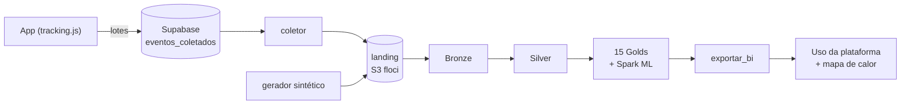

# Viabilidade e impacto do MVP — datalake de uso e BI

Análise do MVP de business intelligence do uso da plataforma: o rastreamento no app, a tabela coletora no Supabase, o datalake medalhão em PySpark (`datalake/`), o modelo de IA (Spark ML) e o painel "Uso da plataforma". Ela vem antes da implementação completa e cobre o que é viável hoje, o que ele custa, que riscos traz e como medir se valeu a pena.

> Base: o projeto-modelo de engenharia de dados do professor, aplicado ao SolarVision. Arquitetura em [ARQUITETURA.md](ARQUITETURA.md#8-datalake-de-uso-bi-do-produto), enunciado em [datalake/docs/ENUNCIADO.md](../datalake/docs/ENUNCIADO.md), números em [datalake/RELATORIO.md](../datalake/RELATORIO.md).

## 1. Problema e proposta

Sabemos quantas usinas existem, mas não **como** a plataforma é usada: onde as pessoas desistem do cadastro, quais telas importam, de onde vêm os usuários que ficam e quem está perto de abandonar. Sem isso, cada melhoria é palpite.

A proposta é instrumentar o app com 20 eventos de uso e levá-los a um datalake (Bronze → Silver → Gold). O datalake responde a quatro perguntas de produto: funil de ativação, engajamento, aquisição/retenção e previsão de ativação. As respostas voltam para dentro do produto, num painel e num mapa de calor.

## 2. Viabilidade técnica

| Item | Situação |
| --- | --- |
| Coleta | `lib/tracking.js` (porta da `track()` do projeto-modelo), envio em lotes de 5 s para uma tabela do Supabase que só aceita insert |
| Processamento | PySpark 4.2 em Docker (`datalake/`), S3 emulado (floci); oito jobs e um script de sequência; roda num notebook comum |
| IA | Spark ML: regressão logística (propensão de ativação, AUC 0,97 na simulação) e K-Means (dois perfis, silhueta 0,79) |
| Integração ao produto | Página `/app/uso` (ADMIN) e overlay do mapa de calor, lendo o que o `exportar_bi.py` grava em `frontend/public/bi` |
| Qualidade | 74 testes do gerador, testes das funções de cada job (Spark em memória), 4 do coletor, 72 do frontend e um teste de ponta a ponta da tabela coletora |
| Reaproveitamento | Docker, `comum.py`, `bronze.py`, explorador e metade do gerador vieram prontos do projeto-modelo |

**Limitação técnica do MVP:** o datalake roda em lote, na máquina de quem opera, e o BI chega ao app como arquivo estático. Para o painel funcionar em produção para qualquer ADMIN, o próximo passo é publicar a Gold numa tabela do Supabase só para ADMIN (ver evolução).

## 3. Viabilidade econômica

| Componente | Custo |
| --- | --- |
| Rastreamento e tabela coletora | R$ 0 (plano gratuito do Supabase, já usado pelo app) |
| Datalake (Docker, floci, PySpark) | R$ 0 (roda localmente; nenhuma conta de nuvem) |
| Modelo de IA | R$ 0 (Spark ML local; nenhuma API paga) |
| Painel e mapa de calor | R$ 0 (Vercel, que já hospeda o app) |

**Escala.** Na simulação, cada sessão gera em média 8,5 eventos de ~1 KB. Com 1.000 usuários ativos fazendo 10 sessões por mês, são ~85 mil eventos (~85 MB) por mês na tabela coletora, contra 500 MB do plano gratuito. Por isso o coletor deve **apagar o que já levou** para a landing (evolução 1), o que mantém a tabela pequena.

**Por que não um LLM agora.** Avaliamos uma análise em linguagem natural por LLM:
- Usar a conta Claude do próprio usuário dentro de um app de terceiros é **vedado pelos termos da Anthropic** desde fevereiro de 2026.
- As APIs gratuitas têm limites baixos, e algumas usam os dados enviados para treinar modelos.

O modelo próprio em Spark ML cumpre o papel de IA sem custo e sem mandar dado de usuário para fora. O LLM fica como evolução: narrar o relatório a partir das Golds, por um conector MCP que o usuário autoriza no próprio Claude.

## 4. Viabilidade legal (LGPD)

- **Minimização:** o evento nunca leva e-mail, nome, coordenadas, tarifa ou texto livre (o único texto é o termo buscado no seletor, que é o nome da usina). O contrato proíbe, e o teste do gerador confere.
- **Pseudonimização:** o `user_id` é um hash do id interno (`u-<hash>`) e o navegador é um id aleatório. É pseudonimização (LGPD, art. 13), não anonimização: quem tem a tabela de usuários consegue ligar o hash à pessoa. Por isso o datalake fica com quem opera e só agregados saem dele (o `bi.js` não tem nenhuma linha por pessoa).
- **Transparência e controle:** a seção Privacidade de Configurações liga e desliga o rastreamento, e a escolha fica na conta, valendo em qualquer navegador.
- **Acesso:** a tabela coletora só aceita insert; ninguém lê os eventos pela API, nem o próprio usuário. Só a service key do coletor lê.
- **Pendências:** avisar sobre o rastreamento já no cadastro (hoje o aviso está em Configurações) e definir um prazo de retenção dos eventos na landing.

## 5. Impacto social e de qualidade

- O relatório aponta que **o celular ativa metade do desktop** (29% contra 55%). Simplificar o cadastro no celular amplia o acesso de quem não tem computador, como pequenos produtores rurais, que são justamente o público de usinas pequenas.
- As **buscas sem resultado** (bateria, inversor, cliente, consumo) viram backlog guiado por uso real, em vez de opinião.
- Decisões de produto passam a ter número e fonte: cada recomendação do relatório cita a tabela Gold.

## 6. Riscos e mitigação

| Risco | Impacto | Mitigação |
| --- | --- | --- |
| Insert anônimo na tabela coletora (spam, eventos forjados) | Dado poluído e tabela cheia | Check de formato e tamanho no banco; a Silver valida tudo (R7) e separa o inválido com motivo; limite por IP/sessão como evolução |
| Pouco uso real | Golds instáveis, modelo treinado em simulação | Gerador com jornadas plausíveis para desenvolver; trocar pela base real assim que houver volume; reavaliar o AUC com dado real |
| Viés da simulação | Números parecem conclusões | Relatório deixa claro que os comportamentos são hipóteses do gerador |
| Exclusão "órfã" legítima | 35 eventos válidos rejeitados | Carregar um snapshot do inventário de placas e grupos na landing (ver RELATORIO) |
| QA e produção no mesmo Supabase | Eventos de teste misturados aos reais | Eventos do teste de ponta a ponta fora do catálogo (a Silver rejeita); projeto de QA separado como evolução |
| floci guarda tudo na memória | Reiniciar o Docker esvazia o bucket | O gerador e o coletor recriam a landing; `rodar_tudo.py --limpar` reconstrói |

## 7. Impacto esperado e como medir

Linha de base: o primeiro mês com eventos reais. Metas iniciais:

| Indicador (tabela Gold) | Hoje (simulação) | Meta do MVP |
| --- | ---: | ---: |
| Conta → usina (`funil_ativacao`) | 51% | 65% |
| Ativação no celular | 29% | 40% |
| Retenção D7 (`retencao`) | 31% | 40% |
| Buscas sem resultado (`buscas_seletor`) | 190 | metade, depois das integrações |
| Abandono (`taxa_abandono`) | 7,1% | < 5% |

## 8. Evolução

1. O coletor apaga da tabela coletora os eventos já levados para a landing.
2. Publicar a Gold numa tabela `bi_*` do Supabase só para ADMIN (o painel passa a funcionar em produção).
3. Snapshot do inventário de placas e grupos para a regra da exclusão órfã.
4. Calibrar as probabilidades do modelo (Platt ou isotônica) e reavaliar com dados reais.
5. Narrativa do relatório por LLM, via conector MCP autorizado pelo usuário no próprio Claude.
